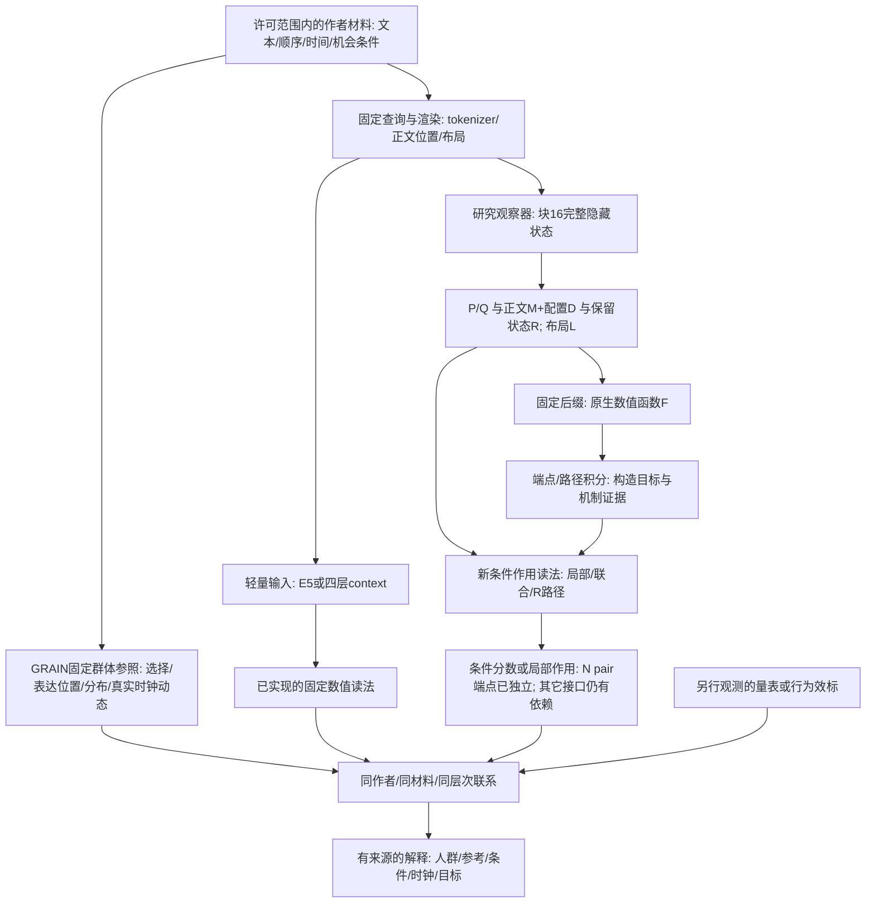

# GRAIN 全系统逻辑：完整输入依赖与条件作用接口

2026-09-10，第十三轮建立、第三十轮补充。接续[31条逻辑总图](GRAIN_SYSTEM_LOGIC_ATLAS_V1.md)。
本页解决的是“哪个公式实际在计算哪个对象、还需要哪些输入”，不替代历史
GRAIN 测量理论，也不把模型判断与人的人格真值合并。

## 1. 三条系统线在同一材料上相接

这里 E5 读法、四层 context 读法、块16新作用读法是不同的已实现/部分实现
路线，不是已串接成功的一个网络。最后的解释也不反向训练或重写固定分数。

## 2. 逐层输入契约

| 节点 | 数学/计算对象 | 当前输入与实现 | 已闭合与保留接口 |
|---|---|---|---|
| 作者材料 | T_u，记录、时间与条件 | 原文、作者ID、评论边界；所有当前新表来自旧许可缓存 | ID负责分组和连接，不是预测特征；抽样评论顺序不自动等于真实情绪时序 |
| 群体表达测量 | G(T_u; population,condition,clock) | 历史GRAIN固定坐标、参照与分布/路径统计 | 固定参照下可比较的位置，不等于特定人格词的得分；没有改发布评分器 |
| 查询渲染 | tokens(T,q), masks, L | `conditional_runtime.encode_with_evidence`；研究路线各自的冻结renderer | 内容、tokenizer、查询token、正文边界、布局必须对应；两路线不能悄悄交换坐标 |
| E5输入路线 | h_E5(T)，固定函数读出 | `run_grain_configuration_extraction.py`及旧固定程序 | 已有原文提取路线；E5编码器仍存在，bag均值不能区分被其压成同一点的顺序 |
| 四层context路线 | x_early(T,q) | `conditional_runtime.ConditionalRuntime`，4个Qwen2 block、冻结参数/参照 | 不运行完整decoder/LM head，但仍是神经编码；没有自动实现本轮块16的所有新项 |
| 原模型研究观察器 | H_16(T,q) | `run_grain_source_anchor.py`保存完整前缀状态 | 本轮从缓存读取；“零新神经调用”不等于状态最初没有经过LLM |
| 同材料原生接合 | D_k=Gc_k*Hc，T_qk=Jacobian_q:D_k | `native_material_reader.py`；固定同作者共同前缀，P/Q保留原query状态 | 当前query-last正文共享；位置特异读法保留。111后缀调用测到直接局部作用，Jacobian和输入仍依赖原模型；不是独立部署程序 |
| 共享方向与局部系数 | Jhat=a(t)V/T，tauhat=Jhat:D | `position_reader.py`；3源基底、留出梯度系数oracle，另有纯位置源拟合 | oracle作用r=.862/.987/.977；位置本身不足。两者明确分开，下一步由当前H/G预测a；不把SVD方向命名为人格 |
| 内容系数读取 | ahat=Phi(H,G)W，Jhat=ahat V/T | `content_coefficients.py`；源PCA32与36/168列设计，独立进程禁读梯度 | T/F内容作用r=.638，幅度12%；GRAIN交互无留出增益。源空间上界表明需增加查询相关输入，不调alpha；当前H仍需原模型前缀 |
| 查询残差输入 | Phi=[Phi0,standardize(R U_q)]，ahat=Phi W | `query_residual_input.py`；源系数残差与H补空间的交叉协方差，44列固定Ridge | 源查询8方向GRAIN作用r=.863/.473/.576，普通残差PCA为.684/.114/.149。当前目标禁读，但源Jacobian及块16H仍为依赖 |
| 跨查询输入借用 | Phi_(q<-p)=[Phi0_q,standardize(R U_p)] | `query_direction_transfer.py`；donor仅提供同源折输入U，保留recipient目标与V | 旧4人N/确认输入重叠.662、TF约.260。新8人等权应用未保留专用方向优势；保留两批协议，不当量表共享方差 |
| 新作者固定读法 | Jhat=sum_s Phi_s W_s V_s/(4T) | `reader_ensemble.py`；各源模型独立中心/尺度/基底，96系数堆栈先冻结 | 新8人自身作用r=.001/.121/.314；源联合32方向的真实梯度投影r=.836/.951/.876。方向表示保留，当前系数程序局部失配，oracle不是部署性能；H仍由模型前缀提供 |
| 输出方向与传输 | b=p*(v-F)，s=W_A^T b，J=K^T s | `output_seed.py`；旧4/新8缓存与12行冻结权重，无新神经调用 | N/确认s余弦.943/.954、J为.704/.649；同一各向异性K也能改角度。T/F去概率尺度未恢复读法；NEXT39固定相同s来检验条件K |
| 注意力解析作用 | sum_m a_mj[u_m+rho_mj*t_mj]，包含RoPE/GQA | `fixed_seed_attention.py`；实际最后attention block的归一化BODY输入、q/k/v与下游g | 24/24解析梯度接合，最大相对误差2.03e-6；新作者key/value范数比1.83/1.89。原分解用当前g；NEXT40另行完成源固定替代，不混成块16或完整F |
| 源固定局部读法 | lambda_f=A D_f，tauhat=lambda_f^T gbar | `source_cotangent.py`；当前forward-only q/k/v/位置/GRAIN，旧4源g均值，独立禁读目标进程 | 新8自身源作用r=.809/.955，pool=.919/.869，完整式优于value-only误差。零新神经调用不消除当前原生编码依赖；NEXT41接完整H16路径 |
| 完整H16作用传输 | tauhat=tbar^T E(I+DA27)P26...P17 D | `complete_transport.py`；原H16、固定源t、实际上游层JVP，不读当前评分/梯度 | 新8作用r=.99814/.99610；最后attention前已.99688/.98816，保留上游query/残差。当前仍运行原模型后缀，不是已替代编码器；NEXT42测试实际较早停止 |
| 固定输出方向传输 | J_q=K_q^T W_A^T c，c固定 | `run_grain_fixed_seed_attention.py`；旧4/新8共同正文、N/确认原query状态与布局 | 相同seed下正文余弦.728/.657，直接显示条件传输差异；不是单靠两个不同seed的夹角推断K变化。L是新logit诊断，不是原概率F |
| 状态分区 | x=(P,Q), E=(正文,R,L) | `comment_carrier.partition`与冻结查询mask | P是查询位置集合，Q是最终读取位置；R是非正文非P/Q位置，不是自然语言噪声类别 |
| 正文分区 | H_body=M+D | 各评论均值M与均值内配置D | C(E)令D=0，保留M、R、布局；没有删除上游已流入R/PQ的信息 |
| 原生输出 | F_q(E,x) | 冻结后缀、候选logits及固定S映射 | 模型条件评分，不是问卷真值、自由生成解释或注意力的唯一因果路径 |
| 条件起点 | b_q(E)=F_q(E,x0) | 旧锚定P/Q端点 | 当前完整E仍随作者变化；不等于固定截距，也不等于下面的B |
| 均值化条件分数 | B=F_q(C(E),x0) | NEXT15/18实际四格端点 | 比b(E)再去掉正文配置；只是一部分原生输出 |
| R轻量作用 | g_ref或g_cal的内积 | `action_geometry.py`，4参照作用校准，136×1536状态差 | 后缀外读法已实现；R输入仍来自原模型前缀，参考矩阵来自原模型梯度 |
| R非线性候选 | delta_logit=<vbar,d>+sum(d_r K_r d_r)/2 | `retained_logit.py`；4源梯度、逐位置径向/切向系数；无新后缀调用 | 发现内部曲率但该近似作用误差变大，不替换旧法。source_origin用源常数；oracle_origin借用当前b00/b10，二者明确分开 |
| 联合作用 | Δz_ij，沿v的幅度及正交部分 | `joint_readout.py`，固定对称核/四折 | 可读部分混合logits；最终评分组装仍用真实单评论端点z_add |
| 条件作用矩 | mu、M、V，energy=norm(mu)^2+trace(V) | `conditional_energy.py`，同折外作者的正核混合分布；0模型调用 | 矩恒等式闭合，未优于平均强度基线；保留旧signed读法。分布评分相对均值评分改变很小，且仍需实际z_add，不是新完整推论器 |
| 完整条件N pair | S(z0_hat+di_hat+dj_hat+mixed_hat) | `complete_pair.py`，M/R/layout+固定Fourier输入，4-fold源拟合 | 禁读当前端点可独立复算；pooled r=-.107/.0006，基线/单片段读法未恢复作者差异。不替换原评分器；块16输入和源神经构造资产仍存 |
| 查询定向N基线 | S(b+Jbar_M:M+Jbar_R:R) | `query_baseline.py`，4旧源Jacobian编译、20作者测试；不借当前端点 | 模型条件评分r=.727，源匹配kernel=-.050；是B而非完整F。块16输入仍存、布局运输为经验近似；已接入下行NEXT33 |
| 同源定向N pair | S(bhat+di_hat+dj_hat+mixed_hat) | `query_pair.py`，同4源/20作者、5头、0神经调用 | 完整score/logit禁读端点重放；r=.610/.593，但基线-only .602。相邻配置幅度可读，方向未恢复，下一步token位置读取 |
| 效标与解释 | Corr/response/criterion | 冻结之后连接原有自评；保持量表、模型、行为通道区分 | 不据最高Y相关选择某个坐标/函数；无新增真人或日常行动效标 |

## 3. 完整F与条件B的精确关系

同一材料、查询、布局和数值观察器下，旧四格的定义为：

    f00 = F(C(E),x0) = B
    f10 = F(E,x0)    = b(E)
    f01 = F(C(E),x)
    f11 = F(E,x)     = F_native

因此定义A=f10-f00，Q=f01-f00，I=f11-f10-f01+f00，精确得到：

    F_native = B + A + Q + I.

A是固定查询状态下的正文配置作用；Q是均值化正文条件下的查询状态作用；
I是两种操作的非加和。三者不是互不相关的心理变量，操作参考也不是唯一的。

在T/F的B内部，再固定参考正文M0、参考保留状态R0及目标布局L：

    b00 = F(M0,R0,x0;L)
    b10 = F(Mu,R0,x0;L)
    b01 = F(M0,Ru,x0;L)
    B   = F(Mu,Ru,x0;L)
    Phi_M = [(b10-b00)+(B-b01)]/2
    Phi_R = [(b01-b00)+(B-b10)]/2
    F_native = b00 + Phi_M + Phi_R + A + Q + I.

这个对称分配保留总和，但不把M/R交互隐去，而是各分一半。它与上面的
配置×查询交互I不是同一个四格。新R公式只替代Phi_R，没有顺手替代其它五项。

实际48名旧作者的外层恒等式最大误差8.33e-17；T/F内层最大1.39e-17；旧
端点重放误差0。**B与原生F的RMS差为T/F .31799、N .04033**。因此，报告
“完整B重建”只能指B，不能写成完整F，更不能直接写成人格预测闭环。

## 4. 两种当前条件组装的精确依赖

| 组装 | 已由新数学程序计算 | 仍借用原模型实测值 | 要发展成独立程序需要什么 |
|---|---|---|---|
| b00 + Phi_M + Phi_R_hat | 给定R位移后的Phi_R_hat | 当前作者b00(L)、Phi_M；原模型R输入；源参考矩阵 | 明确构造b00/Phi_M、条件敏感度及轻量R输入，再比较同一个B目标 |
| S(z_add + mixed_hat)-S(z_add) | 混合logits预测、S数值映射 | z_add=zi+zj-z0，来自当前作者真实单评论端点；原模型评论状态 | 完整logit基线/单评论作用及输入提取，或把目标明确限定为局部修正 |
| NEXT26完整条件pair候选 | 基线+单片段+混合logits及原S，全部源固定 | 无当前作者端点；仍用块16输入及源固定资产 | 运行依赖已闭合，先修查询定向基线的函数忠实度，再谈早层输入运输 |
| NEXT32定向基线 | 源仿射平均及S换算，预测阶段纯数值 | 无当前作者端点；源梯度来自原后缀、M/R来自原前缀 | 已有用的B读法，按4源协议重建完整pair的单片段/mixed，不能拼接旧18源参数当匹配检验 |
| 四层已编译条件程序 | 原文→早层输入→固定多项读出 | 私有源参照与4层权重属于固定构造资产，不读取新作者teacher端点 | 这是已经存在的另一轻量路径；逐项测试新机制能否迁入，而非直接宣布已替代 |

这些依赖不使局部实验无效：它们告诉我们该保留哪个机制、下一步该构造哪个
接口。不要因发现局部程序还不完整就抹掉既有的E5/四层原文路线。

## 5. 从局部作用回到人的测量

固定程序在同一人不同材料上变化，测到的是该程序对材料的响应；跨人同一
材料单位的差异，才进入群体参照比较。两种统计均有用途，不能交叉代替。

若完整程序误差为e=e_B+e_A+e_Q+e_I，则MSE包括各项误差的交叉乘积；
Corr(F_hat,Y)也受幅度、相互抵消和Y所关联方向影响。因此某项更像teacher、
或某个矩阵更相似，都不自动保留完整作者效标关系。每次替换只需在同一
材料上报告目标作用、完整组装及人类联系三本账，不为此重启无边界调参。

真正的新发展接口是：让GRAIN描述**作者在条件下的位置/分布/变化**，让查询
路线给这些位置和变化配上**对指定判断的作用函数**。同一输入可有共享与
特异读法，后续心理解释取决于哪种作用与哪些独立指标相联，而不是先给所有
残差命名为人格或噪声。

## 6. 可复算入口与下一步

当前下一步是[NEXT42层间累积与较早读取](GRAIN_LAYER_ACCUMULATION_PLAN_V1.md)。
第三十轮[完整H16上下文作用](GRAIN_COMPLETE_TRANSPORT_THEORY_V1.md)已接合：
固定源t配合真正的前向JVP保留query和残差作用。最后attention前已可读取
主要响应；下一步测试层20/23/26的固定出口，不继续磨最后读出的精度。
第二十九轮[前向GRAIN响应与源固定读出](GRAIN_SOURCE_COTANGENT_READER_THEORY_V1.md)
已替换最后BODY局部作用的当前g；需把块16方向经过query/残差的所有路径
接到最后post-attention状态，不能只保留局部BODY项就声称全部串联。
第二十八轮已将真实attention解析接合，见[条件token作用理论](GRAIN_FIXED_SEED_ATTENTION_THEORY_V1.md)。
[第二十七轮理论](GRAIN_READER_OUTPUT_SEED_THEORY_V1.md)区分候选坐标、最终隐藏
方向和正文梯度，同时提供值传输/选择变化的可验算公式。下面的历史步骤
保留来源，不把早期“下一执行”当作当前排程。

第十七轮[内部曲率](GRAIN_RETAINED_LOGIT_CURVATURE_THEORY_V1.md)将二值概率
的最后sigmoid换算与内部logit曲率精确拆开。前者RMS=.000081，后者=.013657。
新的受限二次候选没有改善Phi_R，不改本文其它项。这里使用参考R位置，
并非下段的GRAIN正文方向；二者通过完整F的条件输入联系，不能混称同一作用。

第十六轮的同材料[原生读法](GRAIN_NATIVE_MATERIAL_READER_THEORY_V1.md)增加
一个真实接点：共同GRAIN×token隐藏配置可由不同查询梯度读取，T=Cw+位置
特异项。此T是本文F在指定正文方向上的导数，不等于F、B、A或上述条件起点，
也没有替换P/Q/R的原生提取依赖。旧六项接口照常保留。

- 数值审计：`scripts/run_grain_action_geometry.py`的`dependency_accounts`。
- 四格来源：`scripts/run_grain_configuration_query_factorial.py`与
  `scripts/run_grain_comment_carrier.py`；保持两个四格的符号区别。
- 聚合证据：[第十三轮报告](../reports/grain_vector_mechanisms/ACTION_GEOMETRY_LOGIC_REPORT_V1.md)。
- 第十八轮条件矩比较已完成：新增强度未优于源平均强度，最后评分的矩修正
  很小；不继续能量网格。见[条件矩理论](GRAIN_CONDITIONAL_MOMENT_THEORY_V1.md)。
- 第十九轮[NEXT26报告](../reports/grain_vector_mechanisms/COMPLETE_PAIR_INTERFACE_REPORT_V1.md)：
  已用M/R/layout拟合z_0与单评论增量，禁读端点仍能完整复算；但基线及作者
  差异读法失效，故不升级预测器。输入仍来自块16，不改旧锁箱、评分器或MEPS。
- 第二十轮[NEXT32报告](../reports/grain_vector_mechanisms/QUERY_DIRECTED_BASELINE_REPORT_V1.md)：
  4源Jacobian在20作者恢复B的差异r=.727，匹配kernel=-.050。80/80候选方向
  同号，读法与源位置协方差项精确保留。可用的基础读法已出现。
- 第二十一轮[NEXT33同源完整组装](../reports/grain_vector_mechanisms/QUERY_DIRECTED_PAIR_REPORT_V1.md)
  完成：同4源/20评估，5数值头、0新神经调用。幅度与有符号方向不是同一目标；
  最终S链接的曲率很小，下一执行[NEXT31位置特异读取](GRAIN_POSITION_SPECIFIC_READER_PLAN_V1.md)。
