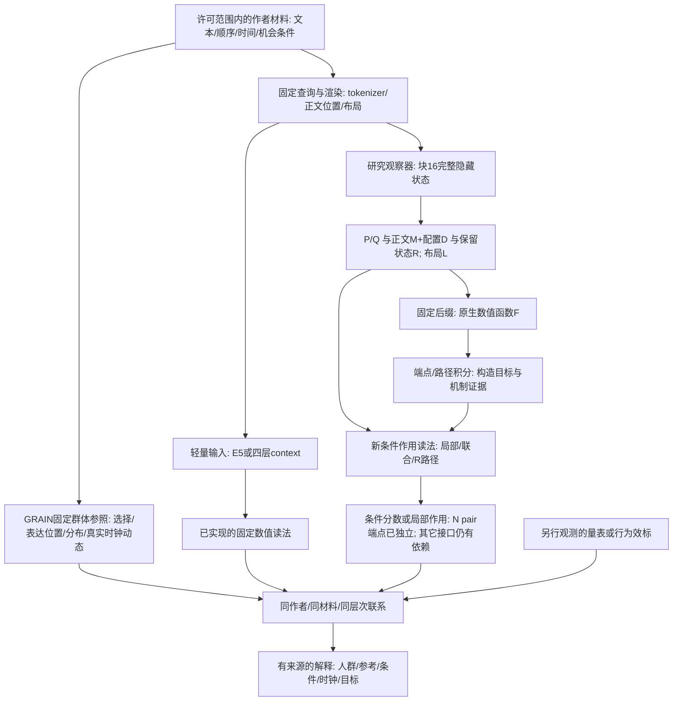

# GRAIN 全系统逻辑：完整输入依赖与条件作用接口

2026-09-11，第十三轮建立、第58轮补充。接续[31条逻辑总图](GRAIN_SYSTEM_LOGIC_ATLAS_V1.md)。
本页解决的是“哪个公式实际在计算哪个对象、还需要哪些输入”，不替代历史
GRAIN 测量理论，也不把模型判断与人的人格真值合并。

## 1. 三条系统线在同一材料上相接

这里 E5 读法、四层 context 读法、块16新作用读法是不同的已实现/部分实现
路线，不是已串接成功的一个网络。最后的解释也不反向训练或重写固定分数。

## 2. 逐层输入契约

| 节点 | 数学/计算对象 | 当前输入与实现 | 已闭合与保留接口 |
|---|---|---|---|
| 内容相关的池化交互 | F=local+.5mean(phi)^T M mean(phi)；phi为16冻结Gaussian | `nonlinear_pooling.py`；NEXT69两求解/同1305参数 | 预测B变化57.81%/53.26%离开位置子空间，但坐标误差 .9934/.9956更差；新8整读数不提升。二次族关闭，NEXT70比较保留logmass的相对选择，不从形式复杂度推定功能收益 |
| 已学习的跨token二次作用 | F=局部函数+.5v^T Mv；梯度同标量；v为16线性/位置矩 | `coupled_pooling.py`；NEXT68同源4四视图、两查询4拟合 | 源B响应SSEzero .9733/.9743，四GRAIN作用 .9608/.9616；新8完整评分未晋级。B变化只能a+p*b，上限覆盖2.939%/3.034%目标能量；NEXT69同大小改为token非线性前置，不继续调alpha |
| 跨正文材料的读取交互 | delta_g_B=(g_B(H+epsilonD_A)-g_B(H-epsilonD_A))/2，B/last不动 | `cross_token_reading.py`；NEXT67源4两查询，17原生调用/20.03秒 | B梯度变化.261%/.314%，8/8条件，全部32B方向有作用；旧局部求和严格0。同BODY两查询响应余弦.708；NEXT68开发二次池化交互，非新增人格准确率 |
| 配对变化教学与token联合读法 | J66=J65+源单位能量配对密度差监督；当前函数仍局部求和 | `paired_response_objective.py`；NEXT66两源求解，已有源外8应用 | 变化SSEzero降至1.003/1.010；源字典仅覆盖11.34%/8.66%，整体未提升。固定last时跨token混合导数严格0；NEXT67已测非零原生跨区域读法，转向联合汇总，不继续调权 |
| 完整context距离与配对响应 | 原始last距离核；源同BODY两条件密度分为mean/half-difference | `full_context_geometry.py`；NEXT65两求解；运行后精确账本不改拟合 | N源配置变化r=.378->.530，整新8评分未提升；半差只占目标能量.1905%/.4836%，相对变化SSE仍1.02。NEXT66在同scalar增加源归一化变化监督，输入/字典不改；小能量不等于噪声 |
| 条件token标量与参照几何 | Lhat=加性项+mean gamma(c)*局部Hermite项；评分/梯度同源 | `context_modulated_potential.py`；NEXT64同源原始/干预材料，4求解，源外8应用 | 原生变化幅度只恢复7.54%/8.20%，变化r=.143/-.371；新8作用微增但整分数下降，不晋级。源4全秩白化造出等距单纯形，新8context能量覆盖9%/11%；NEXT65保留完整last距离，非继续调参 |
| 读取上下文与BODY的有限交互 | delta_g=积分 H_(BODY,last) delta_last；delta_tau=delta_g:D | `context_reading_interaction.py`；NEXT63源4同query其它3源last均值，只替换最后H16行；9原生后缀反传 | last相对变化5.35%/5.74%，BODY梯度变化10.45%/16.08%，32方向作用全变；原加性模型精确0。旧U8能量21%/25%仍有作用抵消，不能删除补空间；NEXT64全源构造条件scalar，新8才做应用；非人类人格因果 |
| 局部方向增强标量 | Lhat=b+a mean(z)+beta last+mean(k,center导数)；tau=grad Lhat:D | `hermite_token_potential.py`；NEXT62源4/留一3，原rank8描述不变，10求解，源+当前输入白名单隔离 | 源字段容量26.05%/21.71%，新8方向误差比旧低6.29%/7.53%；分数r=.503/.538略降，完整门槛未过。BODY-by-last混合导数仍严格零，NEXT63源干预检验这一缺项；当前H16仍神经、真人Y未用 |
| 作者材料 | T_u，记录、时间与条件 | 原文、作者ID、评论边界；所有当前新表来自旧许可缓存 | ID负责分组和连接，不是预测特征；抽样评论顺序不自动等于真实情绪时序 |
| 群体表达测量 | G(T_u; population,condition,clock) | 历史GRAIN固定坐标、参照与分布/路径统计 | 固定参照下可比较的位置，不等于特定人格词的得分；没有改发布评分器 |
| 查询渲染 | tokens(T,q), masks, L | `conditional_runtime.encode_with_evidence`；研究路线各自的冻结renderer | 内容、tokenizer、查询token、正文边界、布局必须对应；两路线不能悄悄交换坐标 |
| E5输入路线 | h_E5(T)，固定函数读出 | `run_grain_configuration_extraction.py`及旧固定程序 | 已有原文提取路线；E5编码器仍存在，bag均值不能区分被其压成同一点的顺序 |
| 四层context路线 | x_early(T,q) | `conditional_runtime.ConditionalRuntime`，4个Qwen2 block、冻结参数/参照 | 不运行完整decoder/LM head，但仍是神经编码；没有自动实现本轮块16的所有新项 |
| 原模型研究观察器 | H_16(T,q) | `run_grain_source_anchor.py`保存完整前缀状态 | 本轮从缓存读取；“零新神经调用”不等于状态最初没有经过LLM |
| 同材料原生接合 | D_k=Gc_k*Hc，T_qk=Jacobian_q:D_k | `native_material_reader.py`；固定同作者共同前缀，P/Q保留原query状态 | 当前query-last正文共享；位置特异读法保留。111后缀调用测到直接局部作用，Jacobian和输入仍依赖原模型；不是独立部署程序 |
| 共享方向与局部系数 | Jhat=a(t)V/T，tauhat=Jhat:D | `position_reader.py`；3源基底、留出梯度系数oracle，另有纯位置源拟合 | oracle作用r=.862/.987/.977；位置本身不足。两者明确分开，下一步由当前H/G预测a；不把SVD方向命名为人格 |
| 内容系数读取 | ahat=Phi(H,G)W，Jhat=ahat V/T | `content_coefficients.py`；源PCA32与36/168列设计，独立进程禁读梯度 | T/F内容作用r=.638，幅度12%；GRAIN交互无留出增益。源空间上界表明需增加查询相关输入，不调alpha；当前H仍需原模型前缀 |
| 查询残差输入 | Phi=[Phi0,standardize(R U_q)]，ahat=Phi W | `query_residual_input.py`；源系数残差与H补空间的交叉协方差，44列固定Ridge | 源查询8方向GRAIN作用r=.863/.473/.576，普通残差PCA为.684/.114/.149。当前目标禁读，但源Jacobian及块16H仍为依赖 |
| 跨查询输入借用 | Phi_(q<-p)=[Phi0_q,standardize(R U_p)] | `query_direction_transfer.py`；donor仅提供同源折输入U，保留recipient目标与V | 旧4人N/确认输入重叠.662、TF约.260。新8人等权应用未保留专用方向优势；保留两批协议，不当量表共享方差 |
| 新作者固定读法 | Jhat=sum_s Phi_s W_s V_s/(4T) | `reader_ensemble.py`；各源模型独立中心/尺度/基底，96系数堆栈先冻结 | 新8人自身作用r=.001/.121/.314；源联合32方向的真实梯度投影r=.836/.951/.876。方向表示保留，当前系数程序局部失配，oracle不是部署性能；H仍由模型前缀提供 |
| 输出方向与传输 | b=p*(v-F)，s=W_A^T b，J=K^T s | `output_seed.py`；旧4/新8缓存与12行冻结权重，无新神经调用 | N/确认s余弦.943/.954、J为.704/.649；同一各向异性K也能改角度。T/F去概率尺度未恢复读法；NEXT39固定相同s来检验条件K |
| 注意力解析作用 | sum_m a_mj[u_m+rho_mj*t_mj]，包含RoPE/GQA | `fixed_seed_attention.py`；实际最后attention block的归一化BODY输入、q/k/v与下游g | 24/24解析梯度接合，最大相对误差2.03e-6；新作者key/value范数比1.83/1.89。原分解用当前g；NEXT40另行完成源固定替代，不混成块16或完整F |
| 源固定局部读法 | lambda_f=A D_f，tauhat=lambda_f^T gbar | `source_cotangent.py`；当前forward-only q/k/v/位置/GRAIN，旧4源g均值，独立禁读目标进程 | 新8自身源作用r=.809/.955，pool=.919/.869，完整式优于value-only误差。零新神经调用不消除当前原生编码依赖；NEXT41接完整H16路径 |
| 完整H16作用传输 | tauhat=tbar^T E(I+DA27)P26...P17 D | `complete_transport.py`；原H16、固定源t、实际上游层JVP，不读当前评分/梯度 | 新8作用r=.99814/.99610；最后attention前已.99688/.98816，保留上游query/残差。仍有原模型后缀；NEXT42现已分层核验，不是独立编码器 |
| 固定深度与有符号累积 | v_k=sum_(j<=k)(a_j+m_j)，tauhat_k=tbar^T v_k | `layer_accumulation.py`；同H16与D，实际停止17..20、完整遍历同时捕获出口20/23/26 | 新8层20 r=.092/.343，层23=.952/.823但幅度约半；层25MLP最大正投影增量.371/.508。截短4方向精确，仍需原0..16输入与所保留层；NEXT43研究门控而非继续磨r |
| 源固定门控局部算子 | tauhat=tbar^T mean_s(B_s N_s)d=wbar^T d | `gated_update.py`、`compiled_gated_readout.py`；源4的门控/RMS与t编译，当前只读门控前d | 新8r=.996936/.998451，SSE/zero=.011988/.002932；完整向量误差.213/.194。单向量编译差<7.772e-16；局部读法不再要当前x/MLP矩阵，但d仍需原上游与GRAIN方向；不是全F或问卷分数 |
| 共享读头与查询差异 | tau_q=w_q^T d_q；差异R+T，T=w*^T(d_N-d_C) | `compiled_query_transfer.py`；同作者相同BODY/GRAIN，固定接收目标，两查询读头互换，结果后等权编译w* | 新8互换r=.990935/.994290；自身模式T有符号投影.914272、R .085728，pool有抵消。共享w*可用而当前d仍原生；NEXT45追踪上游差异形成，不把query措辞差异或分账当人格份额 |
| 查询差异形成 | T=sum_s w*^T(u_sN-u_sC)，delta_d_next=Abar delta_d+delta_A dbar | `query_transport_formation.py`、`query_response_recursion.py`；原生17个前置更新与共享w*，另有递推恒等式测试 | 新8对比RMS在层23增至.208，再至preMLP25为.163；MLP22 +.354、MLP24 -.246。保留符号与协方差；NEXT46拆MLP24已有输入/算子差异，递推公式不等于已测全Jacobian |
| 查询差异回调 | delta_u=Jbar delta_d+delta_J dbar | `query_counteraction.py`；实际preMLP24 x、缓存d、block24矩阵、同源w*，完整2x2交换 | 新8传入/算子项对最终T=-.313540/+.067912；完整96向量核验。Jbar仍随当前作者变化；NEXT47才测试源固定共享，当前步骤没有去掉上游神经依赖 |
| 源固定共同回调 | v*=mean_s,q J24(x_s,q)^T w*，chat=v*^T delta_d | `source_common_counteraction.py`；构造仅源4 x/权重；当前应用只用两个固定v与d | 新8r=.955274/.954853、SSE/zero=.091333/.092402；8人v完全相同。去掉此处当前x依赖但保留原生上游d；NEXT48只检验一次源查询差异，随后回到完整输入链 |
| 源固定查询修正 | delta_ahat=v_common^T delta_d+(v_N-v_C)^T dbar | `source_query_correction.py`；构造仅源4分查询J伴随均值；当前应用v,d，公共项不变 | 新8修正/算子项r=.886208/.885192；总对比r=.976535/.976360、SSE/zero=.060734/.061466。105测试/12数组8CSV重放；MLP24-only细调结束，NEXT49补全上游attention22的Q/K/V传输，不把局部高r当问卷预测 |
| 上游完整注意力三通道 | dot_o=sum a dot_V + sum a(V-o)(dot_Q K+Q dot_K)/sqrt(h) | `upstream_attention_channels.py`；全token preAttention22 x/d、实际norm/QKV/O/RoPE/GQA/mask、固定w*；r2汇总 | 新8Q/K/V局部对比投影=.083/.904/.013，源4=.562/.271/.167；96原生向量相对差≤5.272e-6。Q不应删除；NEXT50用源固定Q检验key选择读法，当前K/V/dK仍原生 |
| 源查询引子选择 | sum a_Q(V-o_Q)(Qbar dot_K)/sqrt(h)，每引子重算softmax | `source_query_selection.py`；源4 pre-RoPE Q均值、当前K/V/dK、实际位置与固定w*；预测禁读当前Q | 新8同/另/共享引子对比r=.939/-.890/.477；同query幅度29.1%，各query门槛三者均过。当前证据依旧query-conditioned；局部引子家族关闭，NEXT51测后续读出与完整端点中的作用 |
| 选择的端点组件 | kappahat=rbar_q^T uhat_K(Qbar_q;K,V,dK) | `selection_endpoint.py`；先冻结完整增量向量，再从源4编译后续读头；当前梯度只供oracle评估 | 新8组件r=.973/.978，对比=.963、幅度59.2%；K/V/dK仍原生。局部交换引子反号不保留到端点；NEXT52从H16用同一函数生成状态与导数，移除blocks17–21的当前运行依赖 |
| 源状态与同函数导数 | Xhat=Psi(X16)，dhat=D Psi[D] | `source_state_transport.py`；源4 primal-only Ridge、固定PCA32、点式/因果累计图，同源Qbar/rbar端点 | NEXT52已执行：状态误差降42–47%，方向误差增39–50%；全部未过替代门槛。identity仍有r=.878/.893但幅度约4倍；PCA覆盖方向31.94%。NEXT53改为源值+方向联合目标，不拟合当前结果；H16仍原生 |
| 源GRAIN响应联合教学 | L=L_value+L_direction+alpha penalty，Xhat/dhat由同B生成 | `response_aware_state.py`；既有源U32/尺度，源值及四方向，归一化匹配对照；当前禁读pre22/梯度/端点 | NEXT53新8组件r~.900/.924，两图过门槛；相对匹配对照端点误差再降15–19%，全方向约1.1%。源4端点仍弱；20solves/0神经。已保留组件无需当前blocks17–21，但H16仍原生；NEXT54拆状态/方向修复途径 |
| 状态依赖读法与方向修复 | delta_A=delta_ell^T dbar+ellbar^T delta_d | `response_repair.py`；冻结V/J状态和同函数方向，2x2诊断交换，固定引子/读头 | NEXT54新8既有误差降低中80.4–83.4%分给状态路线，16.6–19.6%给方向；交互RMS约1%。源4对比略恶化，保留。0拟合/神经，34测试；NEXT55接完整L及导数，不以局部修复代替整函数成功 |
| 完整函数的状态/方向接合 | Lhat=S(Psi(X16))，tauhat=grad S(Psi(X16)):D Psi[D] | `whole_path_assembly.py`；冻结三图、实际suffix22–end、同地址D，无当前目标回填 | NEXT55联合分数排序r=.548/.420但幅度压缩、完整响应丢失，三门槛均失败。缓存交叉定位为状态移动后的读法变化，方向仅变1.82%；72反传/54.34秒。NEXT56只拆源截距/非截距，不调局部参数；H16与后缀仍原生 |
| 源共同偏移与完整读取 | Psi=X+b+V；四兼容函数I/O/V/F | `source_offset.py`；实际源截距系数，O/V新后缀，I/F重用；预测禁读目标 | NEXT56偏移-only梯度与联合图余弦.9998，其余校正与identity为.9993；新8查询对比r=.811，源4仍负，整分数门槛失败。48反传/39.67秒，41测试。隐藏状态替代家族关闭，NEXT57直接数值拟合原生完整L和同函数导数，尝试移除后缀 |
| 固定输出方向传输 | J_q=K_q^T W_A^T c，c固定 | `run_grain_fixed_seed_attention.py`；旧4/新8共同正文、N/确认原query状态与布局 | 相同seed下正文余弦.728/.657，直接显示条件传输差异；不是单靠两个不同seed的夹角推断K变化。L是新logit诊断，不是原概率F |
| 状态分区 | x=(P,Q), E=(正文,R,L) | `comment_carrier.partition`与冻结查询mask | P是查询位置集合，Q是最终读取位置；R是非正文非P/Q位置，不是自然语言噪声类别 |
| 正文分区 | H_body=M+D | 各评论均值M与均值内配置D | C(E)令D=0，保留M、R、布局；没有删除上游已流入R/PQ的信息 |
| 原生输出 | F_q(E,x) | 冻结后缀、候选logits及固定S映射 | 模型条件评分，不是问卷真值、自由生成解释或注意力的唯一因果路径 |
| 条件起点 | b_q(E)=F_q(E,x0) | 旧锚定P/Q端点 | 当前完整E仍随作者变化；不等于固定截距，也不等于下面的B |
| 均值化条件分数 | B=F_q(C(E),x0) | NEXT15/18实际四格端点 | 比b(E)再去掉正文配置；只是一部分原生输出 |
| R轻量作用 | g_ref或g_cal的内积 | `action_geometry.py`，4参照作用校准，136×1536状态差 | 后缀外读法已实现；R输入仍来自原模型前缀，参考矩阵来自原模型梯度 |
| R非线性候选 | delta_logit=<vbar,d>+sum(d_r K_r d_r)/2 | `retained_logit.py`；4源梯度、逐位置径向/切向系数；无新后缀调用 | 发现内部曲率但该近似作用误差变大，不替换旧法。source_origin用源常数；oracle_origin借用当前b00/b10，二者明确分开 |
| 联合作用 | Δz_ij，沿v的幅度及正交部分 | `joint_readout.py`，固定对称核/四折 | 可读部分混合logits；最终评分组装仍用真实单评论端点z_add |
| 条件作用矩 | mu、M、V，energy=norm(mu)^2+trace(V) | `conditional_energy.py`，同折外作者的正核混合分布；0模型调用 | 矩恒等式闭合，未优于平均强度基线；保留旧signed读法。分布评分相对均值评分改变很小，且仍需实际z_add，不是新完整推论器 |
| 完整条件N pair | S(z0_hat+di_hat+dj_hat+mixed_hat) | `complete_pair.py`，M/R/layout+固定Fourier输入，4-fold源拟合 | 禁读当前端点可独立复算；pooled r=-.107/.0006，基线/单片段读法未恢复作者差异。不替换原评分器；块16输入和源神经构造资产仍存 |
| 查询定向N基线 | S(b+Jbar_M:M+Jbar_R:R) | `query_baseline.py`，4旧源Jacobian编译、20作者测试；不借当前端点 | 模型条件评分r=.727，源匹配kernel=-.050；是B而非完整F。块16输入仍存、布局运输为经验近似；已接入下行NEXT33 |
| 同源定向N pair | S(bhat+di_hat+dj_hat+mixed_hat) | `query_pair.py`，同4源/20作者、5头、0神经调用 | 完整score/logit禁读端点重放；r=.610/.593，但基线-only .602。相邻配置幅度可读，方向未恢复，下一步token位置读取 |
| 完整标量与同函数响应抽取 | Lhat=ellbar+sL(a+w^T z)，tauhat=sL w^T Dz[D] | `complete_function_extraction.py`；同源PCA32正文均值/末token，源原生L/tau，20源求解；应用无后缀/当前目标 | NEXT57值对照新8分数r=.300/.336，联合-.782/-.473，F04响应保留.639/.610；完整门槛未过，关闭加性池化族。源设计rank20/65；NEXT58分解BODY/查询补偿与支持覆盖。H16仍神经，不把模型拟合当人格效度 |
| 效标与解释 | Corr/response/criterion | 冻结之后连接原有自评；保持量表、模型、行为通道区分 | 不据最高Y相关选择某个坐标/函数；无新增真人或日常行动效标 |
| 源正文/查询补偿与可观察输入 | DeltaL=I+B+Q；数据行空间覆盖与Dphi零空间不同 | `value_tangent_compensation.py`；冻结NEXT57两函数、原始目标只作计算解释 | NEXT58源B/Q近完全抵消，新8仅弱抵消；评分覆盖.346/.521、方向.796–.877。N F04中心化r=.629。NEXT59才检查原生梯度在池化盲区的作用；不能用几何覆盖率当预测率，也不把模型分账当心理机制 |
| 均值/PCA不可见的GRAIN配置 | D=visible+allocation+outside；tau_j=gradL:D_j | `pooled_feature_null_response.py`；NEXT57源基底与NEXT39完整H16 BODY梯度逐地址绑定 | NEXT59新8allocation投影.946/.943；96方向在Dphi核内仍有原生作用。输入盲区已检出，非线性头在相同phi不能修复；NEXT60才开发聚合前token标量函数，保持同函数导数，当前仍非新独立人格评分 |
| 聚合前token可微标量 | Lhat=b+a·mean(z)+beta·z_last+mean(phi(z,p))；tauhat=dLhat[D] | `token_potential.py`；仅源rank8/核/系数，当前H16/GRAIN，无当前梯度或后缀 | NEXT60完整L r=.534/.547，匹配对照相近；配置作用新8r=.486/.087但幅度小，完整tau SSEzero1.153/1.181。源密度loss全>1；NEXT61区分固定字典容量与评分/惩罚牵制，不启动参数网格。H16仍神经 |
| 固定字典的源目标分解 | 字段误差=col(D)外目标+字典内未用部分；delta属于ker(V)保持源分数 | `token_objective_compatibility.py`；只读既有源目标与冻结函数，诊断系数不作新作者预测 | NEXT61候选源目标96.0%/97.2%在字典外，源评分不增加该极限；正则牵制存在但不是主表达缺口。NEXT62新增可积的center导数基，不用残差去宣称人格噪声或直接部署源拟合 |

## 3. 完整F与条件B的精确关系

NEXT48之后的精简[全链依赖与归位图](GRAIN_UPSTREAM_MECHANISM_INTEGRATION_V1.md)
将已经提取的局部读法、当前仍需原模型的全token传输和效标解释分开。
旧末端BODY-only K/V分解不包含被固定的query变化；NEXT49在传播后的
attention22边界已补齐这一项，旧受限公式本身不因此失效。
第三十八轮的[三通道机制](GRAIN_UPSTREAM_ATTENTION_CHANNELS_THEORY_V1.md)
显示选择与写入可同时变化。第三十九轮的[源query引子](GRAIN_SOURCE_QUERY_SELECTION_THEORY_V1.md)
在不读当前Q时保留局部选择，交换引子改变两query对比；当前K/V/dK仍原生。
第四十轮[NEXT51端点接合](GRAIN_SELECTION_ENDPOINT_THEORY_V1.md)已完成：固定源引子与
后续读头保留一项实际logit导数贡献，对比r=.963；不是完整原文分数。
选择误差与读头误差有负交叉项。NEXT52同函数近似已经完成：位置更接近不等于
GRAIN响应更接近；没有用失败候选替换NEXT51。第四十一轮
[理论](GRAIN_SOURCE_STATE_TRANSPORT_THEORY_V1.md)给出基底盲区与GRAIN方向加权
Jacobian误差；[NEXT53](GRAIN_RESPONSE_AWARE_STATE_PLAN_V1.md)已完成源值/方向联合
匹配及运行前补充的归一化对照。新8组件可用，源4弱端点保留；不是整个F。
[联合教学理论](GRAIN_RESPONSE_AWARE_STATE_THEORY_V1.md)区分正则化与方向教学，
[NEXT54](GRAIN_RESPONSE_REPAIR_MECHANISM_PLAN_V1.md)已完成：固定A(X,d)=ell(X)^T d
四格表明既有新8增益主要经由状态依赖读法，方向路线也有贡献；不是单纯方向修正。
[修复理论](GRAIN_RESPONSE_REPAIR_THEORY_V1.md)保留源4对比恶化与精确误差项。
[NEXT55](GRAIN_WHOLE_PATH_ASSEMBLY_PLAN_V1.md)已把固定Psi及导数送入真实
suffix22–end。联合图有部分分数排序但明显压缩幅度，整函数响应不再匹配；
三候选均未过完整门槛，原有局部机制仍保留。后验缓存交叉显示主要区别在
映射后状态的后缀梯度，而非只变化1.82%的方向。见
[整链理论](GRAIN_WHOLE_PATH_ASSEMBLY_THEORY_V1.md)。
[NEXT56](GRAIN_SOURCE_OFFSET_MECHANISM_PLAN_V1.md)已执行：实际源截距重现该读法
移动，其余校正保持identity样式、查询对比r=.811，但不恢复完整分数。见
[源偏移理论](GRAIN_SOURCE_OFFSET_MECHANISM_THEORY_V1.md)。隐藏状态替代家族关闭；
[NEXT57](GRAIN_COMPLETE_FUNCTION_EXTRACTION_PLAN_V1.md)改为完整L及GRAIN导数的
源数值函数，不再要求重构每个隐藏坐标，目标是移除当前实际后缀。H16仍原生，
不把当前目标或其它原生组件加回来冒充独立预测。

[NEXT58](GRAIN_VALUE_TANGENT_COMPENSATION_PLAN_V1.md)已完成：源近完美B/Q
补偿换人后失效；源数据支持覆盖与完整输入可观察性是两个不同问题。
见[补偿理论](GRAIN_VALUE_TANGENT_COMPENSATION_THEORY_V1.md)。
[NEXT59](GRAIN_POOLED_FEATURE_NULL_RESPONSE_PLAN_V1.md)计划仅用旧H16原生梯度，
分离token内分配与源PCA外均值；直接选择下一输入机制，0新神经/拟合。

NEXT59现已完成，见[报告](../reports/grain_vector_mechanisms/POOLED_FEATURE_NULL_RESPONSE_REPORT_V1.md)
与[理论](GRAIN_POOLED_FEATURE_NULL_RESPONSE_THEORY_V1.md)。大部分当前GRAIN
作用来自零均值token分配，源PCA外均值作用较小但不删。下一步
[NEXT60](GRAIN_TOKEN_POTENTIAL_EXTRACTION_PLAN_V1.md)以同一标量核函数在
聚合前读取token，并从源梯度教学；相同源参照控制聚合先后，不继续磨旧phi。

NEXT60已经完成，[新报告](../reports/grain_vector_mechanisms/TOKEN_POTENTIAL_EXTRACTION_REPORT_V1.md)
与[理论](GRAIN_TOKEN_POTENTIAL_EXTRACTION_THEORY_V1.md)记录相同可微函数的
评分、配置与全响应分层结果。20拟合/7.782秒CPU、0神经/Y，目标禁入预测。
NEXT61计划只分解源目标的可表示部分与保持评分的参数自由度，暂不计算
诊断系数的新8成绩；参考[NEXT61计划](GRAIN_TOKEN_OBJECTIVE_COMPATIBILITY_PLAN_V1.md)。

NEXT61已完成，[源分解报告](../reports/grain_vector_mechanisms/TOKEN_OBJECTIVE_COMPATIBILITY_REPORT_V1.md)
表明有限字典表达力是主缺口，评分锚定可在源内保持但不足以保证新作者。
NEXT62将同一token标量扩展为导数增强核，见[计划](GRAIN_HERMITE_TOKEN_POTENTIAL_PLAN_V1.md)。
既有H16、源教师依赖没有因代数分解自动消失；当前没有新运行中模型。

同一材料、查询、布局和数值观察器下，旧四格的定义为：

    f00 = F(C(E),x0) = B
    f10 = F(E,x0)    = b(E)
    f01 = F(C(E),x)
    f11 = F(E,x)     = F_native

因此定义A=f10-f00，Q=f01-f00，I=f11-f10-f01+f00，精确得到：

    F_native = B + A + Q + I.

A是固定查询状态下的正文配置作用；Q是均值化正文条件下的查询状态作用；
I是两种操作的非加和。三者不是互不相关的心理变量，操作参考也不是唯一的。

在T/F的B内部，再固定参考正文M0、参考保留状态R0及目标布局L：

    b00 = F(M0,R0,x0;L)
    b10 = F(Mu,R0,x0;L)
    b01 = F(M0,Ru,x0;L)
    B   = F(Mu,Ru,x0;L)
    Phi_M = [(b10-b00)+(B-b01)]/2
    Phi_R = [(b01-b00)+(B-b10)]/2
    F_native = b00 + Phi_M + Phi_R + A + Q + I.

这个对称分配保留总和，但不把M/R交互隐去，而是各分一半。它与上面的
配置×查询交互I不是同一个四格。新R公式只替代Phi_R，没有顺手替代其它五项。

实际48名旧作者的外层恒等式最大误差8.33e-17；T/F内层最大1.39e-17；旧
端点重放误差0。**B与原生F的RMS差为T/F .31799、N .04033**。因此，报告
“完整B重建”只能指B，不能写成完整F，更不能直接写成人格预测闭环。

## 4. 两种当前条件组装的精确依赖

| 组装 | 已由新数学程序计算 | 仍借用原模型实测值 | 要发展成独立程序需要什么 |
|---|---|---|---|
| b00 + Phi_M + Phi_R_hat | 给定R位移后的Phi_R_hat | 当前作者b00(L)、Phi_M；原模型R输入；源参考矩阵 | 明确构造b00/Phi_M、条件敏感度及轻量R输入，再比较同一个B目标 |
| S(z_add + mixed_hat)-S(z_add) | 混合logits预测、S数值映射 | z_add=zi+zj-z0，来自当前作者真实单评论端点；原模型评论状态 | 完整logit基线/单评论作用及输入提取，或把目标明确限定为局部修正 |
| NEXT26完整条件pair候选 | 基线+单片段+混合logits及原S，全部源固定 | 无当前作者端点；仍用块16输入及源固定资产 | 运行依赖已闭合，先修查询定向基线的函数忠实度，再谈早层输入运输 |
| NEXT32定向基线 | 源仿射平均及S换算，预测阶段纯数值 | 无当前作者端点；源梯度来自原后缀、M/R来自原前缀 | 已有用的B读法，按4源协议重建完整pair的单片段/mixed，不能拼接旧18源参数当匹配检验 |
| 四层已编译条件程序 | 原文→早层输入→固定多项读出 | 私有源参照与4层权重属于固定构造资产，不读取新作者teacher端点 | 这是已经存在的另一轻量路径；逐项测试新机制能否迁入，而非直接宣布已替代 |

这些依赖不使局部实验无效：它们告诉我们该保留哪个机制、下一步该构造哪个
接口。不要因发现局部程序还不完整就抹掉既有的E5/四层原文路线。

## 5. 从局部作用回到人的测量

固定程序在同一人不同材料上变化，测到的是该程序对材料的响应；跨人同一
材料单位的差异，才进入群体参照比较。两种统计均有用途，不能交叉代替。

若完整程序误差为e=e_B+e_A+e_Q+e_I，则MSE包括各项误差的交叉乘积；
Corr(F_hat,Y)也受幅度、相互抵消和Y所关联方向影响。因此某项更像teacher、
或某个矩阵更相似，都不自动保留完整作者效标关系。每次替换只需在同一
材料上报告目标作用、完整组装及人类联系三本账，不为此重启无边界调参。

真正的新发展接口是：让GRAIN描述**作者在条件下的位置/分布/变化**，让查询
路线给这些位置和变化配上**对指定判断的作用函数**。同一输入可有共享与
特异读法，后续心理解释取决于哪种作用与哪些独立指标相联，而不是先给所有
残差命名为人格或噪声。

## 6. 可复算入口与下一步

当前下一步是[NEXT52源状态运输](GRAIN_SOURCE_STATE_TRANSPORT_PLAN_V1.md)。
NEXT51已完成选择向量到最终L的一项贡献；当前梯度为评估，源rbar为程序。
接下来固定这些源资产，用H16到pre22的Psi及D Psi生成一套相容的状态与导数，
在禁止新8中间目标的条件下测原生运行依赖是否可减少。H16本身仍来自编码器。
以下NEXT51及更早步骤保留历史论证来源，不作为当前排程。
NEXT50同query源引子读取新8的N/确认K作用r=.938/.903，对比r=.939，
但幅度未全保留。随后r_u,q^T e与局部w*^T e不同，必须在相同向量上接合。
只捕获尚未捕获的后续读出；候选先冻结，当前梯度仅用于评估，不冒充源程序。
以下NEXT46及更早步骤保留历史论证来源，不作为当前排程。
第三十四轮[差异形成](GRAIN_QUERY_TRANSPORT_FORMATION_THEORY_V1.md)已完成：
同一共享w*下实际前置增量形成先放大后调整的查询对比，MLP24持续为负。
下一步只收集MLP24前的局部状态，以精确对称递推拆解已有输入与算子差异。
以下历史步骤保留原论证来源，不作为当前排程。
第三十三轮[共享读头与条件方向](GRAIN_COMPILED_QUERY_TRANSFER_THEORY_V1.md)
已完成：同一BODY/GRAIN输入下互借query读头保留有效作用；对称差异分账
主要在传入方向d。下一步使用已存增量定位差异在哪里累积，不再优化末端r。
以下历史步骤保留原论证来源，不作为当前排程。
第三十二轮[门控算子](GRAIN_GATED_UPDATE_THEORY_V1.md)已接合：保留两个
乘积导数项，但用源作者固定系数即可保留有用的局部作用；已编译为wbar^T d。
下一步交换两个query的完整wbar，分解读头差异与输入方向差异，0新模型调用。
第三十一轮
[层间累积](GRAIN_LAYER_ACCUMULATION_THEORY_V1.md)已完成：同一源读出下，
新8人的有用响应在层23明显形成，层25MLP又显著增加有符号作用。下面将
门控、输入变化与归一化导数分开，比较当前/源固定算子，定位实际条件依赖。
层20截短程序虽精确复算，但N的新作者作用弱，不因可运行就升级它。
第三十轮[完整H16上下文作用](GRAIN_COMPLETE_TRANSPORT_THEORY_V1.md)已接合：
固定源t配合真正的前向JVP保留query和残差作用。最后attention前已可读取
主要响应；下一步测试层20/23/26的固定出口，不继续磨最后读出的精度。
第二十九轮[前向GRAIN响应与源固定读出](GRAIN_SOURCE_COTANGENT_READER_THEORY_V1.md)
已替换最后BODY局部作用的当前g；需把块16方向经过query/残差的所有路径
接到最后post-attention状态，不能只保留局部BODY项就声称全部串联。
第二十八轮已将真实attention解析接合，见[条件token作用理论](GRAIN_FIXED_SEED_ATTENTION_THEORY_V1.md)。
[第二十七轮理论](GRAIN_READER_OUTPUT_SEED_THEORY_V1.md)区分候选坐标、最终隐藏
方向和正文梯度，同时提供值传输/选择变化的可验算公式。下面的历史步骤
保留来源，不把早期“下一执行”当作当前排程。

第十七轮[内部曲率](GRAIN_RETAINED_LOGIT_CURVATURE_THEORY_V1.md)将二值概率
的最后sigmoid换算与内部logit曲率精确拆开。前者RMS=.000081，后者=.013657。
新的受限二次候选没有改善Phi_R，不改本文其它项。这里使用参考R位置，
并非下段的GRAIN正文方向；二者通过完整F的条件输入联系，不能混称同一作用。

第十六轮的同材料[原生读法](GRAIN_NATIVE_MATERIAL_READER_THEORY_V1.md)增加
一个真实接点：共同GRAIN×token隐藏配置可由不同查询梯度读取，T=Cw+位置
特异项。此T是本文F在指定正文方向上的导数，不等于F、B、A或上述条件起点，
也没有替换P/Q/R的原生提取依赖。旧六项接口照常保留。

- 数值审计：`scripts/run_grain_action_geometry.py`的`dependency_accounts`。
- 四格来源：`scripts/run_grain_configuration_query_factorial.py`与
  `scripts/run_grain_comment_carrier.py`；保持两个四格的符号区别。
- 聚合证据：[第十三轮报告](../reports/grain_vector_mechanisms/ACTION_GEOMETRY_LOGIC_REPORT_V1.md)。
- 第十八轮条件矩比较已完成：新增强度未优于源平均强度，最后评分的矩修正
  很小；不继续能量网格。见[条件矩理论](GRAIN_CONDITIONAL_MOMENT_THEORY_V1.md)。
- 第十九轮[NEXT26报告](../reports/grain_vector_mechanisms/COMPLETE_PAIR_INTERFACE_REPORT_V1.md)：
  已用M/R/layout拟合z_0与单评论增量，禁读端点仍能完整复算；但基线及作者
  差异读法失效，故不升级预测器。输入仍来自块16，不改旧锁箱、评分器或MEPS。
- 第二十轮[NEXT32报告](../reports/grain_vector_mechanisms/QUERY_DIRECTED_BASELINE_REPORT_V1.md)：
  4源Jacobian在20作者恢复B的差异r=.727，匹配kernel=-.050。80/80候选方向
  同号，读法与源位置协方差项精确保留。可用的基础读法已出现。
- 第二十一轮[NEXT33同源完整组装](../reports/grain_vector_mechanisms/QUERY_DIRECTED_PAIR_REPORT_V1.md)
  完成：同4源/20评估，5数值头、0新神经调用。幅度与有符号方向不是同一目标；
  最终S链接的曲率很小，下一执行[NEXT31位置特异读取](GRAIN_POSITION_SPECIFIC_READER_PLAN_V1.md)。
