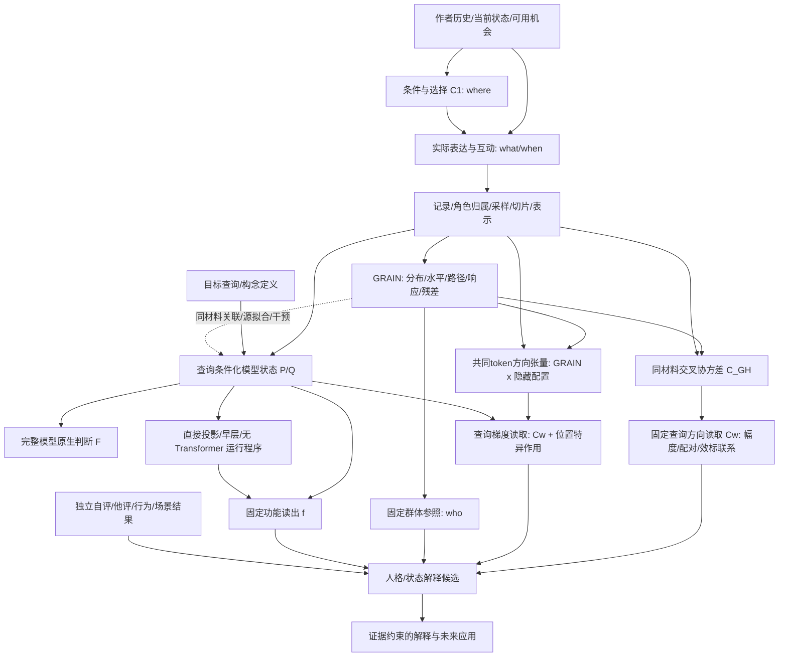
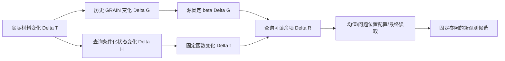

# GRAIN 全系统逻辑图谱 V1

2026-09-10。用途：整个 Project Persona / GRAIN 的理论连接与开发总图，不是
新量表、发布评分器或新的心理效度结论。此图谱将历史 V8 与九月向量路径研究
接起来，不以新路线抹掉旧成果。具体数值以所链接的版本化报告为准。

## 1. 最终问题与三个需要同时存在的系统

最终问题是：如何从作者的自然语言材料形成可计算、可解释、相对明确群体有
意义的人格/状态推论？不是只预测一个量表，也不是只识别作者，更不是只拟合
LLM 的答案。

1. **表达与测量系统**：作者在机会条件下选择、表达、互动；GRAIN 将记录转成
   可比较的表达配置、分布、路径与响应对象，并放回参照总体。
2. **模型推论系统**：给定相同材料与一个明确查询，定位模型如何读取、归纳、
   组合信息，再尽可能将其有用计算抽取成固定数学程序。
3. **解释与效标系统**：将技术对象、模型读出与自评、他评、状态或行为通道
   分别连接；LLM 可渲染解释，但不能悄悄改写固定计分。

这三者通过相同作者、相同材料、相同查询和明确时间范围连接，并不互相替代。

图中实线也不全是已证明的因果关系。下表明确每条边的逻辑类型。

## 2. 每个结果必须带的对象地址

定义对象地址

\[
\omega=(\text{cohort, author unit, material, clock, operator, reference,
query, statistic, endpoint, model/version}).
\]

例如“F02 与 T/F 有联系”不完整。F02 的作者均值、文内离散度、跨抽样期差分
是三个不同统计对象；T/F 自报、固定函数 f 与原生模型 p(F) 是三个不同终点。
对象地址只是报告/实验协议，不是新心理学术语。

| 输出 | 数学对象 | 回答的问题 |
|---|---|---|
| 个体分数 | \(m_u=\Psi(A_u;P_0,Q_0,S,R,\mathcal C)\) | 此人在指定参照中处于哪里？ |
| 个体内变化 | \(m_{uv}-\bar m_u\) 或相邻视图差分 | 此人的不同记录如何变化？ |
| 人际关系 | \(d(A_u,A_v)\) | 两人的哪些表达特征相近？ |
| 群体关系 | \(\mathrm{Cov}_u(A_u,B_u)\) | 群体中两类位置如何共同变化？ |
| 模型响应 | \(F(H+\delta)-F(H)\) | 此向量操作怎样改变模型输出？ |
| 心理连接 | \(\mathrm{Assoc}(m_u,Y_u)\) | 技术读数与某一实际效标怎样相关？ |

## 3. 全链路逻辑登记

类型：D=定义；M=数学命题；E=已有有界经验结果；I=模型内干预；
H=仍待选择的机制假说；U=需要额外观测才能识别。状态不是理论完成百分比。

| ID | 前提 -> 推论 | 类型/现状 | 替代机制与下一连接 | 证据入口 |
|---|---|---|---|---|
| L01 | 心理过程在机会中产生语言 -> 可观察表达 | H/U | 沉默、选择、引用、AI 代写使记录不等于完整行为 | unified V8 §§2-4 |
| L02 | where 是可选择的 -> 条件选择也是作者信息 | E | 可用机会不等于选择偏好；先保留二者再比较 | 4W / rind V3 |
| L03 | 固定条件 -> 减少机会差异后的表达比较 | E | 固定条件也限制 C1；不推成任意总体内都提高信度 | rind / retrospective |
| L04 | 记录 -> 切片/向量/因子分数 | D/E | 带事件元数据的展示规范化可以保留真实路径；去掉时钟则展示反转与实际次序不可分。评论内序不等于评论间序 | V7 / clock and target contract §§2-3 |
| L05 | 向量近邻/聚类 -> 局部共同表达结构 | E | 主题、格式、模型几何也能产生簇；簇数不自动等于心理因子数 | V7 / route index |
| L06 | 多个局部观察 -> 作者分布与参数 | D/E | 采样量、时间窗、条件组成决定汇总对象 | unified §§4-5 |
| L07 | 群体因子坐标 -> 新作者固定参照分数 | D/E | 批内标准化与固定常模不同；新材料算子需显式版本 | V7 / NAV reference |
| L08 | 同人检索/折半几何 -> 可重复作者信息 | E | 身份/写作习惯可重复也不等于人格标签 | retrospective |
| L09 | 残差仍有作者结构 -> 保留残差作为候选信息 | E | 新增源固定查询配置余项：可计分且跟随模型变化；并非全部残差均为心理信息 | V6 / unified §8 / natural transport §4 |
| L10 | 动态不是均值函数 -> 路径提供额外观察对象 | M/E | 不推出额外人格维度；应区分表达顺序、抽样历时、模型层深 | V6 / dynamic report |
| L11 | 微观过程 -> 分布/响应/转移/互动/高阶路径 | M/E | 玩具世界证明机制可实现，不证明人类只由这些机制组成 | M3 atlas |
| L12 | 局部机制组合 -> 介观与群体关系 | M/E | 组合可有反馈/抵消/支持集漂移；单边成功不保证复合成功 | M4 / cross-level contract |
| L13 | 样本趋大 -> 估计误差减少 | M | 个体事件随机性、遗漏结构与估计方差不是同一误差 | unified §8 / cross-level §8 |
| L14 | 文本 + 查询 -> P/Q 条件化表征 | E/I | NEXT39固定完全相同输出方向，旧4/新8正文梯度余弦仍.728/.657，显示条件传输差异；query状态与布局共同包含。原概率.704/.649与新logit目标分开，不当量表相关 | fixed seed attention theory §1; output seed theory §§1-3 |
| L15 | 表征含信息 -> 读出可利用信息 | M/E | 固定P/Q的已测输入族中，f及三分量不变而原生锚定值变化；任何只读这些量的函数不能精确重建该干预族。自然分布另论 | scalar/conditional report §4 / input quotient |
| L16 | 精确锚定/路径积分 -> 分数变化分解 | M/E | 参考R的概率余项RMS=.013657，sigmoid曲率仅.000081；内部logit梯度也变化。不是单纯输出映射或未分账噪声，Hessian公式不等于已测完整Hessian | retained logit report §1; action geometry §3 |
| L17 | 源拟合固定读出 -> 重现完整模型部分判断 | E/I | 同4源完整N pair定向读法r=.610/.593，对照-.095/.092；但基线-only已有.602。相邻配置幅度r=.637/.721，有符号方向未恢复；不以完整分数替代局部机制 | query-directed pair report §§1-3; query-directed baseline report |
| L18 | 无完整 LLM 生成 -> 可数学单独运行 | E | E5均值接口扩展九查询；E/A/O保留效标r=.189/.148/.206。E5仍有编码器，token查表依赖不同 | NAV build / reading level report §4 |
| L19 | GRAIN 与查询关联 -> 可建立共同接口 | E/M | NEXT56四兼容函数定位实际源截距：O梯度与F余弦.9998，V与I为.9993；V查询对比r=.811但完整分数未恢复。共同系数可改变个体差异的读取敏感度；GRAIN给扰动分布，不把共同偏移直接叫噪声或人格 | source offset mechanism theory §§1-3; whole path assembly theory |
| L20 | GRAIN 差分 -> P/Q 方向 -> 原生输出改变 | I/E | 新4作者3查询48个正文方向，有限差分与梯度47/48同号、相对L2误差.49%-1.67%；为固定P/Q的块16直接作用，不是自然文本总路径。实际E1旧结果保留 | native material reader report §4; natural transport §3 |
| L21 | 同一因子的离散度/变化/均值 -> 同一机制？ | M/E | pooled损失精确分为作者间/视图内；两种读取斜率确实不同但不自动改善。within不识别作者截距 | LOG01 / reading level report §§2,5 |
| L22 | 路径可读性高 -> 人类效标相关高？ | E | TF实际R/校准R自评r=.199/-.047，作用改善尚未恢复关联。N相邻实际幅度/正交范数自评r=.427/.469；保留不同几何统计，不据Y挑方向 | action geometry report §5 |
| L23 | 因子轴旋转 -> 共同对象仍可追踪 | M/E | C'=CT与w'=T^-1w保持Cw；多查询作用距离可连接旧作用加权几何。任意G坐标重表达还须传递输出度量 | material operator theory §4; LOG02 |
| L24 | 共享路径 -> 量表相关？ | H/E | 五Big5/四MBTI组内共32条分层关系；N余项作者水平较特异，其他部分共享。下一步接实际效标 | all-factor atlas / configuration extraction §6 |
| L25 | 联合 GRAIN+路径 -> 更多人格预测信息 | E | O/F03配对方向/自评r=-.272，错位.044，幅度乘积.009；A查询波动另有.224。S/Y贡献主要为对齐项-.249。源探索和无拟合折内账，不发布新预测器 | material geometry report §§2-4; same-material report §3 |
| L26 | 自评 Big5/MBTI -> 行动倾向/实际行动 | H/U | 自评是独立通道而非实测行动；T,Y 不识别未观测 B | dynamic report §6 / MTMM |
| L27 | 稳定 LLM 解释 -> 可重复且有据的叙述 | E/H | 新增原文区间/数字绑定校验、候选与替代解释协议；解释事件不等于token切口。新prompt尚未做LLM评价；独立盲编码与看数字后的渲染分开 | same-material interpretation theory §§4-5; V8 LLM assessment |
| L28 | 查询性“人格意义” -> GRAIN 因子构念 | H/E | 已找到T/F、E/A/O配置余项的外部关联；技术组件、特定效标与完整心理构念仍分层连接 | 4W / configuration criterion report |
| L29 | 多语/跨域可运行 -> 可比较心理量 | H/E | 运行兼容、几何稳定、测量等价是三条边；无需为探索先完成全部 | retrospective / unified §12 |
| L30 | 合成导航成功 -> 真人材料路径可计算 | E | 原顺序/成对源训练已分开；源OOF与旧12人运输响应仍可分歧，支持覆盖不是自动运输保证 | conditional / paired support reports |
| L31 | 当前局部接口 -> 人格/状态解释器 | H/E | NEXT56保留新8查询对比改进而整函数门槛失败；隐藏状态替代家族关闭。NEXT57改为完整L及同函数GRAIN导数的源数值抽取，应用不运行后缀，H16仍原生。旧局部/效标证据分层保留，不以模型响应r命名心理构念 | source offset mechanism theory §4; complete function extraction plan; same-material interpretation theory |

## 4. 历史成果如何留在新系统中

| 开发段 | 当前仍保留的作用 | 不应混用的结果 |
|---|---|---|
| LoRA/表示优先/H2 | 预测与结构恢复分开；真实对照重要 | 结构矩阵相关不是个体预测 r |
| MCD | 条件相对的位置、选择和局部信息可补 baseline | 官方预计算协议 NP+MCD .318 与 clean 协议不是同一 benchmark |
| HMCD/V3 | 自由选择相 + 条件固定相；分布与条件响应 | 情动词的状态作用不等于稳定 trait 子量表 |
| V6/V7 | 静态、动态、共享、私有残差与多观察平面 | 0 个确认轴不否定分布式作者结构 |
| V8 M3/M4 | 微观-介观-宏观的有类型机制关系 | 人类机制玩具世界不等于 Transformer 电路 |
| 4W | where/what/who/when 联合解释 | where 选择包含 who，不是四个独立因子 |
| 向量查询/导航 | 固定功能、自然端点变化、便携计算 | 拟合 f、改变 F、相关 Y 是不同成功 |
| GRAIN-路径接合 | 相同材料上的分数/路径/原生干预连接 | 旧因子库只代表已实现的切口，不代表 GRAIN 全能力 |

历史来源：[`GRAIN_PROJECT_RETROSPECTIVE_20260905.md`](GRAIN_PROJECT_RETROSPECTIVE_20260905.md)、
[`SUICA_THEORY_ROUTE_INDEX.md`](SUICA_THEORY_ROUTE_INDEX.md)。
原始 parent MCD 报告仍在 ../project persona/reports/，不是在独立仓库重新全量复现。

## 5. 从“公式有余项”到“机制有解释”

\(Y=f(X)+R\) 总可以成立，但没有确定 R 的来源；同样
\(\Delta H=D\Delta G+R_H\) 并未让 D 变成唯一心理路径。我们需要逐边问：

1. 谁生成这个对象？作者、情境、记录器、表示模型、拟合器还是解释器？
2. 观察到了什么？值、差分、分布、子空间、模型响应还是效标？
3. 什么替代机制仍能产生相同现象？哪个最小改变能区分它们？
4. 结果能发展出什么新计算，而不是仅多出一条“不得宣称”？

接合的一般形式保留三个不同算子：

\[
G_u=\mathcal G(T_u;\omega),\quad
H_{uq}=\mathcal H_M(T_u,q),\quad
\widehat Y_{uq}=\mathcal R_q(G_u,H_{uq};\text{source}).
\]

研究 \(G\to H\to F\) 的干预作用可以发现“模型如何判断”；研究
\((G,H)\to Y\) 的作者级关系可以发现“什么信息与效标相关”。两条都成功才
能发展一个对该效标有意义的模型解释接口；它们仍非人脑机制的同一性证明。

### 5.1 第二轮：接口不能只靠同名因子相接

同一12人真实材料删减后，冻结向量函数f追踪原生F的变化：T/F r=.886、
神经质r=.681；源拟合GRAIN变化映射弱得多，T/F可反向。因此加入两条明确边：

这里Delta R=Delta f-beta Delta G，不能因恒等式成立就说机制唯一。
实际可发展的部分是其中**问题位置配置余项**：与原生变化r=.775/.642；
三个部分已逐个保存源拟合系数、固定参照与新作者读数。它需要P/Q状态，
不是无模型的文本编码器，也不是新命名的人格构念。
材料删减还给出精确组成式Delta mean(s)=(k/n)(mean_kept-mean_removed)，
但极性相似度不等于模型功能作用。机会、材料可用性、作者选择仍分开处理。

详见[自然变化/查询余项报告](../reports/grain_vector_mechanisms/NATURAL_TRANSPORT_LOGIC_REPORT_V1.md)。

### 5.2 第三轮：共同输入表示与查询功能连接

冻结的E5均值线性程序可以提取N配置余项：E1变化忠实度r=.841，和原生模型
变化r=.733（12作者）。幅度约真实余项变化的12.9%，但MSE相对零变化减少18.4%。
T/F未获得同样的自然变化重现。纯token查表的N完整水平相关.744，却未跟随
实际变化。由此分开**位置函数**、**证据响应函数**与**统计单位/材料支持**。

每评论的已学功能分数psi_q(h)=w_q^T h，使该轻量程序的删除变化精确等于
(k/n)(mean_kept(psi)-mean_removed(psi))。N权重与人格词极性方向cosine=.083，
表明它不是直接拿人格词相似度充当功能读数；这不是独立心理维度的证明。

同一固定输入与Ridge算子S_X下有新接口关系：

    R_direct = S_X(c-m_G),   R_derived = S_X(c)-m_G
    R_direct-R_derived = m_G-S_X(m_G).

因此“直接预测余项”减去的是输入可重现的GRAIN部分，而非完整GRAIN。两种
加减法不能随意互换或称更纯人格。该关系可检验、可用于设计共同表示接口。
五个Big5查询在213作者上、四个MBTI查询在63作者上分别分析，N余项在作者
水平相对特异，A/E等保留共享；未混合人群或将模型组件关系当真实量表关系。

详见[轻量提取/作用算子报告](../reports/grain_vector_mechanisms/CONFIGURATION_EXTRACTION_LOGIC_REPORT_V1.md)。
下一连接：固定技术读数与已许可外部效标的信息分配，而非继续追求模型自洽。

### 5.3 第四轮：从模型读取走到作者效标

同一276源作者的已有真实量表，已与全部九查询组件及两个轻量提取目标联接。
T/F余项/自报r=.305；外向性、宜人性、开放性为.227/.186/.176。
E5均值OOF读数保留T/F r=.249，但N仅.061。N的局部模型响应成功仍保留，
用途不同，不被效标差额抹去。这里3视图作者均值也不同于12人单次删除响应。

两条可计算连接分别是：

    Cov(c,Y) = Cov(m_G,Y) + Cov(R,Y)
    Cov(R,Y) = Cov(R_hat,Y) + Cov(R-R_hat,Y).

第二式T/F按同一sd(R)sd(Y)标准化后为.304=.157+.147，定位了读出误差中的
效标联系，不是一个“剩余人格比例”。完整f的T/F效标.201则由配置+.240和
均值/最终读取约-.039共同构成，说明组合算子会保留或抵消特定效标关联。
因此理论应同时记录**机制重现**、**效标保留**与**组合后的作用**，不让一个
相关数充当整套理论的优劣裁决。

详见[效标连接与作用记账](../reports/grain_vector_mechanisms/CONFIGURATION_CRITERION_LOGIC_REPORT_V1.md)。
Funder(1995)的线索相关性/可获得性/检测/使用框架，为这些不同连接提供先例，
不是当前神经机制已被既有心理学理论证明的意思。

### 5.4 第五轮：从误差存在走到误差属于哪个读取环节

固定目标t与预测p可以描述成t=a+bp+e，因此：

    Cov(t-p,Y)=(b-1)Cov(p,Y)+Cov(e,Y).

T/F余项+.1475的剩余关联贡献中，幅度+.0068、无法用p仿射重标定消去的部分
+.1406。这是新的定位，不是新的分数。它把“只是缩得太小”的解释降级，也不
把非仿射剩余直接叫作非线性机制。另一方面，pooled平方损失精确拆成作者均值
和视图内两项；同一输入分别学习的斜率确有差异，但作者间专用训练未提高T/F。

同一固定接口已实际扩展全部九查询：E5余项E/A/O的效标r=.189/.148/.206。
N视图内读取的自然变化r=.788，但组件忠实度低于原pooled，不做自动升级。
两种成功分别归档：**保留人际效标信息**与**读取材料变化**。

这把系统的“放大人格信号”主张细化为：先指定目标信息、统计层级与输入
可用性，再找到相应的计算算子；不是统一删噪、统一放大或统一换一个更高r的头。
[完整报告](../reports/grain_vector_mechanisms/READING_LEVEL_LOGIC_REPORT_V1.md)保留全臂结果。
下一边对接历史S6内部配置机制与当前E5输入；不把两个空间中的“均值核”当成同一物。

### 5.5 第六轮：输入相同、模型不同，应该补输入还是换目标？

同一12作者的12条评论保持原文，只反转列表，E5均值不变，但原生T/F/N判断
变化RMS=.105/.034。两查询均12/12人发生变化，旧端点及重复误差为0。
这是当前真实输入等价类中的可观察失配，不再只是低r或另一个空间的内部干预。

对反转J，定义t+=(t+tJ)/2、t-=(t-tJ)/2。任何不变预测p在这个等权二元轨道上：

    mean_pair (t-p)^2 = (t_plus-p)^2 + t_minus^2.

这个误差下界属于该人为呈现实验，不是原始自然作者效标中的人格比例。
源拟合ordinal向量新增了顺序区分能力，却没有跟上实际配置变化；源T/F拟合
略升、自评联系反降。由此将系统分成三个需要分别发展的接口：**输入可区分**、
**条件运算可迁移**、**作者效标信息保留**。

下一层逻辑也随之明确：对任意呈现排序稳定的作者位置，和真实表达顺序中的
动态响应，是不同目标。若只追求复制LLM，可能把呈现偏差一起复制；若一概删
顺序，又会丢掉真实when。GRAIN保留两个观察对象，再决定各自的解释与效标。
详见[实际输入实验](../reports/grain_vector_mechanisms/INPUT_ORDER_LOGIC_REPORT_V1.md)与
[输入等价类/目标理论](GRAIN_INPUT_QUOTIENT_AND_TARGET_THEORY_V1.md)。

### 5.6 第九轮：从固定分数推进到有依据的条件函数

本轮同时回答“能否只换读法”和“输入有没有丢区别”。7臂、276作者的固定
仿射/三次/分量读法未清楚补回原生联系；旧M11固定P/Q后，当前分量相同而
原生值仍变。后者给出实测输入等价类上的所有标量读法风险下界，不靠低r猜测。

旧M11/M28的两查询函数完全相同。对旧24人/query按当前代理投影后，条件
起点仍留有共同根效标贡献TF+.0946、N+.2123。下一步因此是构造已有干预
定义的b(E)与条件敏感度K(E,d)，而不是把所有误差压成一个非线性总分。
换参考会改变分项而不改变总函数，故参照与依赖输入支持也属于公式的定义。

[条件函数逻辑](GRAIN_CONDITIONAL_FUNCTION_LOGIC_V1.md)把该接口接回GRAIN的
条件组成、作者位置和路径测量，并逐项保留M12-M19已经完成的构造与反例。
[实测报告](../reports/grain_vector_mechanisms/SCALAR_CONDITIONAL_LOGIC_REPORT_V1.md)
提供完整七臂、精确聚合式、条件投影及输入族结果；没有新增神经调用。

### 5.7 第十轮：同一条件缺口不要求同一修复函数

当前代理下剩余TF条件联系主要在B=F(C(E),x0)，N则在保持评论均值的配置A。
两条操作顺序都保留N的局部配置贡献，但会按交互I搬移分账。这把“条件项”
细化成不同的模型计算对象，没有将其直接命名为主题或人格。

新配置候选用均值作相位条件，读出非线性分布差，保持零位移及反射奇偶。
四臂实测表明新增表示能力没有普遍改善原生作用重建；一些自评联系仍可保留。
下一步不是调频数，而是检验跨评论共同作用，并继续追踪TF均值化后保留的
条件载体。[完整结果](../reports/grain_vector_mechanisms/CONDITIONAL_FACTORIAL_KERNEL_LOGIC_REPORT_V1.md)。

### 5.8 第十一轮：误差分层成为可定位作用

410次后缀调用补上独立评论四格与TF条件载体四格。内部混合差与softmax
曲率明确分账，前者确实存在；当前按token相加的核读出因此需要局部联合
函数，而不是仅增加单token非线性。N相邻交互强度的源关联是一个可发展线索。

TF均值化后保留的136位置非正文状态有明确作用。正文改成均值不等于清除
上游已经送入模板位置的信息；固定字面不能替代固定状态。固定M0/R0时
布局仍造成读数差异，这又与GRAIN前置条件/参照设计相接。
[实测报告](../reports/grain_vector_mechanisms/COMMENT_CARRIER_LOGIC_REPORT_V1.md)
及[交互函数理论](GRAIN_CONDITIONAL_INTERACTION_OPERATOR_V1.md)给出全部接口。
没有把24人点位关联升级成新量表，也没有因关联区间宽而删除实际计算作用。

### 5.9 第十二轮：共同矩阵不等于共同作用最优

两个具体读法已执行：N按作者四折的对称张量核，TF四参照作者的R路径积分
矩阵；32次后缀前向/反向对，37.61秒，无新前缀或问卷拟合。
N局部交互可读，但对类型均值已经解释大量共有作用；远隔个体变化仍不跟随。
TF矩阵有91.18%共同欧氏能量，平均矩阵却只读出部分实际个体作用。

因此新增逻辑不是“再多几个因子”，而是**参数相似性必须经过实际位移的作用
度量才能连接到作者差异**。正规方程与参照支持内的校准候选已经写出；不把
少量参照上可积分的公式误当跨作者最优预测器。完整条件B的布局/正文输入
仍明确标为原模型端点，不用组装相关跳过输入链。
见[本轮报告](../reports/grain_vector_mechanisms/JOINT_CARRIER_READOUT_LOGIC_REPORT_V1.md)
和[作用度量推导](GRAIN_CONDITIONAL_INTERACTION_OPERATOR_V1.md#6-共享函数的几何不能只按矩阵范数定义)。

### 5.10 第十三轮：找到条件位移曲率，补齐完整输入账本

一次四参照内校准使其余20人T/F作用误差相对下降4.67%，但区间跨零。
更有决策价值的是：软参照支持仅约0.9%；矩阵参数中的布局差异很大，却不
主导被遗漏的实际作用，R位移路径变化才是最大的分项。这让下一对象从
固定平均矩阵变成明确的条件响应函数，而非重复精度/维度搜索。

N相邻共同方向有折内幅度信息可读；远隔pooled负相关不能直接解释成人格
方向反转。最后softmax的局部余项很小，下一步应看方向与正交能量的分工。
固定Ridge再训投影目标与投影原输出相同，但条件能量不等于条件均值的能量。

[第十三轮报告](../reports/grain_vector_mechanisms/ACTION_GEOMETRY_LOGIC_REPORT_V1.md)
保留全部作用/效标/负条件；[输入依赖图](GRAIN_CONDITIONAL_INPUT_DEPENDENCIES_V1.md)
精确区分F、b(E)、B，避免把部分公式的闭合扩大为完整系统独立可运行。
83项相关测试通过、15份数值/聚合产物字节重放；0新神经调用或参与者。

### 5.11 第十四至十六轮：同材料接口进入原生读法

同评论GRAIN/编译查询的共同变化，已分解为边缘波动和配对方向，并归纳成
可复用作者C矩阵；O/F03的配对方向与自评r=-.272，宜人性查询波动r=.224。
第十六轮进一步发现：当前query-last原生布局可固定同一正文，但不同query
在不同token位置的读取不可简单平均。带token位置的GRAIN×隐藏配置张量，
与原生分数梯度相乘，可重放实测局部作用；旧Cw是其均匀读者特例。

原生4作者、3查询、48方向，111后缀调用/72.59秒，58项相关测试、10文件
精确重放。共同前缀数值差异与旁文件读取问题均保留并明确修复；未重跑神经
收集，未新增问卷读取。见[原生报告](../reports/grain_vector_mechanisms/NATIVE_MATERIAL_READER_LOGIC_REPORT_V1.md)
和[原生接口理论](GRAIN_NATIVE_MATERIAL_READER_THEORY_V1.md)。接下来回到
NEXT24–26条件作用/能量/完整输入，不以一个局部导数代替完整人格推论。

### 5.12 第十七轮：曲率发生在内部，不只在输出换算

4参照作者×2正文条件的旧R路径，转到log-odds后仍有明显曲率。总概率
非线性余项RMS=.013657，sigmoid-only=.000081；精确拆分误差0，梯度场
端点变化约起点范数的.443。这个发现保留了状态相关读法的发展方向。

一次有界径向/切向二次函数测试已完成：20旧评估作者的响应r从.295到.323，
作用MSE/零却从.913到1.122。真实起点也不救回，所以不升级该候选。数学
反例解释为什么块内伸缩可能漏掉方向耦合，但真实耦合位置仍需所选接口
来指定，不能由失败直接命名机制。41相关测试、10文件精确重放，0神经调用。

见[曲率报告](../reports/grain_vector_mechanisms/RETAINED_LOGIT_CURVATURE_REPORT_V1.md)
和[内部函数理论](GRAIN_RETAINED_LOGIT_CURVATURE_THEORY_V1.md)。NEXT24有界
比较结束，继续条件能量和完整输入接口，不把逐次失败变成无边界调参。

### 5.13 第十八轮：均值之外的强度，以及条件方差的来源

同24作者/48文本对，正核混合分布可统一算均值、二阶强度与协方差，矩恒等式
误差9.89e-17。原预测强度的缺口含正负交叉项，不可全部命名为残差方差。
现有相邻读法强度r=.486/.476，折内仍.448/.438；新增第二矩主要恢复群体
量级，未优于源平均强度。分布评分相对均值评分只改变原生作用RMS的约
.165%/.034%，不是当前丢失主作用的解释。

更关键的理论接点：完整固定输入使模型输出确定，聚合输入可产生条件方差。
额外条件降低理想平均风险，但不保证每个群或每次拟合都改善。它把GRAIN的
条件化思路接到具体函数输入，见[条件矩理论](GRAIN_CONDITIONAL_MOMENT_THEORY_V1.md)。

[实证报告](../reports/grain_vector_mechanisms/CONDITIONAL_ENERGY_REPORT_V1.md)：
46相关测试、9文件重放、0神经调用；NEXT25结束。下一[完整条件文本对接口](GRAIN_COMPLETE_PAIR_INTERFACE_PLAN_V1.md)
拟合当时借用的z_0/单评论端点，再接既有mixed读法；执行结果见下段。

### 5.14 第十九轮：执行闭合后，读取函数的缺口显现

完整条件N pair评分已用数值输入/源模型独立运行，禁读所有其它文件的四个
进程精确复算。4个基线头+8个单评论头，无新神经调用或Y读取。目标仍是
固定P/Q、两评论恢复的模型分数，不是完整F或人的人格。

pooled r=-.107/.0006，RMSE=.01613/.01581；真实additive+旧mixed有约.9997
相关，差异说明借用起点对总分的重要性，不否认旧局部mixed作用。基线本身
r=-.164、折内.010，误差大于源均值；给真mixed也无法救回。因而下一步应
发展查询定向上下文读法，而非继续交互或最终概率精修。

这是“输入可见不等于读法学会”的实测实例：完整均值化上下文坐标仍在，
但有限源下通用相似度核主要拟合共同分布；压缩评论配置另有信息限制。
见[报告](../reports/grain_vector_mechanisms/COMPLETE_PAIR_INTERFACE_REPORT_V1.md)、
[理论](GRAIN_COMPLETE_PAIR_INTERFACE_THEORY_V1.md)和
[NEXT32查询定向方案](GRAIN_QUERY_DIRECTED_BASELINE_PLAN_V1.md)。

## 6. 本轮文献与执行入口

### 第二十五轮补充：共享与专用输入，离开四人面板

只换输入方向，不换接收查询的目标、输出基底或拟合规则。N/确认子空间
重叠.662，TF与二者约.260。N借确认作用r=.508、自身.473，但误差近乎
相同；确认借N=.551、自身.576。TF自身.863明显高于借N的.623与借确认.575。
这支持部分共享/部分专用的局部读法，不把子空间重叠解释成量表相关。

几何旋转不变不等于标准化Ridge程序不变；新测试验证惩罚必须一起变换。
同8列也不等于严格同有效自由度。全矩阵与例外保留，不选择新最佳donor。
24新头、0神经调用、40数值文件重放、55测试。NEXT37已固定8名旧许可源外
作者（两来源各4），没有采集新目标；用旧读法等权集成，native上限600秒。
[报告](../reports/grain_vector_mechanisms/QUERY_DIRECTION_TRANSFER_REPORT_V1.md)、
[理论](GRAIN_QUERY_DIRECTION_TRANSFER_THEORY_V1.md)、
[源外作者实验](GRAIN_READER_NEW_AUTHOR_TRANSPORT_PLAN_V1.md)。

### 第二十四轮补充：低能量输入与查询读取相接

新增8个源查询残差方向，覆盖残差能量2.985–3.192%，而等宽PCA覆盖7.071%；
前者T/F、N、寻求确认的GRAIN作用r=.863/.473/.576，后者.684/.114/.149。
作用SSE/零也同步改善到.657/.874/.712，源系数误差下降，作者中心化结果
保留。不是单纯调alpha或报告少数正例。完整梯度误差变大却不抹掉可测方向
更准确的结果：Frobenius误差和D构成的测量半范数是不同对象。

4旧作者/3查询，24源拟合，0新神经调用，当前梯度/旧结果禁读。43文件精确
重放、48测试通过。历史同名入口已恢复，新runner独立r2与初次未审阅数值
一致。GRAIN本体、外部效标和解释协议仍独立。
[报告](../reports/grain_vector_mechanisms/QUERY_RESIDUAL_INPUT_REPORT_V1.md)、
[三类方向理论](GRAIN_QUERY_RESIDUAL_INPUT_THEORY_V1.md)、
[下一步跨查询借用](GRAIN_QUERY_DIRECTION_TRANSFER_PLAN_V1.md)。

### 第二十三轮补充：内容权重与源特征空间的明确边界

同4作者，内容向量预测T/F局部作用r=.638（纯位置.498），去因子均值后
作者r=.614，幅度仅12%。当前GRAIN交互源拟合改善但留出更差，不替换GRAIN。
源空间投影证明最低误差仍.866-.959，正则化增加仅.000012-.000069；PCA32
保留39.8%输入方差。下一步应找查询相关的压缩残余，而非继续调整同一读法。

基底/系数在梯度空间正交，在测量作用空间有交叉项；两层恒等式均复算。
34测试、48数值文件精确重放、0神经调用。[报告](../reports/grain_vector_mechanisms/CONTENT_COEFFICIENT_READER_REPORT_V1.md)、
[理论](GRAIN_CONTENT_COEFFICIENT_THEORY_V1.md)、
[NEXT35残余输入计划](GRAIN_QUERY_RESIDUAL_INPUT_PLAN_V1.md)。

### 第二十二轮补充：方向词汇可共享，token权重需要内容条件

同4旧作者/3查询，原生48个GRAIN切线作用；自身rank8压缩r=.952/.998/.990，
其他3作者rank8方向+当前梯度系数oracle为.862/.987/.977，源三次位置读法
仅.498/.047/.033。于是共享隐藏方向V和局部系数a成为两个可分别测试的对象，
不是用高r跳过系数预测。局部对象仍是原生模型导数，不是新心理量表分数。

18次nested-mode增量中4次能量误差改善但作用变差；标准有符号误差恒等式
重放至2.22e-16。测量半范数说明为何“能量更像”与“作用更像”不同，也不应
把对当前四个方向不可见的部分叫人格噪声。23测试、18数值文件精确重放、
0新神经调用。[报告](../reports/grain_vector_mechanisms/POSITION_SPECIFIC_READER_REPORT_V1.md)、
[理论](GRAIN_POSITION_READER_THEORY_V1.md)、
[NEXT34内容/GRAIN系数计划](GRAIN_CONTENT_COEFFICIENT_READER_PLAN_V1.md)。

### 第二十一轮补充：完整组装与有符号方向

同4源的完整条件pair已数值接通，r=.610/.593，对照-.095/.092；基线-only
已有.602。相邻配置幅度r=.637/.721，但共同原生评分方向的对齐r=-.315/-.312。
最终评分函数的切线近似与原生变化r=.9981/.9998，缺口主要在链接之前。
将DeltaS写成长度、读取敏感度、夹角的乘积，并作固定顺序的误差分账，
80个配对诊断条目复算误差<=3.35e-16。原生基线只作诊断，不混入预测器。

[报告](../reports/grain_vector_mechanisms/QUERY_DIRECTED_PAIR_REPORT_V1.md)、
[方向理论](GRAIN_COMPLETE_RESPONSE_DIRECTION_THEORY_V1.md)、
[NEXT31位置读取](GRAIN_POSITION_SPECIFIC_READER_PLAN_V1.md)。81相关测试、16
数值文件精确重放，0新神经调用；发现有效组装，也定位了应开发的局部机制。

### 第二十轮补充：查询定向的基础读法

四个旧N参考作者提供条件候选Jacobian，另外20作者测量数值读法；同源核
r=-.050，查询仿射r=.727 [.443,.885]，评分RMSE降25.3%。这证明了本地
“指定查询所读方向”的可用性，不是只增加相似度特征。原测量20前向/
40反向目标/38.41秒；8个向量差分的80候选分量同号。

作者中心化logit误差/变化=.524 versus kernel1.061，整体向量误差却受共同
偏移影响。读法平均还有来源明确的配对项：zhat=zbar+Jbar(c-cbar)-C_Jc，
C_Jc的源RMS=.052493，复算误差2.45e-15。源位置与源读取不能任意拆开平均。
它把已有同材料共变思想接到了一个可独立算的条件函数。

[报告](../reports/grain_vector_mechanisms/QUERY_DIRECTED_BASELINE_REPORT_V1.md)、
[作用几何理论](GRAIN_QUERY_DIRECTED_BASELINE_THEORY_V1.md)、
[NEXT33同源完整组装](GRAIN_QUERY_DIRECTED_PAIR_ASSEMBLY_PLAN_V1.md)。
本轮用固定块16输入与源导数；临床解释和人的外部效标没有由这次模型r替代。

### 第二十七轮补充：回答编码、传输与上下文相对作用

新8人N/确认的输出方向余弦.954，而正文梯度.649；源输出方向空间仍覆盖
99%以上能量。有限候选字母本身约束秩，不把它命名成共通人格空间。T/F
没有概率饱和，按源gain换算后新作者作用r仍.011，故继续开发条件读法。

标准注意力反传提供值项a_j W_V^T g与选择项
a_j*((v_j-o)^T g)*W_K^T q/sqrt(d)。玩具例子中其它token改变o，使目标
key作用+.25变-.50，而目标token/query/注意力权重全不变。这个解析机制
具体说明缺失的全局上下文变量；真实模型head的量级将在NEXT39验证。
同一各向异性传输改变夹角的反例已测试，因此下一步固定相同seed而非仅比角度。

[报告](../reports/grain_vector_mechanisms/READER_OUTPUT_SEED_REPORT_V1.md)、
[理论](GRAIN_READER_OUTPUT_SEED_THEORY_V1.md)、
[NEXT39](GRAIN_FIXED_SEED_ATTENTION_PLAN_V1.md)。77聚焦测试、9数值文件精确
重放、0神经调用；两套系统的同token接合与独立辅助解释层均保留。

### 第二十八轮补充：实际attention中可分离的条件读取

同一输出s下正文J仍有query差异（旧4/新8余弦.728/.657），因此条件传输
确实不同，不再仅是不同输出seed经过共同矩阵的歧义。query布局与状态仍
共同包含。两层分别定义局部干预，不能用余弦变化计算心理信息损失。

实际最后block12头/2KV/RoPE的值和key作用24/24复算，相对误差2.03e-6。
新8人key/value逐作者范数比平均1.826/1.887，丢弃key误差.731/.743。
GRAIN投影中仍有反号相抵，保留有符号加和而非只取正attention权重。

[报告](../reports/grain_vector_mechanisms/FIXED_SEED_ATTENTION_REPORT_V1.md)、
[理论](GRAIN_FIXED_SEED_ATTENTION_THEORY_V1.md)、
[NEXT40源固定g程序](GRAIN_SOURCE_COTANGENT_READER_PLAN_V1.md)。28前向/24反向，
44.410秒，51聚焦测试，6CSV精确重放。当前q/k/v/g仍有原模型依赖；下一步
替换当前g，不冒称全部LLM推论已独立。整体goal继续ACTIVE。

### 第二十九轮补充：共同读出与上下文响应可以分开实现

最后层GRAIN局部作用现在可写为tauhat=(A D)^T gbar，A保留当前材料attention，
gbar仅取旧源。新8人自身查询源r=.809/.955，pool=.919/.869；全式误差明显
低于value-only，当前g/梯度禁读。此处并非整个人格预测，输入q/k/v仍来自模型。

实际误差恒等式delta_tau=Lambda delta_g闭合至6.11e-16，提示应该在所测
响应的几何下判断读出误差。N的g欧氏误差增加而GRAIN作用误差减小就是
一例，不需把整个场拟合到完美才发展可用接口。源pool和自身两法全部保留。

[报告](../reports/grain_vector_mechanisms/SOURCE_COTANGENT_READER_REPORT_V1.md)、
[理论](GRAIN_SOURCE_COTANGENT_READER_THEORY_V1.md)、
[NEXT41](GRAIN_COMPLETE_TRANSPORT_JVP_PLAN_V1.md)。24数值包/6CSV精确复算，
54聚焦测试，0神经调用。下一步将块16方向传至post-attention残差并用源t读，
保留最终query与直接残差，不把最后BODY公式误当完整上游传输。goal ACTIVE。

### 第三十轮补充：完整作用的生成位置与最终读取分开

完整H16方向经各层attention/MLP与query状态传播，再由固定源t读，
新8人N/确认r=.99814/.99610；进入最后层前单独已有.99688/.98816。
因此最后attention并非全部推论机制，它主要调整已形成的响应。direct
项包含此前10层的attention/MLP，不是“attention不重要”或普通直通文本。

链式乘积与残差望远镜展开给出下一步：在固定深度20/23/26读取，并检查
有符号增量如何相加，最终实现可提前停止的程序。保持层/目标地址与旧
NEXT40区别，不用同一个r符号抹掉不同实验对象。心理解释另行连接。

[报告](../reports/grain_vector_mechanisms/COMPLETE_TRANSPORT_JVP_REPORT_V1.md)、
[理论](GRAIN_COMPLETE_TRANSPORT_THEORY_V1.md)、[NEXT42](GRAIN_LAYER_ACCUMULATION_PLAN_V1.md)。
源捕获浮点试跑已修复且留档，全部源评分重放0；96JVP/4有限前向、总
10源前向/反向，172.89秒。57测试、3CSV精确复算，无当前目标反向/标签。

### 第三十一轮补充：把条件变换定位到可拆解的门控更新

层20的N作用在旧4人r=.876，新8人只有.092；到层23，新8为.952，确认
查询为.823但幅度仍约半。层25MLP随后给出两查询最大的正投影更新，
累计SSE/zero从.275/.314降至.022/.028。这个位置已被实际计算定位，不是
按最终注意力图猜测。两查询共享有用更新位置，但份额/个体路径不同。

下一步是SwiGLU乘积法则与RMS导数：把输入变化、门控变化显式分开，
并分别固定源门控/源norm检验所需的条件系数。原样共享矩阵可工作与
必须读当前系数是两条有用分支。两种结论都发展提取机制，而不是给层起人格名。

[报告](../reports/grain_vector_mechanisms/LAYER_ACCUMULATION_REPORT_V1.md)、
[公式](GRAIN_LAYER_ACCUMULATION_THEORY_V1.md)、[NEXT43](GRAIN_GATED_UPDATE_PLAN_V1.md)。
100JVP/167.352秒，4真实截短检查精确；24完整参考精确，5CSV重放，65测试。
无当前评分/反向/标签，整体goal ACTIVE，未改解释通道/旧锁箱/评分规范。

### 第三十二轮补充：机制有用不等于每个局部参数都要因人调整

源固定层25完整门控/RMS算子在新8人保留r=.996936/.998451。与此同时，
单独丢掉输入或门控变化项会使SSE/zero升至.201-.385。因此应保留乘法
机制，而不必在这个已测试位置为每个作者重新拟合细小系数。源程序可精确
编译为单个wbar，作用=wbar^T d；当前d仍承载上游的实际条件化过程。

这不是“模型本来就是线性的”，也不是“0.997人格准确率”。它给出一个
局部可替换的计算对象：读数几何允许完整向量有.213/.194相对误差，但
有用的查询方向作用仍被保留。下一步借用query读头，区分差异来自w还是d。

[报告](../reports/grain_vector_mechanisms/GATED_UPDATE_REPORT_V1.md)、
[理论](GRAIN_GATED_UPDATE_THEORY_V1.md)、[NEXT44](GRAIN_COMPILED_QUERY_TRANSFER_PLAN_V1.md)。
96JVP/149.086秒、数值3.059秒，源排除/6CSV复算、75测试；单向量编译差
7.772e-16。预算暂停后原包续跑，未增加额度或重复采样。整体goal ACTIVE。

### 第三十三轮补充：相同正文扰动，经不同查询运输后可由共享读头读取

12位作者两查询的BODY状态/位置/GRAIN完全一致；固定recipient目标后互借
读头，新8作用r仍.990935/.994290。等权共享读头是可保留的局部计算对象，
不需要强行让每个人格查询都有一套完全不共通的末端坐标。

精确对称差异C=R+T；自身模式新8的T投影.914272，R .085728，pool则
R为负、T超过1，说明必须保留抵消。它定位的是计算差异的入口，不是人的
心理份额或唯一因果中介。当前d仍来自上游查询上下文；下一步找到它的形成过程。

[报告](../reports/grain_vector_mechanisms/COMPILED_QUERY_TRANSFER_REPORT_V1.md)、
[理论](GRAIN_COMPILED_QUERY_TRANSFER_THEORY_V1.md)、[NEXT45](GRAIN_QUERY_TRANSPORT_FORMATION_PLAN_V1.md)。
384数值动作、0神经调用、8CSV重放、83测试；全系统goal继续ACTIVE。

### 第四十五轮补充：实际源截距控制了完整函数的读取敏感度

NEXT56固定四兼容函数I=X、O=X+b、V=X+V、F=X+b+V。新8 O梯度与F余弦
.9998，V与I为.9993；源截距/总校正能量约99.91%。这将上一轮状态位置诊断
进一步定位到实际源系数。V查询对比r=.811、SSE/zero=.351，优于I的.774/.404，
四因子对比误差均改善但符号17/32未变。源4对比仍负，完整分数门槛仍未过。

共同b无当前作者间方差，却能经grad S(X+b)改变差异的读法；这是计算机制，
不是把b命名为topic或心理噪声。隐藏状态替代家族关闭，NEXT57改学完整L和
同函数GRAIN导数，尝试用源数值程序移除当前后缀，而不继续调偏移/基底。

48新反传/39.67秒，26CSV精确重放，41测试；0新拟合/API/Y。见
[报告](../reports/grain_vector_mechanisms/SOURCE_OFFSET_MECHANISM_REPORT_V1.md)、
[理论](GRAIN_SOURCE_OFFSET_MECHANISM_THEORY_V1.md)、
[NEXT57](GRAIN_COMPLETE_FUNCTION_EXTRACTION_PLAN_V1.md)。整体goal ACTIVE，无模型任务。

### 第四十四轮补充：共同位移改变了个体差异的读取位置

NEXT55将三个固定Psi及同函数导数接真实suffix22–end。新8联合分数相关
.548/.420，SD却只有.056/.057对比原生.904/1.039；完整GRAIN响应r=.049/
.022。三候选均未过整函数门槛；identity的查询间响应对比仍r=.774，保留其
作用范围。源4查询对比为负，同样报告。这不是问卷预测r，旧NEXT53组件有效。

结果后冻结的I/J缓存交叉显示，I状态配J方向保持对比r=.775，J状态配I方向
则.057。方向仅改1.82%，梯度范数却降到约20%、方向余弦约.20–.25，故损失
主要来自状态移动后的读法。精确分账delta_tau=delta_g:dbar+gbar:delta_d。
token恒定位移能量99.95%不是源截距份额；NEXT56才分离实际源截距和其它项。

72实际反传/54.34秒，16主CSV重放；交叉24数组14CSV精确重放，0额外神经调用；
37测试。见[报告](../reports/grain_vector_mechanisms/WHOLE_PATH_ASSEMBLY_REPORT_V1.md)、
[理论](GRAIN_WHOLE_PATH_ASSEMBLY_THEORY_V1.md)、
[NEXT56](GRAIN_SOURCE_OFFSET_MECHANISM_PLAN_V1.md)。整体goal ACTIVE，无运行中模型。

### 第四十三轮补充：教变化也改变了状态依赖的读法

NEXT54固定VV/VJ/JV/JJ，0拟合/神经/Y，解释而非再次提高NEXT53的结果。
A(X,d)=ell(X)^T d，差异精确等于delta_ell^T dbar+ellbar^T delta_d。
既有新8误差改善中80.4–83.4%由状态路线分得、16.6–19.6%由方向分得，交互
RMS约为总改变量1%。状态平均距离略变差不妨碍功能更准，因为度量不同。
所有新8单query/contrast因子改善；源4对比却变差0.90–1.44%，完整保留。

这是对称计算记账，不是人格静动份额；交叉组合不是新函数导数。12.595秒
CPU，24包12CSV精确重放，34测试通过。当前固定基底家族结束。
[NEXT55](GRAIN_WHOLE_PATH_ASSEMBLY_PLAN_V1.md)计划冻结pointwise联合/值对照/
identity后接实际后缀22–end，对整个固定L和四方向响应测一次，不调局部参数。
见[报告](../reports/grain_vector_mechanisms/RESPONSE_REPAIR_REPORT_V1.md)、
[理论](GRAIN_RESPONSE_REPAIR_THEORY_V1.md)。全系统goal ACTIVE，暂无模型任务。

### 第四十二轮补充：源响应教学产生可保留的数值组件

NEXT53联合点式/因果图的新8N/C组件r约.900/.924，原定两query替代门槛通过。
运行前发现损失归一化改变正则化相对强度，补同归一化值对照后发现两种效应：
仅归一化对照本身已可用；GRAIN方向教学再降新8端点误差14.8–19.1%，全方向
误差降1.09–1.12%，状态误差略增约0.26%。源4端点依然弱，没有混成总体成功。

原source基底/尺度/引子/读头不变；同B生成状态与方向。截距维持，非恒定
系数大幅缩小。GRAIN可以规定源函数应保留的扰动分布Sigma_G；这是有实际
计算结果的接口，不是两个问卷分数相加。组件输入已无需当前blocks17–21，
H16仍原生，输出不是完整人格分数。20solves/13.150秒、0神经/Y；48包25CSV
精确复算，49测试通过。NEXT54做一次固定状态/方向交叉解释修复，然后回整链。
见[报告](../reports/grain_vector_mechanisms/RESPONSE_AWARE_STATE_REPORT_V1.md)、
[理论](GRAIN_RESPONSE_AWARE_STATE_THEORY_V1.md)、
[NEXT54](GRAIN_RESPONSE_REPAIR_MECHANISM_PLAN_V1.md)。整体goal ACTIVE。

### 第四十一轮补充：相似位置与相似运动不是同一个学习目标

NEXT52只拟合源作者H16->pre22状态，同一函数解析生成方向。新8点式/因果
状态误差降47%/42%，方向误差却增39%/50%；identity保留N/确认组件r=.878/
.893但幅度约4倍。三个替代均未通过原定门槛，旧NEXT51原生输入组件保留。
方向分解发现源PCA32覆盖31.94%的GRAIN扰动能量；基底盲区的方向必原样通过。
这不是心理信息比例，而是当前函数家族的可学习范围。

由此连接GRAIN与路径的一种新方式是Sigma_G=sum D_f D_f^T/4，以
tr((Jhat-J)Sigma_G(Jhat-J)^T)度量需保留的方向响应。NEXT53固定同基底和参数，
只改为源值+方向联合目标；不是新8标签调参，也不是两个总分简单相加。
7.185秒CPU、10solves、0神经/Y；24包/9CSV精确复算，44测试通过。
见[报告](../reports/grain_vector_mechanisms/SOURCE_STATE_TRANSPORT_REPORT_V1.md)、
[理论](GRAIN_SOURCE_STATE_TRANSPORT_THEORY_V1.md)、
[NEXT53](GRAIN_RESPONSE_AWARE_STATE_PLAN_V1.md)。全系统goal ACTIVE。

### 第四十轮补充：选择的作用抵达端点，意义依赖后续配对

NEXT51固定源query引子和后续读头，在新8的N/确认端点key组件r=.973/.978，
对比r=.963、RMS59.2%，两项原定门槛均过。源4对比=.921，完整因子保留。
局部w*下交换引子的-.890，经实际端点读头变为+.868、源读头+.447：
局部结果有效但不能推及所有读法，query作用不是只在一个引子内。

选择/读头/交叉MSE=.007729/.000777/-.004120，负交叉项说明固定读头
可部分补偿选择近似。原生其它项加回后的r=.995仅为替换审计，不作独立预测。
24reverse+2JVP+4FD共20.365秒；完整96个H16作用与原模型差≤4.777e-6；
24向量/12预测/7CSV重放，67测试。NEXT52转向Psi(X16)及其同函数导数，
从当前K/V/dK移除blocks17–21，不继续局部层/头/读头精度搜索。见
[理论](GRAIN_SELECTION_ENDPOINT_THEORY_V1.md)、
[报告](../reports/grain_vector_mechanisms/SELECTION_ENDPOINT_REPORT_V1.md)、
[NEXT52](GRAIN_SOURCE_STATE_TRANSPORT_PLAN_V1.md)。

### 第三十九轮补充：可共享查询引子，但查询差别需要相应选择

NEXT50仅从源4编译Q引子，预测不读当前Q。同/另/共享query引子的新8对比
r=.939345/-.890468/.477162；同query31/32同号，RMS为原生29.1%，共享
为8.4%。三者各query的原定SSE/zero门槛均过，不能把对比差别偷偷改成
原来的通过门槛。保留完整因子/source/pooled表，不再局部调参。

该式把同一材料的GRAIN方向接到token级选择作用，查询引子决定该变化如何
参与证据竞争；当前K/V/dK仍依赖query-conditioned原生状态。它为辅助解释
提供数值/文本共同地址，不自动命名精神分析或交流分析构念。

576动作/288对比、12作者，0模型/拟合/Y，.373秒及.430秒重放；12数组和
6CSV完全重放，62相关测试通过。下一步r^T u的端点贡献与源rbar替代：
不能因局部w*^T u相近就跳过后续运输。见[理论](GRAIN_SOURCE_QUERY_SELECTION_THEORY_V1.md)、
[报告](../reports/grain_vector_mechanisms/SOURCE_QUERY_SELECTION_REPORT_V1.md)、
[NEXT51](GRAIN_SELECTION_ENDPOINT_PLAN_V1.md)。

### 第三十八轮补充：同材料方向不仅搬运内容，还改变证据选择

NEXT49以完整preAttention22状态/方向展开Q/K/V。新8自身局部对比投影
=.083093/.903954/.012952；source4=.561950/.271327/.166722。神经质
查询新8的Q=-.125849、K=1.125420；确认寻求则Q=.444047、K=.452388。
因此查询可调整已有选择，不能把旧BODY-only限制硬套在传播后的方向上。

96前缀JVP用77.972秒，96原生增量向量相对差≤5.272e-6；0评分/拟合/Y。
最初报表的key/query身份列冲突已在r2明确修复，预测与数值对比未改、未重跑。
12数组/6CSV/1JSON重放，116测试通过。NEXT50只用源固定query引子检验
当前证据K/V/dK的选择读法，随后回整链，而非继续层/头网格。见
[理论](GRAIN_UPSTREAM_ATTENTION_CHANNELS_THEORY_V1.md)、
[报告](../reports/grain_vector_mechanisms/UPSTREAM_ATTENTION_CHANNELS_REPORT_V1.md)、
[NEXT50](GRAIN_SOURCE_QUERY_SELECTION_PLAN_V1.md)。

### 第三十七轮补充：查询特异修正也可编译，回到完整上游运输

NEXT48仅从源4编译分查询读向量，新8的修正项与当前算子差异r=.886208，
总对比r=.976535、SSE/zero=.060734。公共项与NEXT47完全一致，8新作者
使用相同分query/mode向量；pooled也通过。源4 F02的修正SSE略高于零
基线，完整保留；没有用人格标签挑选或重新拟合。

新8源误差RMS=.013454、查询误差=.012086，总误差=.023478。误差及
平方误差变化恒等式均核验，不能把相关误差直接相加。4.078秒数值、0模型
调用，12数组/8CSV重放、105测试通过。MLP24局部细调按预定规则结束。

下一步是真正仍需当前材料的全token传输。旧末端BODY-only扰动固定最终
query，而attention22的传入方向可能已改变它；NEXT49完整展开Q/K/V，
保留旧公式边界，检验新的上游选择/写入机制。详见
[理论](GRAIN_SOURCE_QUERY_CORRECTION_THEORY_V1.md)、
[报告](../reports/grain_vector_mechanisms/SOURCE_QUERY_CORRECTION_REPORT_V1.md)、
[全链接合图](GRAIN_UPSTREAM_MECHANISM_INTEGRATION_V1.md)。

### 第三十六轮补充：局部计算可共享，作者材料仍以条件化方向进入

NEXT47仅用旧4作者编译源共同读向量，8个新作者使用完全相同的v，仍保留
MLP24回调：自身模式对比r=.955274、SSE/zero=.091333，最终T投影-.304183。
没有用当前x或人格标签。这把当前门控依赖从此处局部读法中移除，但没有
假装上游d已不需模型。源4留一与pooled、所有因子结果均保留。

剩余误差明确分成源替换、遗漏的查询项和数值余项。新8前两者RMS为
.013454/.024635，后者1.84e-7。下一步只问较大的查询项是否也能从源编译，
之后结束此层的细调，回到完整文本输入链。

4.069秒，0原生调用/拟合/Y；101聚焦测试、12数组与6CSV重放通过。见
[理论](GRAIN_SOURCE_COMMON_COUNTERACTION_THEORY_V1.md)、
[报告](../reports/grain_vector_mechanisms/SOURCE_COMMON_COUNTERACTION_REPORT_V1.md)。

### 第三十五轮补充：回调主要作用于已有差异，算子变化并非同一个方向

NEXT46真实block24的局部2x2交换完成，新8自身模式传入/算子项RMS为
.090579/.024635，局部投影.918570/.081430。相对最终T则为
-.313540/+.067912，合计-.245629。这把“负向更新”细化成可计算的两个来源，
而不是把整个模块当作噪声；源4和pooled也保留总体方向，但因子细节不同。

两个查询的平均J仍按当前作者x计算，并非所有人共享一个固定J。下一步
NEXT47以源4构造共同读向量，检验能否去掉这一处当前状态的依赖。该检查
不需要新神经调用，不改变GRAIN计分或心理解释规则。

28前缀执行14.103秒、加载3.492秒；完整96对角向量通过，3CSV及12数组
重放一致，96聚焦测试通过。详见[新理论](GRAIN_QUERY_COUNTERACTION_THEORY_V1.md)
与[报告](../reports/grain_vector_mechanisms/QUERY_COUNTERACTION_REPORT_V1.md)。

### 第三十四轮补充：路径差异会被增强，也会被后续更新修订

NEXT45将NEXT44的运输差异T精确接到17个前置原生更新。新8人在层23
累积RMS=.208，最终preMLP25为.163；MLP24有负投影-.246，四因子均为负。
源4也有MLP24反向作用，但attention22的作用不同，不能推广固定层排名。

发展出的精确递推为delta_d_next=Abar delta_d+delta_A dbar，区分已有
差异的传输与当前算子对比。矩阵顺序保留，不要求可逆/可交换；两项测试
验证代数，尚不等于从末位更新识别了全部完整Jacobian。NEXT46只测试MLP24。

[报告](../reports/grain_vector_mechanisms/QUERY_TRANSPORT_FORMATION_REPORT_V1.md)、
[理论](GRAIN_QUERY_TRANSPORT_FORMATION_THEORY_V1.md)、[NEXT46](GRAIN_QUERY_COUNTERACTION_PLAN_V1.md)。
1728有符号记录、.245秒、0新神经调用、12CSV重放、93测试；整体goal ACTIVE。

表内历史证据简称的可定位入口：
- unified V8：[总体系](SUICA_UNIFIED_THEORY_SYSTEM_V8.md)；4W：[解释链](SUICA_4W_PERSON_INTERPRETER_THEORY.md)。
- rind：[独立库实证](../reports/suica_rind_regime_test_v3.md)；原理论在 parent
  `../project persona/docs/SUICA_RIND_THEORY_BASE_V3.md`，属于历史资料位置，不是当前新实验。
- M3：[机制类型](SUICA_M3_MECHANISM_ATLAS_THEORY.md)；M4：[机制组合](SUICA_M4_MECHANISM_COMPOSITION_THEORY.md)。
- cross-level：[跨层连接](SUICA_CROSS_LEVEL_INFERENCE_CONTRACT.md)。
- NAV：[真实/合成读出参照](../reports/grain_vector_mechanisms/NAVIGATION_REFERENCE_ROUTE_REPORT.md)。
- all-factor：[查询函数总表](GRAIN_ALL_FACTOR_MATHEMATICAL_ATLAS_M31.md)。
- factor/path：[四路线实证](../reports/grain_vector_mechanisms/FACTOR_PATH_ALL_ROUTES_REPORT.md)。
- LLM assessment：[观察-表示-计分-解释](V8_LLM_NATIVE_ASSESSMENT_THEORY.md)。

- [逻辑研究计划与活跃问题](GRAIN_LOGIC_RESEARCH_PLAN_V1.md)
- [参考理论](GRAIN_REFERENCE_FUNCTION_FRAMEWORK_V1.md)
- [条件计算及实际依赖](GRAIN_CONDITIONAL_NAVIGATION_THEORY_V1.md)
- [全系统输入依赖与嵌套端点](GRAIN_CONDITIONAL_INPUT_DEPENDENCIES_V1.md)
- [V8 类型体系](SUICA_UNIFIED_THEORY_SYSTEM_V8.md)
- [4W](SUICA_4W_PERSON_INTERPRETER_THEORY.md)
- [动态与效标通道](../reports/grain_vector_mechanisms/DYNAMIC_PATH_CHANNEL_REPORT.md)

本文是当前逻辑总入口；报告正文不会自动“证明”登记的每条边。新的实验将更新
连接状态与实例，不把有限清单的完成写成穷尽全部可能性。
