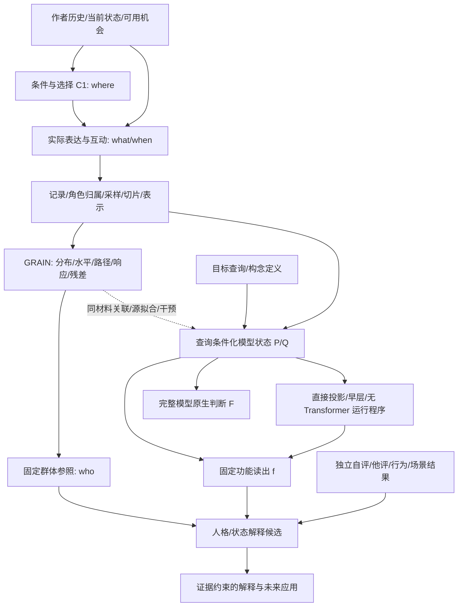

# GRAIN 全系统逻辑图谱 V1

2026-09-10。用途：整个 Project Persona / GRAIN 的理论连接与开发总图，不是
新量表、发布评分器或新的心理效度结论。此图谱将历史 V8 与九月向量路径研究
接起来，不以新路线抹掉旧成果。具体数值以所链接的版本化报告为准。

## 1. 最终问题与三个需要同时存在的系统

最终问题是：如何从作者的自然语言材料形成可计算、可解释、相对明确群体有
意义的人格/状态推论？不是只预测一个量表，也不是只识别作者，更不是只拟合
LLM 的答案。

1. **表达与测量系统**：作者在机会条件下选择、表达、互动；GRAIN 将记录转成
   可比较的表达配置、分布、路径与响应对象，并放回参照总体。
2. **模型推论系统**：给定相同材料与一个明确查询，定位模型如何读取、归纳、
   组合信息，再尽可能将其有用计算抽取成固定数学程序。
3. **解释与效标系统**：将技术对象、模型读出与自评、他评、状态或行为通道
   分别连接；LLM 可渲染解释，但不能悄悄改写固定计分。

这三者通过相同作者、相同材料、相同查询和明确时间范围连接，并不互相替代。

图中实线也不全是已证明的因果关系。下表明确每条边的逻辑类型。

## 2. 每个结果必须带的对象地址

定义对象地址

\[
\omega=(\text{cohort, author unit, material, clock, operator, reference,
query, statistic, endpoint, model/version}).
\]

例如“F02 与 T/F 有联系”不完整。F02 的作者均值、文内离散度、跨抽样期差分
是三个不同统计对象；T/F 自报、固定函数 f 与原生模型 p(F) 是三个不同终点。
对象地址只是报告/实验协议，不是新心理学术语。

| 输出 | 数学对象 | 回答的问题 |
|---|---|---|
| 个体分数 | \(m_u=\Psi(A_u;P_0,Q_0,S,R,\mathcal C)\) | 此人在指定参照中处于哪里？ |
| 个体内变化 | \(m_{uv}-\bar m_u\) 或相邻视图差分 | 此人的不同记录如何变化？ |
| 人际关系 | \(d(A_u,A_v)\) | 两人的哪些表达特征相近？ |
| 群体关系 | \(\mathrm{Cov}_u(A_u,B_u)\) | 群体中两类位置如何共同变化？ |
| 模型响应 | \(F(H+\delta)-F(H)\) | 此向量操作怎样改变模型输出？ |
| 心理连接 | \(\mathrm{Assoc}(m_u,Y_u)\) | 技术读数与某一实际效标怎样相关？ |

## 3. 全链路逻辑登记

类型：D=定义；M=数学命题；E=已有有界经验结果；I=模型内干预；
H=仍待选择的机制假说；U=需要额外观测才能识别。状态不是理论完成百分比。

| ID | 前提 -> 推论 | 类型/现状 | 替代机制与下一连接 | 证据入口 |
|---|---|---|---|---|
| L01 | 心理过程在机会中产生语言 -> 可观察表达 | H/U | 沉默、选择、引用、AI 代写使记录不等于完整行为 | unified V8 §§2-4 |
| L02 | where 是可选择的 -> 条件选择也是作者信息 | E | 可用机会不等于选择偏好；先保留二者再比较 | 4W / rind V3 |
| L03 | 固定条件 -> 减少机会差异后的表达比较 | E | 固定条件也限制 C1；不推成任意总体内都提高信度 | rind / retrospective |
| L04 | 记录 -> 切片/向量/因子分数 | D/E | 操作算子改变能看见的特征；不要求一种切法统治所有对象 | V7 / unified §3 |
| L05 | 向量近邻/聚类 -> 局部共同表达结构 | E | 主题、格式、模型几何也能产生簇；簇数不自动等于心理因子数 | V7 / route index |
| L06 | 多个局部观察 -> 作者分布与参数 | D/E | 采样量、时间窗、条件组成决定汇总对象 | unified §§4-5 |
| L07 | 群体因子坐标 -> 新作者固定参照分数 | D/E | 批内标准化与固定常模不同；新材料算子需显式版本 | V7 / NAV reference |
| L08 | 同人检索/折半几何 -> 可重复作者信息 | E | 身份/写作习惯可重复也不等于人格标签 | retrospective |
| L09 | 残差仍有作者结构 -> 保留残差作为候选信息 | E | 隐藏条件、高维私有结构、测量误差均可能；不能一概删除 | V6 / unified §8 |
| L10 | 动态不是均值函数 -> 路径提供额外观察对象 | M/E | 不推出额外人格维度；应区分表达顺序、抽样历时、模型层深 | V6 / dynamic report |
| L11 | 微观过程 -> 分布/响应/转移/互动/高阶路径 | M/E | 玩具世界证明机制可实现，不证明人类只由这些机制组成 | M3 atlas |
| L12 | 局部机制组合 -> 介观与群体关系 | M/E | 组合可有反馈/抵消/支持集漂移；单边成功不保证复合成功 | M4 / cross-level contract |
| L13 | 样本趋大 -> 估计误差减少 | M | 个体事件随机性、遗漏结构与估计方差不是同一误差 | unified §8 / cross-level §8 |
| L14 | 文本 + 查询 -> P/Q 条件化表征 | E/I | 查询槽整合信息，不必是一条关键词到特质词的唯一链 | mainline / reference framework |
| L15 | 表征含信息 -> 读出可利用信息 | H/E | 可解码与模型实际使用不同；保持 f 与原生 F 两终点 | reference / conditional reports |
| L16 | 精确锚定/路径积分 -> 分数变化分解 | M | 恒等式不保证敏感度可识别、可迁移或易从文本计算 | reference framework §§2,7 |
| L17 | 源拟合固定读出 -> 重现完整模型部分判断 | E | 可能保留偏置/语料先验；另测人类效标而非自称心理真值 | all-factor / NAV reports |
| L18 | 无完整 LLM 生成 -> 可数学单独运行 | E | B0 无 Transformer、B4 有四层、固定 f 仍需 P/Q；依赖账不同 | NAV build / conditional theory |
| L19 | GRAIN 与查询关联 -> 可建立共同接口 | E | 同文本共同原因也可相关；定位到效应后再解释作用 | factor/path report |
| L20 | GRAIN 差分 -> P/Q 方向 -> 原生输出改变 | I | 证明模型敏感方向；未单独识别人类心理过程或唯一自然路径 | dynamic report §3 |
| L21 | 同一因子的离散度/变化/均值 -> 同一机制？ | H | 层级和统计量必须先匹配；本轮 LOG01 拆解 | 本轮实验计划 |
| L22 | 路径可读性高 -> 人类效标相关高？ | H/E | 模型选择信息、效标通道、条件覆盖分别可限制连接 | factor/path / dynamic reports |
| L23 | 因子轴旋转 -> 共同对象仍可追踪 | M/H | 比较作用子空间/坐标协变函数，而非重新编号后的单轴 | LOG02 / reference theory |
| L24 | 共享路径 -> 量表相关？ | H/E | 共享输入/语义/编码均可解释；共同作用与独特作用要同终点检验 | all-factor atlas / shared functions |
| L25 | 联合 GRAIN+路径 -> 更多人格预测信息 | E | 有局部 E 增益，无普遍拼接提升；不能把指标提升当机制解释 | four routes / dynamic report |
| L26 | 自评 Big5/MBTI -> 行动倾向/实际行动 | H/U | 自评是独立通道而非实测行动；T,Y 不识别未观测 B | dynamic report §6 / MTMM |
| L27 | 稳定 LLM 解释 -> 可重复且有据的叙述 | E | 一致可来自共同偏置；固定分数不被解释层回写 | V8 LLM assessment |
| L28 | 查询性“人格意义” -> GRAIN 因子构念 | H | 先固定对象/效标，再命名；允许多对多和不同条件下不同意义 | 4W / all-factor atlas |
| L29 | 多语/跨域可运行 -> 可比较心理量 | H/E | 运行兼容、几何稳定、测量等价是三条边；无需为探索先完成全部 | retrospective / unified §12 |
| L30 | 合成导航成功 -> 真人材料路径可计算 | E | 自然条件与源支持不同；用实际同文本端点验证能搬运的部分 | conditional / NAV reports |
| L31 | 当前局部接口 -> 人格/状态解释器 | H | 组装已知有效对象，不以模型自洽代替作者外部连接 | 全系统目标 |

## 4. 历史成果如何留在新系统中

| 开发段 | 当前仍保留的作用 | 不应混用的结果 |
|---|---|---|
| LoRA/表示优先/H2 | 预测与结构恢复分开；真实对照重要 | 结构矩阵相关不是个体预测 r |
| MCD | 条件相对的位置、选择和局部信息可补 baseline | 官方预计算协议 NP+MCD .318 与 clean 协议不是同一 benchmark |
| HMCD/V3 | 自由选择相 + 条件固定相；分布与条件响应 | 情动词的状态作用不等于稳定 trait 子量表 |
| V6/V7 | 静态、动态、共享、私有残差与多观察平面 | 0 个确认轴不否定分布式作者结构 |
| V8 M3/M4 | 微观-介观-宏观的有类型机制关系 | 人类机制玩具世界不等于 Transformer 电路 |
| 4W | where/what/who/when 联合解释 | where 选择包含 who，不是四个独立因子 |
| 向量查询/导航 | 固定功能、自然端点变化、便携计算 | 拟合 f、改变 F、相关 Y 是不同成功 |
| GRAIN-路径接合 | 相同材料上的分数/路径/原生干预连接 | 旧因子库只代表已实现的切口，不代表 GRAIN 全能力 |

历史来源：[`GRAIN_PROJECT_RETROSPECTIVE_20260905.md`](GRAIN_PROJECT_RETROSPECTIVE_20260905.md)、
[`SUICA_THEORY_ROUTE_INDEX.md`](SUICA_THEORY_ROUTE_INDEX.md)。
原始 parent MCD 报告仍在 ../project persona/reports/，不是在独立仓库重新全量复现。

## 5. 从“公式有余项”到“机制有解释”

\(Y=f(X)+R\) 总可以成立，但没有确定 R 的来源；同样
\(\Delta H=D\Delta G+R_H\) 并未让 D 变成唯一心理路径。我们需要逐边问：

1. 谁生成这个对象？作者、情境、记录器、表示模型、拟合器还是解释器？
2. 观察到了什么？值、差分、分布、子空间、模型响应还是效标？
3. 什么替代机制仍能产生相同现象？哪个最小改变能区分它们？
4. 结果能发展出什么新计算，而不是仅多出一条“不得宣称”？

接合的一般形式保留三个不同算子：

\[
G_u=\mathcal G(T_u;\omega),\quad
H_{uq}=\mathcal H_M(T_u,q),\quad
\widehat Y_{uq}=\mathcal R_q(G_u,H_{uq};\text{source}).
\]

研究 \(G\to H\to F\) 的干预作用可以发现“模型如何判断”；研究
\((G,H)\to Y\) 的作者级关系可以发现“什么信息与效标相关”。两条都成功才
能发展一个对该效标有意义的模型解释接口；它们仍非人脑机制的同一性证明。

## 6. 本轮文献与执行入口

表内历史证据简称的可定位入口：
- unified V8：[总体系](SUICA_UNIFIED_THEORY_SYSTEM_V8.md)；4W：[解释链](SUICA_4W_PERSON_INTERPRETER_THEORY.md)。
- rind：[独立库实证](../reports/suica_rind_regime_test_v3.md)；原理论在 parent
  `../project persona/docs/SUICA_RIND_THEORY_BASE_V3.md`，属于历史资料位置，不是当前新实验。
- M3：[机制类型](SUICA_M3_MECHANISM_ATLAS_THEORY.md)；M4：[机制组合](SUICA_M4_MECHANISM_COMPOSITION_THEORY.md)。
- cross-level：[跨层连接](SUICA_CROSS_LEVEL_INFERENCE_CONTRACT.md)。
- NAV：[真实/合成读出参照](../reports/grain_vector_mechanisms/NAVIGATION_REFERENCE_ROUTE_REPORT.md)。
- all-factor：[查询函数总表](GRAIN_ALL_FACTOR_MATHEMATICAL_ATLAS_M31.md)。
- factor/path：[四路线实证](../reports/grain_vector_mechanisms/FACTOR_PATH_ALL_ROUTES_REPORT.md)。
- LLM assessment：[观察-表示-计分-解释](V8_LLM_NATIVE_ASSESSMENT_THEORY.md)。

- [逻辑研究计划与活跃问题](GRAIN_LOGIC_RESEARCH_PLAN_V1.md)
- [参考理论](GRAIN_REFERENCE_FUNCTION_FRAMEWORK_V1.md)
- [条件计算及实际依赖](GRAIN_CONDITIONAL_NAVIGATION_THEORY_V1.md)
- [V8 类型体系](SUICA_UNIFIED_THEORY_SYSTEM_V8.md)
- [4W](SUICA_4W_PERSON_INTERPRETER_THEORY.md)
- [动态与效标通道](../reports/grain_vector_mechanisms/DYNAMIC_PATH_CHANNEL_REPORT.md)

本文是当前逻辑总入口；报告正文不会自动“证明”登记的每条边。新的实验将更新
连接状态与实例，不把有限清单的完成写成穷尽全部可能性。
