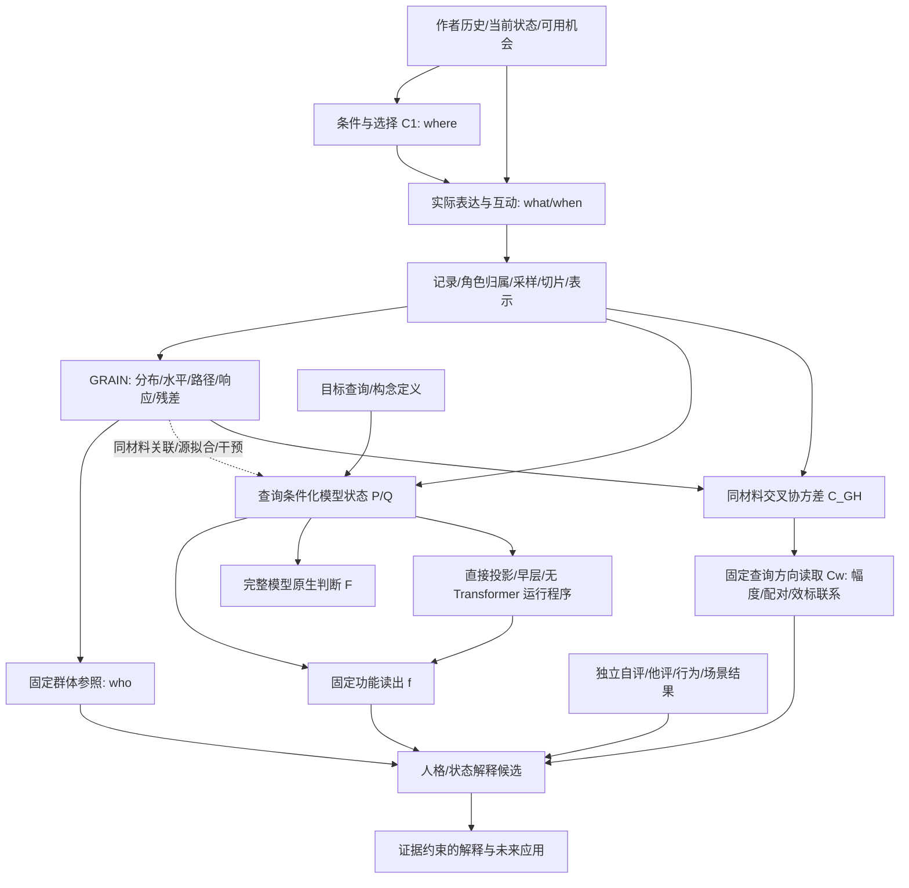
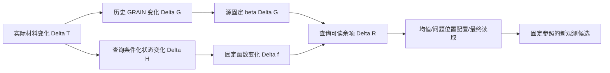

# GRAIN 全系统逻辑图谱 V1

2026-09-10。用途：整个 Project Persona / GRAIN 的理论连接与开发总图，不是
新量表、发布评分器或新的心理效度结论。此图谱将历史 V8 与九月向量路径研究
接起来，不以新路线抹掉旧成果。具体数值以所链接的版本化报告为准。

## 1. 最终问题与三个需要同时存在的系统

最终问题是：如何从作者的自然语言材料形成可计算、可解释、相对明确群体有
意义的人格/状态推论？不是只预测一个量表，也不是只识别作者，更不是只拟合
LLM 的答案。

1. **表达与测量系统**：作者在机会条件下选择、表达、互动；GRAIN 将记录转成
   可比较的表达配置、分布、路径与响应对象，并放回参照总体。
2. **模型推论系统**：给定相同材料与一个明确查询，定位模型如何读取、归纳、
   组合信息，再尽可能将其有用计算抽取成固定数学程序。
3. **解释与效标系统**：将技术对象、模型读出与自评、他评、状态或行为通道
   分别连接；LLM 可渲染解释，但不能悄悄改写固定计分。

这三者通过相同作者、相同材料、相同查询和明确时间范围连接，并不互相替代。

图中实线也不全是已证明的因果关系。下表明确每条边的逻辑类型。

## 2. 每个结果必须带的对象地址

定义对象地址

\[
\omega=(\text{cohort, author unit, material, clock, operator, reference,
query, statistic, endpoint, model/version}).
\]

例如“F02 与 T/F 有联系”不完整。F02 的作者均值、文内离散度、跨抽样期差分
是三个不同统计对象；T/F 自报、固定函数 f 与原生模型 p(F) 是三个不同终点。
对象地址只是报告/实验协议，不是新心理学术语。

| 输出 | 数学对象 | 回答的问题 |
|---|---|---|
| 个体分数 | \(m_u=\Psi(A_u;P_0,Q_0,S,R,\mathcal C)\) | 此人在指定参照中处于哪里？ |
| 个体内变化 | \(m_{uv}-\bar m_u\) 或相邻视图差分 | 此人的不同记录如何变化？ |
| 人际关系 | \(d(A_u,A_v)\) | 两人的哪些表达特征相近？ |
| 群体关系 | \(\mathrm{Cov}_u(A_u,B_u)\) | 群体中两类位置如何共同变化？ |
| 模型响应 | \(F(H+\delta)-F(H)\) | 此向量操作怎样改变模型输出？ |
| 心理连接 | \(\mathrm{Assoc}(m_u,Y_u)\) | 技术读数与某一实际效标怎样相关？ |

## 3. 全链路逻辑登记

类型：D=定义；M=数学命题；E=已有有界经验结果；I=模型内干预；
H=仍待选择的机制假说；U=需要额外观测才能识别。状态不是理论完成百分比。

| ID | 前提 -> 推论 | 类型/现状 | 替代机制与下一连接 | 证据入口 |
|---|---|---|---|---|
| L01 | 心理过程在机会中产生语言 -> 可观察表达 | H/U | 沉默、选择、引用、AI 代写使记录不等于完整行为 | unified V8 §§2-4 |
| L02 | where 是可选择的 -> 条件选择也是作者信息 | E | 可用机会不等于选择偏好；先保留二者再比较 | 4W / rind V3 |
| L03 | 固定条件 -> 减少机会差异后的表达比较 | E | 固定条件也限制 C1；不推成任意总体内都提高信度 | rind / retrospective |
| L04 | 记录 -> 切片/向量/因子分数 | D/E | 带事件元数据的展示规范化可以保留真实路径；去掉时钟则展示反转与实际次序不可分。评论内序不等于评论间序 | V7 / clock and target contract §§2-3 |
| L05 | 向量近邻/聚类 -> 局部共同表达结构 | E | 主题、格式、模型几何也能产生簇；簇数不自动等于心理因子数 | V7 / route index |
| L06 | 多个局部观察 -> 作者分布与参数 | D/E | 采样量、时间窗、条件组成决定汇总对象 | unified §§4-5 |
| L07 | 群体因子坐标 -> 新作者固定参照分数 | D/E | 批内标准化与固定常模不同；新材料算子需显式版本 | V7 / NAV reference |
| L08 | 同人检索/折半几何 -> 可重复作者信息 | E | 身份/写作习惯可重复也不等于人格标签 | retrospective |
| L09 | 残差仍有作者结构 -> 保留残差作为候选信息 | E | 新增源固定查询配置余项：可计分且跟随模型变化；并非全部残差均为心理信息 | V6 / unified §8 / natural transport §4 |
| L10 | 动态不是均值函数 -> 路径提供额外观察对象 | M/E | 不推出额外人格维度；应区分表达顺序、抽样历时、模型层深 | V6 / dynamic report |
| L11 | 微观过程 -> 分布/响应/转移/互动/高阶路径 | M/E | 玩具世界证明机制可实现，不证明人类只由这些机制组成 | M3 atlas |
| L12 | 局部机制组合 -> 介观与群体关系 | M/E | 组合可有反馈/抵消/支持集漂移；单边成功不保证复合成功 | M4 / cross-level contract |
| L13 | 样本趋大 -> 估计误差减少 | M | 个体事件随机性、遗漏结构与估计方差不是同一误差 | unified §8 / cross-level §8 |
| L14 | 文本 + 查询 -> P/Q 条件化表征 | E/I | 查询槽整合信息，不必是一条关键词到特质词的唯一链 | mainline / reference framework |
| L15 | 表征含信息 -> 读出可利用信息 | M/E | 固定P/Q的已测输入族中，f及三分量不变而原生锚定值变化；任何只读这些量的函数不能精确重建该干预族。自然分布另论 | scalar/conditional report §4 / input quotient |
| L16 | 精确锚定/路径积分 -> 分数变化分解 | M/E | 两类四格与最后输出曲率分别记账；参考R的路径变化偏差作用RMS=.014656，高于布局起点.002606。沿位移曲率成为具体待开发对象，不是未分账噪声 | action geometry report §3; interaction operator §7 |
| L17 | 源拟合固定读出 -> 重现完整模型部分判断 | E | TF作用加权校准误差/零=.814，原矩阵=.854；软参照支持均值仅.009129。N相邻幅度折内r=.501/.363；远隔pooled负相关多由折间均值造成 | action geometry report §§2-4; interaction operator §§7-8 |
| L18 | 无完整 LLM 生成 -> 可数学单独运行 | E | E5均值接口扩展九查询；E/A/O保留效标r=.189/.148/.206。E5仍有编码器，token查表依赖不同 | NAV build / reading level report §4 |
| L19 | GRAIN 与查询关联 -> 可建立共同接口 | E/M | 同材料C=G^T JH/n、S_q=Cw_q；828作者/视图矩阵重放15804坐标误差1.11e-16。固定E5的共享C不自动适用于查询改变原生H(q)的路线 | material geometry report §4; operator theory §§3-4 |
| L20 | GRAIN 差分 -> P/Q 方向 -> 原生输出改变 | I/E | 人工方向有效不保证解释自然路径；实际E1中f可追踪、GRAIN差分可能反向 | dynamic report §3 / natural transport §3 |
| L21 | 同一因子的离散度/变化/均值 -> 同一机制？ | M/E | pooled损失精确分为作者间/视图内；两种读取斜率确实不同但不自动改善。within不识别作者截距 | LOG01 / reading level report §§2,5 |
| L22 | 路径可读性高 -> 人类效标相关高？ | E | TF实际R/校准R自评r=.199/-.047，作用改善尚未恢复关联。N相邻实际幅度/正交范数自评r=.427/.469；保留不同几何统计，不据Y挑方向 | action geometry report §5 |
| L23 | 因子轴旋转 -> 共同对象仍可追踪 | M/E | C'=CT与w'=T^-1w保持Cw；多查询作用距离可连接旧作用加权几何。任意G坐标重表达还须传递输出度量 | material operator theory §4; LOG02 |
| L24 | 共享路径 -> 量表相关？ | H/E | 五Big5/四MBTI组内共32条分层关系；N余项作者水平较特异，其他部分共享。下一步接实际效标 | all-factor atlas / configuration extraction §6 |
| L25 | 联合 GRAIN+路径 -> 更多人格预测信息 | E | O/F03配对方向/自评r=-.272，错位.044，幅度乘积.009；A查询波动另有.224。S/Y贡献主要为对齐项-.249。源探索和无拟合折内账，不发布新预测器 | material geometry report §§2-4; same-material report §3 |
| L26 | 自评 Big5/MBTI -> 行动倾向/实际行动 | H/U | 自评是独立通道而非实测行动；T,Y 不识别未观测 B | dynamic report §6 / MTMM |
| L27 | 稳定 LLM 解释 -> 可重复且有据的叙述 | E/H | 新增原文区间/数字绑定校验、候选与替代解释协议；解释事件不等于token切口。新prompt尚未做LLM评价；独立盲编码与看数字后的渲染分开 | same-material interpretation theory §§4-5; V8 LLM assessment |
| L28 | 查询性“人格意义” -> GRAIN 因子构念 | H/E | 已找到T/F、E/A/O配置余项的外部关联；技术组件、特定效标与完整心理构念仍分层连接 | 4W / configuration criterion report |
| L29 | 多语/跨域可运行 -> 可比较心理量 | H/E | 运行兼容、几何稳定、测量等价是三条边；无需为探索先完成全部 | retrospective / unified §12 |
| L30 | 合成导航成功 -> 真人材料路径可计算 | E | 原顺序/成对源训练已分开；源OOF与旧12人运输响应仍可分歧，支持覆盖不是自动运输保证 | conditional / paired support reports |
| L31 | 当前局部接口 -> 人格/状态解释器 | H/E | 完整F=B+A+Q+I与TF的B=b00+Phi_M+Phi_R逐人重放；B不等于F。原文轻量路线与新块16作用路线分开，明确原前缀状态/精确端点仍存的依赖 | conditional input dependencies §§1-5; conditional function logic §10 |

## 4. 历史成果如何留在新系统中

| 开发段 | 当前仍保留的作用 | 不应混用的结果 |
|---|---|---|
| LoRA/表示优先/H2 | 预测与结构恢复分开；真实对照重要 | 结构矩阵相关不是个体预测 r |
| MCD | 条件相对的位置、选择和局部信息可补 baseline | 官方预计算协议 NP+MCD .318 与 clean 协议不是同一 benchmark |
| HMCD/V3 | 自由选择相 + 条件固定相；分布与条件响应 | 情动词的状态作用不等于稳定 trait 子量表 |
| V6/V7 | 静态、动态、共享、私有残差与多观察平面 | 0 个确认轴不否定分布式作者结构 |
| V8 M3/M4 | 微观-介观-宏观的有类型机制关系 | 人类机制玩具世界不等于 Transformer 电路 |
| 4W | where/what/who/when 联合解释 | where 选择包含 who，不是四个独立因子 |
| 向量查询/导航 | 固定功能、自然端点变化、便携计算 | 拟合 f、改变 F、相关 Y 是不同成功 |
| GRAIN-路径接合 | 相同材料上的分数/路径/原生干预连接 | 旧因子库只代表已实现的切口，不代表 GRAIN 全能力 |

历史来源：[`GRAIN_PROJECT_RETROSPECTIVE_20260905.md`](GRAIN_PROJECT_RETROSPECTIVE_20260905.md)、
[`SUICA_THEORY_ROUTE_INDEX.md`](SUICA_THEORY_ROUTE_INDEX.md)。
原始 parent MCD 报告仍在 ../project persona/reports/，不是在独立仓库重新全量复现。

## 5. 从“公式有余项”到“机制有解释”

\(Y=f(X)+R\) 总可以成立，但没有确定 R 的来源；同样
\(\Delta H=D\Delta G+R_H\) 并未让 D 变成唯一心理路径。我们需要逐边问：

1. 谁生成这个对象？作者、情境、记录器、表示模型、拟合器还是解释器？
2. 观察到了什么？值、差分、分布、子空间、模型响应还是效标？
3. 什么替代机制仍能产生相同现象？哪个最小改变能区分它们？
4. 结果能发展出什么新计算，而不是仅多出一条“不得宣称”？

接合的一般形式保留三个不同算子：

\[
G_u=\mathcal G(T_u;\omega),\quad
H_{uq}=\mathcal H_M(T_u,q),\quad
\widehat Y_{uq}=\mathcal R_q(G_u,H_{uq};\text{source}).
\]

研究 \(G\to H\to F\) 的干预作用可以发现“模型如何判断”；研究
\((G,H)\to Y\) 的作者级关系可以发现“什么信息与效标相关”。两条都成功才
能发展一个对该效标有意义的模型解释接口；它们仍非人脑机制的同一性证明。

### 5.1 第二轮：接口不能只靠同名因子相接

同一12人真实材料删减后，冻结向量函数f追踪原生F的变化：T/F r=.886、
神经质r=.681；源拟合GRAIN变化映射弱得多，T/F可反向。因此加入两条明确边：

这里Delta R=Delta f-beta Delta G，不能因恒等式成立就说机制唯一。
实际可发展的部分是其中**问题位置配置余项**：与原生变化r=.775/.642；
三个部分已逐个保存源拟合系数、固定参照与新作者读数。它需要P/Q状态，
不是无模型的文本编码器，也不是新命名的人格构念。
材料删减还给出精确组成式Delta mean(s)=(k/n)(mean_kept-mean_removed)，
但极性相似度不等于模型功能作用。机会、材料可用性、作者选择仍分开处理。

详见[自然变化/查询余项报告](../reports/grain_vector_mechanisms/NATURAL_TRANSPORT_LOGIC_REPORT_V1.md)。

### 5.2 第三轮：共同输入表示与查询功能连接

冻结的E5均值线性程序可以提取N配置余项：E1变化忠实度r=.841，和原生模型
变化r=.733（12作者）。幅度约真实余项变化的12.9%，但MSE相对零变化减少18.4%。
T/F未获得同样的自然变化重现。纯token查表的N完整水平相关.744，却未跟随
实际变化。由此分开**位置函数**、**证据响应函数**与**统计单位/材料支持**。

每评论的已学功能分数psi_q(h)=w_q^T h，使该轻量程序的删除变化精确等于
(k/n)(mean_kept(psi)-mean_removed(psi))。N权重与人格词极性方向cosine=.083，
表明它不是直接拿人格词相似度充当功能读数；这不是独立心理维度的证明。

同一固定输入与Ridge算子S_X下有新接口关系：

    R_direct = S_X(c-m_G),   R_derived = S_X(c)-m_G
    R_direct-R_derived = m_G-S_X(m_G).

因此“直接预测余项”减去的是输入可重现的GRAIN部分，而非完整GRAIN。两种
加减法不能随意互换或称更纯人格。该关系可检验、可用于设计共同表示接口。
五个Big5查询在213作者上、四个MBTI查询在63作者上分别分析，N余项在作者
水平相对特异，A/E等保留共享；未混合人群或将模型组件关系当真实量表关系。

详见[轻量提取/作用算子报告](../reports/grain_vector_mechanisms/CONFIGURATION_EXTRACTION_LOGIC_REPORT_V1.md)。
下一连接：固定技术读数与已许可外部效标的信息分配，而非继续追求模型自洽。

### 5.3 第四轮：从模型读取走到作者效标

同一276源作者的已有真实量表，已与全部九查询组件及两个轻量提取目标联接。
T/F余项/自报r=.305；外向性、宜人性、开放性为.227/.186/.176。
E5均值OOF读数保留T/F r=.249，但N仅.061。N的局部模型响应成功仍保留，
用途不同，不被效标差额抹去。这里3视图作者均值也不同于12人单次删除响应。

两条可计算连接分别是：

    Cov(c,Y) = Cov(m_G,Y) + Cov(R,Y)
    Cov(R,Y) = Cov(R_hat,Y) + Cov(R-R_hat,Y).

第二式T/F按同一sd(R)sd(Y)标准化后为.304=.157+.147，定位了读出误差中的
效标联系，不是一个“剩余人格比例”。完整f的T/F效标.201则由配置+.240和
均值/最终读取约-.039共同构成，说明组合算子会保留或抵消特定效标关联。
因此理论应同时记录**机制重现**、**效标保留**与**组合后的作用**，不让一个
相关数充当整套理论的优劣裁决。

详见[效标连接与作用记账](../reports/grain_vector_mechanisms/CONFIGURATION_CRITERION_LOGIC_REPORT_V1.md)。
Funder(1995)的线索相关性/可获得性/检测/使用框架，为这些不同连接提供先例，
不是当前神经机制已被既有心理学理论证明的意思。

### 5.4 第五轮：从误差存在走到误差属于哪个读取环节

固定目标t与预测p可以描述成t=a+bp+e，因此：

    Cov(t-p,Y)=(b-1)Cov(p,Y)+Cov(e,Y).

T/F余项+.1475的剩余关联贡献中，幅度+.0068、无法用p仿射重标定消去的部分
+.1406。这是新的定位，不是新的分数。它把“只是缩得太小”的解释降级，也不
把非仿射剩余直接叫作非线性机制。另一方面，pooled平方损失精确拆成作者均值
和视图内两项；同一输入分别学习的斜率确有差异，但作者间专用训练未提高T/F。

同一固定接口已实际扩展全部九查询：E5余项E/A/O的效标r=.189/.148/.206。
N视图内读取的自然变化r=.788，但组件忠实度低于原pooled，不做自动升级。
两种成功分别归档：**保留人际效标信息**与**读取材料变化**。

这把系统的“放大人格信号”主张细化为：先指定目标信息、统计层级与输入
可用性，再找到相应的计算算子；不是统一删噪、统一放大或统一换一个更高r的头。
[完整报告](../reports/grain_vector_mechanisms/READING_LEVEL_LOGIC_REPORT_V1.md)保留全臂结果。
下一边对接历史S6内部配置机制与当前E5输入；不把两个空间中的“均值核”当成同一物。

### 5.5 第六轮：输入相同、模型不同，应该补输入还是换目标？

同一12作者的12条评论保持原文，只反转列表，E5均值不变，但原生T/F/N判断
变化RMS=.105/.034。两查询均12/12人发生变化，旧端点及重复误差为0。
这是当前真实输入等价类中的可观察失配，不再只是低r或另一个空间的内部干预。

对反转J，定义t+=(t+tJ)/2、t-=(t-tJ)/2。任何不变预测p在这个等权二元轨道上：

    mean_pair (t-p)^2 = (t_plus-p)^2 + t_minus^2.

这个误差下界属于该人为呈现实验，不是原始自然作者效标中的人格比例。
源拟合ordinal向量新增了顺序区分能力，却没有跟上实际配置变化；源T/F拟合
略升、自评联系反降。由此将系统分成三个需要分别发展的接口：**输入可区分**、
**条件运算可迁移**、**作者效标信息保留**。

下一层逻辑也随之明确：对任意呈现排序稳定的作者位置，和真实表达顺序中的
动态响应，是不同目标。若只追求复制LLM，可能把呈现偏差一起复制；若一概删
顺序，又会丢掉真实when。GRAIN保留两个观察对象，再决定各自的解释与效标。
详见[实际输入实验](../reports/grain_vector_mechanisms/INPUT_ORDER_LOGIC_REPORT_V1.md)与
[输入等价类/目标理论](GRAIN_INPUT_QUOTIENT_AND_TARGET_THEORY_V1.md)。

### 5.6 第九轮：从固定分数推进到有依据的条件函数

本轮同时回答“能否只换读法”和“输入有没有丢区别”。7臂、276作者的固定
仿射/三次/分量读法未清楚补回原生联系；旧M11固定P/Q后，当前分量相同而
原生值仍变。后者给出实测输入等价类上的所有标量读法风险下界，不靠低r猜测。

旧M11/M28的两查询函数完全相同。对旧24人/query按当前代理投影后，条件
起点仍留有共同根效标贡献TF+.0946、N+.2123。下一步因此是构造已有干预
定义的b(E)与条件敏感度K(E,d)，而不是把所有误差压成一个非线性总分。
换参考会改变分项而不改变总函数，故参照与依赖输入支持也属于公式的定义。

[条件函数逻辑](GRAIN_CONDITIONAL_FUNCTION_LOGIC_V1.md)把该接口接回GRAIN的
条件组成、作者位置和路径测量，并逐项保留M12-M19已经完成的构造与反例。
[实测报告](../reports/grain_vector_mechanisms/SCALAR_CONDITIONAL_LOGIC_REPORT_V1.md)
提供完整七臂、精确聚合式、条件投影及输入族结果；没有新增神经调用。

### 5.7 第十轮：同一条件缺口不要求同一修复函数

当前代理下剩余TF条件联系主要在B=F(C(E),x0)，N则在保持评论均值的配置A。
两条操作顺序都保留N的局部配置贡献，但会按交互I搬移分账。这把“条件项”
细化成不同的模型计算对象，没有将其直接命名为主题或人格。

新配置候选用均值作相位条件，读出非线性分布差，保持零位移及反射奇偶。
四臂实测表明新增表示能力没有普遍改善原生作用重建；一些自评联系仍可保留。
下一步不是调频数，而是检验跨评论共同作用，并继续追踪TF均值化后保留的
条件载体。[完整结果](../reports/grain_vector_mechanisms/CONDITIONAL_FACTORIAL_KERNEL_LOGIC_REPORT_V1.md)。

### 5.8 第十一轮：误差分层成为可定位作用

410次后缀调用补上独立评论四格与TF条件载体四格。内部混合差与softmax
曲率明确分账，前者确实存在；当前按token相加的核读出因此需要局部联合
函数，而不是仅增加单token非线性。N相邻交互强度的源关联是一个可发展线索。

TF均值化后保留的136位置非正文状态有明确作用。正文改成均值不等于清除
上游已经送入模板位置的信息；固定字面不能替代固定状态。固定M0/R0时
布局仍造成读数差异，这又与GRAIN前置条件/参照设计相接。
[实测报告](../reports/grain_vector_mechanisms/COMMENT_CARRIER_LOGIC_REPORT_V1.md)
及[交互函数理论](GRAIN_CONDITIONAL_INTERACTION_OPERATOR_V1.md)给出全部接口。
没有把24人点位关联升级成新量表，也没有因关联区间宽而删除实际计算作用。

### 5.9 第十二轮：共同矩阵不等于共同作用最优

两个具体读法已执行：N按作者四折的对称张量核，TF四参照作者的R路径积分
矩阵；32次后缀前向/反向对，37.61秒，无新前缀或问卷拟合。
N局部交互可读，但对类型均值已经解释大量共有作用；远隔个体变化仍不跟随。
TF矩阵有91.18%共同欧氏能量，平均矩阵却只读出部分实际个体作用。

因此新增逻辑不是“再多几个因子”，而是**参数相似性必须经过实际位移的作用
度量才能连接到作者差异**。正规方程与参照支持内的校准候选已经写出；不把
少量参照上可积分的公式误当跨作者最优预测器。完整条件B的布局/正文输入
仍明确标为原模型端点，不用组装相关跳过输入链。
见[本轮报告](../reports/grain_vector_mechanisms/JOINT_CARRIER_READOUT_LOGIC_REPORT_V1.md)
和[作用度量推导](GRAIN_CONDITIONAL_INTERACTION_OPERATOR_V1.md#6-共享函数的几何不能只按矩阵范数定义)。

### 5.10 第十三轮：找到条件位移曲率，补齐完整输入账本

一次四参照内校准使其余20人T/F作用误差相对下降4.67%，但区间跨零。
更有决策价值的是：软参照支持仅约0.9%；矩阵参数中的布局差异很大，却不
主导被遗漏的实际作用，R位移路径变化才是最大的分项。这让下一对象从
固定平均矩阵变成明确的条件响应函数，而非重复精度/维度搜索。

N相邻共同方向有折内幅度信息可读；远隔pooled负相关不能直接解释成人格
方向反转。最后softmax的局部余项很小，下一步应看方向与正交能量的分工。
固定Ridge再训投影目标与投影原输出相同，但条件能量不等于条件均值的能量。

[第十三轮报告](../reports/grain_vector_mechanisms/ACTION_GEOMETRY_LOGIC_REPORT_V1.md)
保留全部作用/效标/负条件；[输入依赖图](GRAIN_CONDITIONAL_INPUT_DEPENDENCIES_V1.md)
精确区分F、b(E)、B，避免把部分公式的闭合扩大为完整系统独立可运行。
83项相关测试通过、15份数值/聚合产物字节重放；0新神经调用或参与者。

## 6. 本轮文献与执行入口

表内历史证据简称的可定位入口：
- unified V8：[总体系](SUICA_UNIFIED_THEORY_SYSTEM_V8.md)；4W：[解释链](SUICA_4W_PERSON_INTERPRETER_THEORY.md)。
- rind：[独立库实证](../reports/suica_rind_regime_test_v3.md)；原理论在 parent
  `../project persona/docs/SUICA_RIND_THEORY_BASE_V3.md`，属于历史资料位置，不是当前新实验。
- M3：[机制类型](SUICA_M3_MECHANISM_ATLAS_THEORY.md)；M4：[机制组合](SUICA_M4_MECHANISM_COMPOSITION_THEORY.md)。
- cross-level：[跨层连接](SUICA_CROSS_LEVEL_INFERENCE_CONTRACT.md)。
- NAV：[真实/合成读出参照](../reports/grain_vector_mechanisms/NAVIGATION_REFERENCE_ROUTE_REPORT.md)。
- all-factor：[查询函数总表](GRAIN_ALL_FACTOR_MATHEMATICAL_ATLAS_M31.md)。
- factor/path：[四路线实证](../reports/grain_vector_mechanisms/FACTOR_PATH_ALL_ROUTES_REPORT.md)。
- LLM assessment：[观察-表示-计分-解释](V8_LLM_NATIVE_ASSESSMENT_THEORY.md)。

- [逻辑研究计划与活跃问题](GRAIN_LOGIC_RESEARCH_PLAN_V1.md)
- [参考理论](GRAIN_REFERENCE_FUNCTION_FRAMEWORK_V1.md)
- [条件计算及实际依赖](GRAIN_CONDITIONAL_NAVIGATION_THEORY_V1.md)
- [全系统输入依赖与嵌套端点](GRAIN_CONDITIONAL_INPUT_DEPENDENCIES_V1.md)
- [V8 类型体系](SUICA_UNIFIED_THEORY_SYSTEM_V8.md)
- [4W](SUICA_4W_PERSON_INTERPRETER_THEORY.md)
- [动态与效标通道](../reports/grain_vector_mechanisms/DYNAMIC_PATH_CHANNEL_REPORT.md)

本文是当前逻辑总入口；报告正文不会自动“证明”登记的每条边。新的实验将更新
连接状态与实例，不把有限清单的完成写成穷尽全部可能性。
