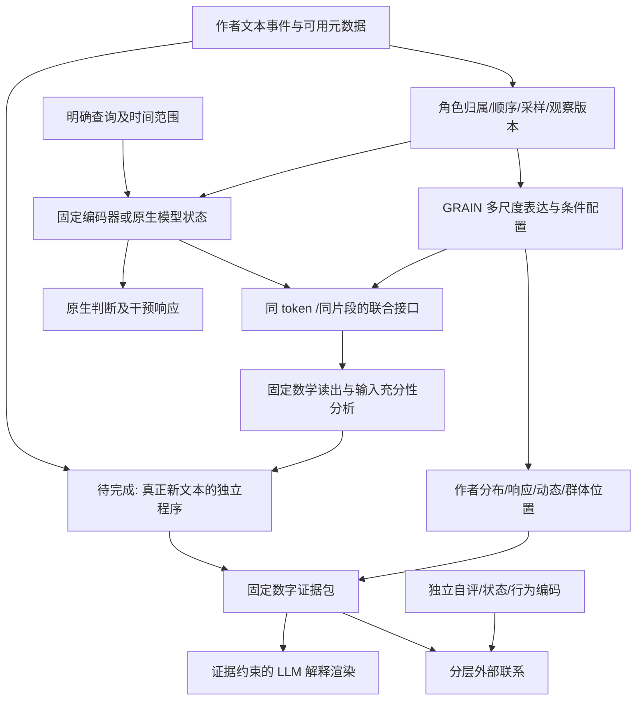

# Project Persona / GRAIN：全系统回顾与架构重建

2026-09-11。审查快照：独立仓库 `de6fcfa`；父仓库 `203f5cc`。
本次是整理、文献研究和规划，没有新实验。运行 goal 为 PAUSED；NEXT91 未执行。
本文替代“只读最近一张结果表就决定下一步”的工作方式，不改历史封印或结果。

配套：[文献与引用链](GRAIN_COMPLETION_LITERATURE_MAP_V1.md)、
[终局计划](GRAIN_COMPLETION_PLAN_V1.md)、[Claude 审查包](GRAIN_COMPLETION_REVIEW_PACKET_V1.md)。

## 1. 我们究竟在完成什么

项目的终极方向是**从作者的自然语言材料形成有心理意义、可计算、可解释的个体推论**。
GRAIN 是这种测量的基础方法，不是要求现有 PANDORA、Essays、X 或 MEPS 立即组成一份临床量表。
新近的向量路径研究增加了第二个要求：找出 LLM 从材料形成特质判断的计算关系，
尽可能把有用部分变成不依赖生成式推理、最终不依赖 Transformer 运行的数学程序。

因此有三个不可互相冒充的成果：

| 成果 | 最终交付 | 不能用什么代替 |
|---|---|---|
| 测量基础 | 定义作者对象、条件、参照、误差、状态与较稳定差异，给出制作步骤 | 仅仅得到一个分类器 |
| 推论机制 | 材料、查询、内部计算与输出之间可检验的作用关系 | 高拟合 r 或漂亮的梯度图 |
| 独立推论 | 新文本进入固定程序，输出可追溯分数及外部关联 | 预先缓存 LLM 隐状态后称“完全脱离 LLM” |

语言中的心理信息可以低维，也可以分布式、非线性、与情境相互作用。
这不是必须先找到若干可命名轴才能开始的项目，也不是只研究文本格式的项目。
Big5、MBTI、自评状态和独立行为编码是不同的外部连接，不是同一个真值。

## 2. 开发过程：保留了什么，修正了什么

下面按思想转折整理，不把版本号当证据等级。历史数值来自已有报告，
本轮核对文档来源但没有重算全部历史数据。详细原始入口见
[九月五日回顾](GRAIN_PROJECT_RETROSPECTIVE_20260905.md)与
[理论路线索引](SUICA_THEORY_ROUTE_INDEX.md)。

| 开发段 | 原问题与尝试 | 留下的结果 | 对后续的改变 |
|---|---|---|---|
| 官方人格预测 | 用户聚合、LoRA、Big5 官方五折、MBTI 分轴 | 早期 Big5 pooled r=.1005；200-iter MBTI balanced probes 近机会水平 | 训练合规、解析成功、预测能力必须分开；不再把 LoRA 当唯一入口 |
| 表示优先 | TF-IDF、稠密表示、小回归头 | PANDORA 历史比较 TF-IDF .184、BGE .148、生成 LoRA .100；迁移中 BGE .153、LoRA .109 | 文本表示与读出方法比强行 JSON 生成更适合独立研究 |
| H2 桥接 | 同文双头、真实同人跨量表结构 | 修正后 MBTI bal=.5015，结构相关=.5621；个体一致性 AUC=.5263、p=.1022 | 群体结构恢复不是个体测量精度；Big5/MBTI 非 bridge 训练，bridge 评估 |
| 合成机制世界 | 人为控制风格、人格标签、噪声与组合 | 合成高精度可由主题/模板取得；v3 合成向真实迁移约 .026/.041 | 玩具世界用于区分机制与反例，不拿合成高分代替真人证据 |
| 反复降噪 | 删除主题、残差化、稳定性选择等 | 删除部分“噪声”同时删除作者信息 | 主题/情境不是默认应删除量；作者选择本身可能含信号 |
| Flat MCD，成果1 | 条件相对位置、选择偏移、局部表达特征 | 官方预计算协议 NP .292628→NP+MCD .318090；配对 pooled OOF Δ=.023608，CI [.013005,.034031] | 保留条件并比较响应，而非整体清除条件 |
| H/V-HMCD 与切片 | 多尺度、局部因子、递归分区、作者评分 | 层级并不总改善预测；可比较结构与可命名轴是不同对象 | 不把更深、更复杂当作进步；保留平行观察方式 |
| SUICA V3 | “皮”作为条件；自由选择 C1 与固定条件 C2 | 同群体条件固定比较有收益，tension 的 trait 解释被时间结构修正 | 方法应同时保留选择和条件内反应；状态另用合适时间对象 |
| V6 | 静态、动态、共享与未解释配置 | 静态残差同人 AUC=.614；静动共享 .585；不是已命名人格因子 | 残差不等于纯噪声；运动可能是响应算子而非公共单轴 |
| V7 | 不同切法为平行观察面、固定参照、几何对齐 | 轴可旋转而相对位置仍保留 | 无切片、分块、层级都须说明观察对象；不强制一种切法 |
| V8 / M3、M4 / 4W | 微观事件、介观配置、宏观关系；误差极限、路径与交点 | 构造出可实现的机制、层间公式与反例 | 玩具模型不是人类因果识别；where/what/who/when 是组织视角而非独立四因子 |
| GRAIN 命名与 LLM 解释 | 群体参照的语言纹理；数字计分与语言渲染分离 | 可追溯分数、材料地址、候选解释及版本化文档 | 心理解释可在计分之后发展，不能被渲染器倒写 |
| 查询条件化向量研究 | 为什么 LLM 能由上下文形成特质判断 | 找到查询选择、方向读取、配置余项、局部作用及部分独立读出 | 从无查询聚合转为“同材料在不同查询下如何被使用” |
| 最近 79 个有界逻辑包 | 对齐 GRAIN、固定函数、原生输出、输入依赖 | 相同 token 上的交叉矩与残余配置均有作用；当前矩不足以重现所有局部作用 | 下一阶段要选择充分的接口并完成端到端，不继续无限细化单一局部读出 |

**历史比较的口径提醒。** MCD 的 N/NP 是官方预计算包协议；N 不能冒充重新训练的完整 word+char 文本复现。
该报告 N=1402、NP=1386，与旧 prepared 1401 不是同一人群。`.318090` 是折汇总均值，
其配对 OOF 增益也不是简单相减得到的 `.025461`。清洗协议的结果属于另一张表。
Hybrid 的 AUC=.6156、结构=.7757 还涉及 E5 Big5 头；不能把全部结构提升归给 MBTI 混合权重。

## 3. 现在系统从输入到输出是什么

### 3.1 输入与观察层

基本单位是带作者和事件地址的文本，不是匿名句子向量。记录角色、来源、
事件顺序、真实时间（有则保留）、机会条件、语言、采样方法和是否存在 AI 协作。
无时间戳可以研究文内顺序，不能编造跨日变化。引用、AI 发言、当事人叙述与
假设性描述不能都当作作者的实际行为。正文泄漏清洗是特定 benchmark 的版本，
不是把所有原始表达永久删除。

### 3.2 GRAIN 作者对象

现有基础理论将选择、表达分布、条件响应、动态和互动分开记录。用统合记号：

\[
\mathcal A_u=(\pi_u,\mu_u,\mathcal R_u,\mathcal K_u,\mathcal C_u,\mathcal P_u),
\qquad m_u=\Psi(\widehat{\mathcal A}_u;P_0,\mathcal O,\mathcal C_0).
\]

这里 `P0` 是固定参照总体，`O` 是观察协议，`C0` 是冻结的校准规则。
作者位置不是“这一批人临时标准化”的结果。动态可以用条件响应算子表示：

\[
w_{u,r,t}=\mu_{r,t}^{\mathrm{opportunity}}+a_u+B_u z_{r,t}+g_{u,r,t}.
\]

这个式子定义了待区分的对象；仅有一个人在一种条件中的文本时，不能唯一分离所有项。
同样的低频波动也可能来自时间状态、选择或机会。现有理论允许这些对象先作为
可计分特征存在，再研究心理意义，不要求今天将每项强行命名。

### 3.3 查询与功能层

对文本 `X` 和查询 `q`，原生模型是 `F_q(X)`；固定中间层状态为 `H_q(X)`；
抽取的数学函数为 `f_q`。项目中的 P/Q 是特定实验的状态槽名，
**不自动等于 Transformer 标准注意力 Q/K/V**。

三个目标需要分别验证：`H` 中有信息、`f` 能读到信息、原生 `F` 确实使用信息。
近期局部读出的一种形式是 `s_q=e_q(H)^T r_q(H)`，证据与读取方式都能随上下文改变：

\[
Ds_q[D]=r_q^\top De_q[D]+e_q^\top Dr_q[D].
\]

只拟合分数而遗漏第二项，会错过“相同文本被不同上下文重新读取”。
跨 token 作用则可以由混合二阶导数刻画。导数是固定函数的局部性质，
不是作者大脑的直接计算记录；有限文本修改还要由路径积分或端点实验连接。

### 3.4 两条线真正相接的地方

同一正文有 token 隐向量矩阵 `B` 与 GRAIN 地址上的分数 `G`。
当前压缩接口记录均值和交叉矩：

\[
\phi(B)=\left(\bar B,T^{-1}\widetilde G^\top B\right),\quad
A=[\mathbf1,\widetilde G],\quad P=AA^+.
\]

冻结 `G` 时，`ker Dφ={D:A^T D=0}`。对原生局部梯度 `J_q`：

\[
J_q=PJ_q+(I-P)J_q,\qquad
\langle J_q,D\rangle=
\langle PJ_q,PD\rangle+
\langle(I-P)J_q,(I-P)D\rangle.
\]

分解发生在 token 索引方向，不是随意删除 embedding 的几个坐标。
它已经证明“某些局部读取不能只从当前 GRAIN 矩获得”，同时证明当前矩保留
一部分有用作用。完整编译程序另有 token 证据输入，不能被误说成也只依赖 `φ`。

这是用户“同一文本的两个侧面”目前最具体的实现：
**GRAIN 组织被观察的表达配置，查询函数决定这些配置如何成为某种推论的证据。**
两者可以共享、互补、重叠、抵消；不预设一定简单相加。

### 3.5 输出层

应输出五类互相链接但不混算的东西：固定参照分数、条件/时间范围、
模型功能与材料作用、独立效标关联、证据约束的解释。
LLM 可以整理解释，但不根据“听起来像谁”修改数值，也不自行新增临床诊断。
若输入不足，应返回可解释的支持范围，而不是默认正常人格或零状态。

### 3.6 不能被最近路径实验遮住的旧理论层

[4W 理论](SUICA_4W_PERSON_INTERPRETER_THEORY.md)并非早期已丢弃的比喻。
`where` 研究进入/回避/返回什么机会，`what` 研究条件内表达，`who` 研究相对群体的
可复现偏离，`when` 研究状态、顺序、恢复与历史。这四者相互依赖。
例如条件选择可以递归写成

\[
\pi_u-\bar\pi=\sum_{l=1}^L[m_l(u)-m_{l-1}(u)]+r_L(u).
\]

“A+B”和“A+C”、继而“A+B+D”和“A+B+E”，对应固定父群后的新增偏离。
这是层级条件信息，不是只因稀有便称为identity；终端余项也可以仍有可复现结构。
旧 T1 提供了探索性见证，后续审查限制其心理解释。终局包继承完整链条，
不只取第一次高AUC，也不要求将连续尾部切成无限个人类型。

微观动力学在[统合理论](SUICA_UNIFIED_THEORY_SYSTEM_V8.md)中用事件核组织：

\[
K_u(ds',dc,d\xi\mid H_t,s,o).
\]

它包含状态转移、条件选择和表达事件；分布、响应、时间、互动、高阶路径是五类机制，
不是五个人格因子。流动、恢复、耦合、滞后等是这种条件过程的不同观察，不是必然公共轴。

进一步的关系层为 `J_s=L_s({A_u})`，宏观层为 `Γ({J_s,ω_s})`。
作者向量、两人关系和总体关系场是三种对象。切片/汇总改变同一对象的分辨率；
把作者提升成关系则改变对象类型，不能都笼统称“降维”。
群内/群间、构成权重、时变耦合和相互抵消因此能被分开讨论。

旧 M4 还留下一个具体失败结果：仅凭预响应支持特征的自动路由，没有可靠识别
哪个变换对某个新单元有利。终局计划不能重新把“覆盖率够高”当万能使用许可。
应保留设计层面的适用范围、源内校准和敏感性比较；未知场景不靠事后调阈值保证成功。

因此当前全系统并不是“4个GRAIN分数加一个神经读出”。最近四坐标实验只是
整个观察器的一张局部图。完整理论仍包括**选择、条件表达、作者分布、动力算子、
互动关系、分辨率残差、群体参照及查询解释**，终局复建必须逐项标明它们的实现状态。

## 4. 当前证据最值得保留的部分

| 现象 | 数字与范围 | 推进价值 |
|---|---|---|
| 真人文本修改能够被固定函数部分追踪 | 旧 12 名 source-disjoint、已反复分析的作者，删除响应 r=.886 T/F、.681 N | 有一条可开发的材料→函数→原生响应通道 |
| GRAIN 与查询具有局部配对结构 | 已暴露源材料中 O/F03 配对与自评 r=-.272；错位 .044，幅度乘积 .009 | 关系不只在各自平均分，也在同材料的配对配置 |
| 某些配置联系外部自评 | T/F 配置 r=.305，AUC=.678，CI r=[.064,.510]，探索性 BH q=.058 | 人格关联存在可研究对象；不是所有查询同样有用 |
| 拟合模型并不保证保留外部联系 | 一组既有 T/F 比较：原生 r=.348、固定函数 .201，即使功能拟合较高 | 独立程序需同时保留判断机制与人类效标，不只模仿教师 |
| 当前 GRAIN 矩有任务相关覆盖 | NEXT90 新8的 N/确认作用投影：均值 .054/.057→当前矩 .451/.327；源4仅 .008/.051 | 接口有作用，但覆盖随材料变化，不能用一个全局百分数描述 |
| 剩余配置仍有共享与特定读取 | 同一新8的余项查询余弦 .656；共同/差异能量 .777/.223；F03 有反向抵消 | 不应删余项或统一正加权；需要研究条件内向量配置 |

来源：[自然修改报告](../reports/grain_vector_mechanisms/NATURAL_TRANSPORT_LOGIC_REPORT_V1.md)、
[配对几何](../reports/grain_vector_mechanisms/MATERIAL_GEOMETRY_LOGIC_REPORT_V1.md)、
[效标报告](../reports/grain_vector_mechanisms/CONFIGURATION_CRITERION_LOGIC_REPORT_V1.md)、
[最新矩核报告](../reports/grain_vector_mechanisms/JOINT_MOMENT_NULLSPACE_REPORT_V1.md)。
最后三种比例/余弦不是人格预测准确率，也不是人格方差解释率。

## 5. 为什么 loop 有进步，却离“结束”没有相应接近

首先，目标经常在“理解原生 LLM”“提高其局部替身”“解释真实作者”之间切换。
每一种都产生真实结果，但第三种不会因第一种进行了很多轮而自动完成。

其次，许多后续包继续分析同一批少量作者、同一层隐状态和同一组干预方向。
这适合机制开发，却不提供等量的新适用范围。79 个包不是 79 次独立总体检验。
单次运行有上限也不足以控制总方向；几十个有界小循环仍会组成无界研究。

第三，数学恒等式逐渐完善，但端到端输入依赖没有同步移除。
一个 H16 上的精确公式仍需要产生 H16。一个含自由余项的式子总能配平，
但不能据此说已经解释了余项的来源。

第四，文档形成了叠加而非收束。README 的“Latest”仍指较早的第15轮，
实际总账已到79轮；父仓库 AGENTS 保留四月训练阶段的说明。
历史资料有保存价值，但导航必须明确当前入口，不能让旧计划重新变成任务。

第五，项目缺少统一的**现象清单、终点清单、完成裁决**。
下一个实验总能提出，研究何时完成却未被同样严格地定义。
本次计划用有限的工作包覆盖既有31条逻辑边，先审查再执行。

## 6. 现在真正的缺口，不再按新因子数量计数

1. **现象→机制**：哪些观察需要同一个机制解释，哪些只是共用坐标？有哪些竞争解释？
2. **压缩→充分性**：要保留 token 配置到什么层次，才能完成目标读取，而非重建全部语言？
3. **局部→完整**：选择、方向、交互、基线和有限变化能否由同一函数实现？
4. **隐状态→新文本**：两个独立实现路线还各依赖什么模型？成本与遗漏信息在哪里？
5. **模型判断→人类差异**：模仿收益和效标收益在哪些因子一致，在哪些分离？
6. **静态→状态**：作者水平与真实时间变化能否在有相应观测的材料中分别计分？
7. **计算→解释**：解释来自哪些材料证据、哪些独立编码，如何避免循环命名？
8. **一批材料→可复现方法**：他人能否在新资料上重建，而不依赖我们的历史缓存与口头知识？

理论上的重要边界是：**观测等价的机制可能不唯一**。因子旋转、不同网络或不同生成过程
可以产生相同统计关系；需要额外条件或干预才能进一步区分。
这不是放弃，而是把最终对象从“宇宙唯一心理公式”改为具有明确识别条件的测量方法。
相关依据及不能直接搬用的假设见配套[文献比较](GRAIN_COMPLETION_LITERATURE_MAP_V1.md)。

## 7. 本次回顾的结论

我们已经积累了**条件化测量、分布式作者结构、查询条件化读取及两者的同材料接口**，
不是仍在起点。最值得发展的核心是：群体参照的表达配置，如何通过明确查询成为
某种心理推论的可计算证据。

下一阶段不应再以“又多一个解释项”为交付，而是做出完整的、可复建的
“文本→配置→查询作用→个体读数→独立解释”实例，并给它的适用条件和失败条件。
临床量表的实际开发与效用试验属于后续应用项目；当前基础研究的必要接口不能因此省略。
