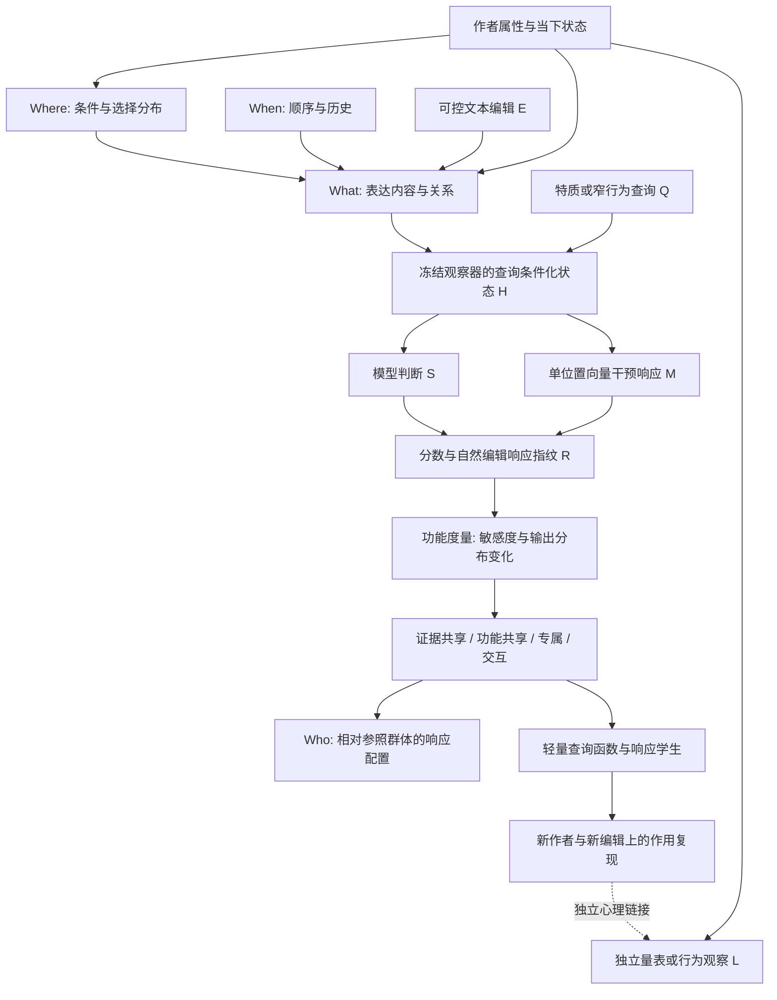

# GRAIN：两次数学研讨会的统一论证网络

2026-09-08。定位：自然语言人格解释方法的理论开发，不是完成新量表，也不是
用数学名称包装文本分类。由Codex与Claude两次研讨会、每次两轮交叉讨论形成。
第一次数学报告见`reports/grain_vector_mechanisms/MATH_SEMINAR_20260908.md`；
第二次讨论、纠正及算例见`reports/grain_vector_mechanisms/MATH_SEMINAR_II_20260908.md`。
新增文献的条件与适用位置见`GRAIN_MATH_SOURCE_MAP_V2.md`，下文S01等对应该表。

## 1. 用户主张如何变成可研究命题

主张不是“任何文本都能精确推出全部人格”。它是：真实语言中有作者相关证据，
LLM能将其中某些证据组织成有心理关联的判断；这些计算发生在向量关系中，
可以追踪、比较、数学化，再尝试由轻量系统复现。

小特质可以有自己的查询和证据，不必先并入Big5/MBTI。不同特质可能共享部分
证据、转换或读出，又保留专属作用。topic/situation既提供表达条件，也可能
是作者的选择结果；不能预先整体删除。群体参照服务作者差异的组织与计分，
不把群体同构误认成个人心理相同。

哲学上的最小推进单位是**一个可辨别的作用关系及其适用范围**。不是每轮
必须发现一个命名因子，也不是每个替代解释都清零才允许继续。

必须拆开的三个命题：

1. 输入到输出存在函数：确定计算系统天然如此，单独这一点不是突破。
2. 该函数具有可复用、可组合、可压缩的规律：这是当前机制主问题。
3. 这些规律连接真实作者的心理属性：已有D1提供部分关联，后续独立连接扩展。

数学化不等于去掉语义。向量保留的仍可能是角色、事件、关系与语境信息；目标
是省略语言化推理过程，而不是宣称语义对人格判断无用。

## 2. 一张总图，而非一个包办所有层次的公式



图中U是工作模型中的潜在对象，不是已经识别出的真实潜变量。因果地位不能
由一张图保证。F->L的连接与教师机制的复现分别检验，不循环互证。

| 层次 | 数学对象 | 主要问题 | 不能替代的下一层 |
|---|---|---|---|
| 材料 | 作者的联合/条件文本分布、序列 | 选择了什么，在什么情况下怎样说 | 不凭语言相似自动命名心理特质 |
| 计算 | 查询条件状态、响应函数、干预 | 哪种证据经哪个状态改变判断 | 静态分数拟合不等于同机制 |
| 几何 | 度量、对偶、等价类 | 怎样比较在不同坐标中相同的作用 | 几何同构不等于同一作者/构念 |
| 统计 | 共同/专属/组合、作者参照 | 哪些规律能跨人复用，哪些因条件变化 | 样本相关不自动给唯一生成潜因子 |
| 心理连接 | 作者级量表与行为关联 | 该函数实际测量了哪方面特性 | 这不是检验所有内部计算细节的入口门槛 |

## 3. 现有数据给理论的支点

| 证据 | 已观察到什么 | 指向的机制问题 |
|---|---|---|
| D1 | 213 Big5-only native mean r=.1993，E5=.1372；2328 MBTI-only native TF AUC=.6600，E5=.7542 | 同一文本不同访问方式各有所长，不必用单一“模型优劣”解释 |
| D1 N | native r=.2244，E5=.0417 | 查询组织可能取到了现有统计读出没取好的信息 |
| D2 | 选中评论/完整文本native分数作者r：TF .6104，N .8193 | 证据可集中；这是native-to-native一致性，不是E5人格预测成绩 |
| D4 | 位移rank8算子留作者响应r=.5314/.5584 | 已有低复杂度响应规律；预测目标是干预响应，不是问卷 |
| D3B | 32新作者共享响应r=.3917/.3694，MSE/zero=.8699/.4987；GRAIN条件项未改善MSE | 简单共享算子可复用；旧增益参数化不是个体条件机制的最终答案 |
| 跨查询几何 | TF/N位移overlap=.2724、功能cos=.0895，作者群不同 | 几何共享与功能共享需要同人同编辑分开验证 |

所有数字沿用当前已完成的aggregate报告，本次没有重跑它们。旧V-HMCD/SUICA
结果保留各自协议；本次未复核的历史MCD分数、P1读写对齐数字不混入此表。

## 4. 可以织在一起的数学关系

### 4.1 功能指纹与可识别性：不必执着唯一的一根轴

固定观察器、Q、E和材料范围，定义

\[
R_{Q,E}(x)=\{s_q(x),\ s_q(E_jx)-s_q(x),\ M_{qj}(x)\}_{q,j}.
\]

两个输入若在这些读出与干预下相同，就属于当前观察器的同一功能等价类。
增加查询或编辑会细分这个类。这是关系的定义，不是“所有同类人有同人格”。
近似距离还须声明查询权重、尺度和材料分布，不能把不同量纲任意混加。

局部查询Jacobian J_Q的核，只表示这些查询的一阶不可见方向。新查询、有限
干预或高阶交互都可能让它重新可见；所以“本次看不见”不自动等于永久噪声。
这给用户“未发现的小特质可能在残差里”的主张一个精确位置。

因果抽象要求高低层模型在声明的干预对应下保持计算关系。[S06,S07]
采用响应等价是一个可操作目标；完整内部机制仍可能比指纹更细。

### 4.2 信息几何：从“近”到“造成相似变化”

令p(h)=softmax(z(h))、J=D_h z，输出KL的局部二次型为

\[
G(h)=J^T[\operatorname{diag}(p)-pp^T]J,
\quad D_{KL}(p(h)\Vert p(h+d))=\tfrac12d^TG(h)d+o(\|d\|^2).
\]

G提供由行为定义的局部几何。它将上次的g^T d、CoBRAS状态/梯度平衡，与
新发现的读写对偶接起来。[S01–S03] a是测量协向量；在G正定时，使a^Td=rho
且局部输出变动最小的操控方向为

\[
d_*={\rho G^{-1}a\over a^TG^{-1}a}.
\]

G奇异时需range条件与伪逆，或显式正则。共同公式不要求共同欧氏轴；换坐标
时d'=Td、a'=T^{-T}a、G'=T^{-T}GT^{-1}，实际作用仍可保持。
输出p的范围必须声明：仅用二候选归一化概率时Fisher至多rank1，不能据此
还原丰富的多构念几何。全词表/多读出的度量更丰富，但不能忽略计算成本。

“给LLM写入persona”和“从真人读出特质”由此可以研究是否有读写对偶关系，
而不把二者当作逆函数。Bayes反向还依赖人群先验、条件及真实文本生成分布；
模拟persona文本不能直接提供真人的全部似然模型。

### 4.3 群论与条件：不变性是要发现的对象

对候选连续动作V，标量函数沿它的变化为Lie导数L_V f=Df[V]。
对称性发现寻找哪些有意义动作近似保持f，等变性则允许输出随动作有规定变化。
[S04,S05] 它比“先删topic，再看剩什么”更接近用户原意。

需严格区分：坐标换基、网络参数对称、真实文本编辑。删除不可逆；self/other
交换、否定、时间关系改变可能直接改证据，不是默认不变群。若对单向量强制
整个GL(d)不变，所有非零向量同轨道，区分作者的能力反而消失。
我们先研究有限、可解释的动作，不强行把离散文本塞进连续Lie群。

### 4.4 共用与专属之外，加入组合贡献

对m个固定证据单元的保留/移除指示sigma∈{-1,1}^m，任何有限实值响应都可
写成Walsh基展开：

\[
v_q(\sigma)=\sum_{A\subseteq\{1,...,m\}}c_{q,A}\prod_{j\in A}\sigma_j.
\]

有限展开存在是代数事实；“只有少数低阶项足够”才是待测压缩假说。现实评论
相依，不能把均匀掩码空间的正交性当成自然文本分布中的心理独立。
第一步只测两证据包的混合差分：

\[
I_{12}=s(E_1E_2x)-s(E_1x)-s(E_2x)+s(x).
\]

I非零先命名为响应交互。它可能来自证据组合、注意力重新归一化、读出非线性、
长度/位置变化，不直接叫语义协同或Lie非交换性。PID与Boolean分析提供结构
思路，四格数据和后续定位决定它属于哪一层。[S12–S15]

跨量表相关还多一条必须分清的路径：若共享特征z经两个线性读出得到s_q、s_r，
则Cov(s_q,s_r)=a_q^T Sigma_z a_r。读出方向的共享、输入特征的协方差，以及
共享的非线性转换都可能贡献相关；a_q与a_r欧氏正交也可产生相关。因此不能
把量表相关直接等同于路径重叠。S1用同人同编辑研究作用关系，再另接心理量表。

### 4.5 作者是分布/路径，不只是一个平均向量

保留P_u(C)、P_u(X|C)及有序联合分布，能同时表示Where选择、What表达和When。
用特征核时mu_P=E[k(X,.)]可唯一表征总体概率分布；有限均值/PCA没有这个
一般保证。[S16] 核距离、landmark和GRAIN群体参照可表达Who的偏离位置。
核袋子仍丢顺序；历史/次序需要联合序列或前次研讨的路径工具另保存。

“群体上同分布”也不是同人配对。无约束GW匹配可以重排身份，只能作坐标/分布
比较，不能替代同作者心理链接。[S21]

### 4.6 共同公式怎样收敛成轻量学生

比较逐级追加信息的学生，不先认定内部只有一种算法：[S17–S19]

```text
共同向量聚合 + 查询读出
  -> 查询条件化证据聚合
  -> 分布/条件信息
  -> 少量证据交互
  -> 必要时历史或局部非线性
```

按作者交叉拟合，分别比较s与自然编辑Delta，保留旧Sobolev式响应学习损失。
对于同一平方可积目标Y与嵌套信息F_l，条件期望m_l=E[Y|F_l]满足
E[(Y-m_l)^2]-E[(Y-m_{l+1})^2]=E[(m_{l+1}-m_l)^2]。
这是新增信息的函数增量，不是有限样本模型必须单调改进的承诺。

固定编码器Z若丢了目标所需信息，最佳平方损失也有E[Var(Y|Z)]这一界。
若轻量学生效果不足，应区分编码器信息损失、样本不足和函数类别不足，再决定
换表示还是加机制；不能一次失败就宣称必须依赖完整LLM。

### 4.7 与早先动态、残差工作的连接

前场的Mori-Zwanzig思想提供一个直接的数学示例：压缩掉的状态可以重新表现为
记忆和初值项，而不只是独立随机噪声。在线性分块系统
`x_(t+1)=Axx x_t+Axz z_t`、`z_(t+1)=Azx x_t+Azz z_t`中，消去z后精确得到

\[
x_{t+1}=A_{xx}x_t+
\sum_{j=0}^{t-1} A_{xz}A_{zz}^{t-1-j}A_{zx}x_j+
A_{xz}A_{zz}^{t}z_0.
\]

这是有限线性系统的代数消元，不假定LLM本身满足该线性方程。它说明为何
只看当前均值的模型可能留下有序历史结构；同端点不同顺序则可由路径迭代积分
等工具刻画。先前发现的动态性质不被新读出研究抛弃，而是成为学生残差的
一种具体解释候选。有顺序依赖的剩余作用才引入记忆模块。

AJIVE处理同作者多块的共同/专属变化，PID/Walsh补组合关系，tensor分解可
继续表达作者×查询×编辑的多路结构。这些对象互补，不将任一分解的秩自动
命名为心理特质数量。前场因条件不足而暂缓某工具，是设计选择，不是其不可能性。

## 5. 八个工作假说与区分实验

支持/反对指向限定的模型或关系，不是对整个人格理论一票否决。

| 假说 | 目前支点 | 竞争解释 | 最小判别与结果分流 |
|---|---|---|---|
| H1 存在可复用的低复杂度响应规律 | D4/D3B | 位移最大方差足够 vs 功能导向更重要 | S0同输入作者CV：监督方向更好则升级；相当则保留简单式，进一步问梯度而非加秩 |
| H2 查询不只改答案词，也组织证据 | D2选择/对照差异 | 共同聚合+不同读出 vs 查询条件化聚合 | S2在同一编辑上比较两类学生；不同归因模式本身只描述现象，必要时再局部交换验证 |
| H3 大小特质有部分共享作用 | 不同任务已有响应，旧几何只是线索 | 证据相同、功能相同、输入相关三者可分 | S1同人同编辑：分别报告证据剖面、带符号响应、作者配置；据结果决定共享哪一层 |
| H4 弱单元可通过组合起作用 | 数学反例直接成立 | 状态组合 vs 读出/归一化非线性 | S1的24次联合编辑，结合状态混合差分和分数交互；有作用才细分评论，无则优先加性学生 |
| H5 persona写入与自然读出有可迁移对偶关系 | 第一轮提出、未在当前包测得 | 真正功能对偶 vs 仅答案通道方向 | 后继固定小面板比较欧氏与输出几何、自然证据响应；按实际作用而非对齐好看推进 |
| H6 条件/choice保留能帮助作者级功能组织 | GRAIN设计；旧gain参数化未获增量 | 条件解释响应差异 vs 当前查询不使用该信息 | S0/S2复用landmark/条件分布增量；未提升则保留独立通道，不据此删除所有topic信息 |
| H7 响应规则能由固定编码器学生复现 | 内部状态算子有效 | 固定表示足够 vs 表示或函数还缺机制 | S2值损失与响应损失比较，留作者/未拟合编辑；定位最有用的新增信息层，而非无限调参 |
| H8 复现的功能保留真实心理关联 | D1部分查询已有外部关联 | 保留了作者关联 vs 主要保留模型特有偏好 | 学生结构确定后，用授权source OOF链路作独立连接；不打开bridge/MEPS问卷或旧lockbox |

对H4额外保存原状态、两单编辑状态和联合编辑状态，可算
d_12-d_1-d_2及g^T(d_12-d_1-d_2)。它定位表示层非加性，不单凭它命名认知组合。
对H3除总体相关，还要看去掉编辑cell共同均值后的作者差异，避免所有人都对
E1响应强制造出“共享作者结构”。

### 最新证明贡献的是怎样找结构

| 证明思路来源 | 对本项目的研究动作 | 与定理本身的关系 |
|---|---|---|
| Wang-Zahl/Guth的Kakeya多尺度结构分析 | 聚焦全局式解释差、局部却重复的case簇；由粗到细找造成近极端响应的共同条件 | 不把高维文本视作三维Kakeya集合 |
| Gowers等的Marton熵距离下降 | 每加入条件/交互/历史，给出明确函数增量与响应误差变化 | 用本项目条件期望恒等式作直接骨架，不移植有限群结论 |
| Huang的超立方体谱/组合方法 | 用编辑布尔格寻找低阶解释遗漏的组合项 | 先测四格，不由实值平均敏感度推Boolean最大敏感度定理 |

前两项一手来源和阅读位置见第一场报告的第8–10条；Huang对应本页S14。
这些策略使搜索有方向，不要求先借到一个
能包办GRAIN的现成大定理。

## 6. 两次研讨怎样真正改变下一包

**保持S0→S1→S2主干，不新开八条长队列。**

1. S0：既有96作者全部开发用途，比较SVD/full-Ridge/PLS。编辑前后E5特征齐全
   时附轻量学生/分布先导；缺字段就记下并交S1补齐，不拿总均值冒充编辑向量。
2. S1：旧24作者×2视图×3查询，先8人资源试跑；在8人一个视图的3查询上补
   E1+E2联合自然编辑24次。包含原6次重复/自替换检查，总750F+144B。
   与原60分钟预算共享上限，不因新增项延长长跑。保存联合状态无需额外forward。
3. S2：同时保留分数与响应指标、shared与query-conditioned两种学生、低阶交互
   的最小对照。新窄特质先操作化行为查询，心理名字由后续证据支持。

不默认抓取完整attention矩阵：输出attention可能迫使后端变化并带来O(T²)
内存，且权重不同本身不识别不同算法。已有廉价统计可以保存；需要head级
交换或Fisher面板时单独写成本，不把数百VJP算作一次免费反传。

S0–S2的当前任务是发现功能关系，预测问卷只是独立连接，不因暂时没有新量表
标签而阻止研究。完整执行字段仍见`GRAIN_FUNCTIONAL_PATH_NEXT_PLAN_V1.md`，
本页仅覆盖新增的理论定义、假说与24次预算变更。

## 7. 需要保留的开放空间

选择数据中有辨识力的少数操作，不是提前证明万能不变性。iVAE、Schur、BBP
等帮助我们理解“何时能识别”，不制造六条件最多两因子、低谱全是噪声等上限。
SFRL/sheaf适合已有多局部空间需要拼接时再用；不是现在先造拓扑网络。[S08–S11,S20,S22]

目前最有希望的理论升级，不是从少数人格轴跳到更多人格轴，而是建立：

**条件化证据分布 → 可操控的功能响应 → 共享/专属/组合结构 → 群体参照下的
作者配置 → 可复用的轻量查询函数。**

每一箭头都有清楚的对象、当前证据和下一次能改变方向的观测。这就是这阶段
“哲学扎实”的可执行含义，不是先宣布理论永久无漏洞。
