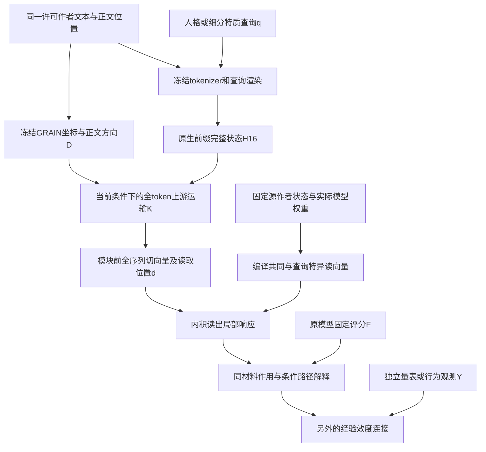

# 从同一文本到GRAIN方向与查询响应：完整机制接合图

2026-09-10，NEXT48之后的主线归位。用户的终点仍是作者文本中的可测差异
如何导向人格相关推论；不是为某个模型层无限追求更高重现相关。

## 1. 现在实际连接的对象

GRAIN给D的是一组可比较方向，查询机制回答这些方向怎样影响固定模型的
推论。相同材料是接口；不是把两系统分数随意相加，也不是二者相关就自动
说明某个GRAIN因子是某一人格特质。

## 2. 哪一段已经能直接算

| 环节 | 本轮可用能力 | 保留的实际依赖 |
|---|---|---|
| 原文到固定GRAIN测量 | 既有坐标、参考总体和token地址 | 固定编码器与评分契约，未在本轮重训 |
| 轻量原文推论分支 | 已有E5、四层context和条件读法，见完整依赖台账 | 是独立候选，不等于最新H16/JVP机制已经全部迁入 |
| H16共同正文方向 | 相同BODY/GRAIN方向接两查询，位置明确 | 原模型前缀、查询位置与保留状态 |
| MLP25局部响应 | 源固定伴随向量内积，跨查询可借用 | 当前上游d，不仅是原始GRAIN四个分数 |
| MLP24局部响应 | 共同v加查询差异v，new8总对比r约.977 | 当前上游d；源构造用实际模型权重/状态 |
| 上游attention选择与写入 | 末端固定query情况下K/V解析式已有实测 | 中途query切向量可能非零，需要Q/K/V完整展开 |
| 局部响应到完整评分 | 局部一阶作用、部分有限路径与独立条件评分已有实验 | 一个局部导数不能替代整个非线性端点；F与人类Y分开 |
| 心理辅助解释 | 同原文地址、固定数值、候选解释与人工核对 | 不把模型内部通道直接命名为精神分析或交流分析构念 |

## 3. 不把三个问题揉成一个问题

1. 数学作用：固定模型实际如何使用给定文本方向？目前逐段已有直接证据。
2. 轻量提取：哪些当前模型计算可以由固定源函数代替？MLP24/25取得局部
   进展，当前全序列传输K仍是最重要运行依赖。
3. 人格意义：这些测量/推论与作者何种量表、行为相关？已有历史外部联系，
   本轮不新增Y相关，也不拿模型响应r代替人格相关。

原来的P/Q重构与直接数学读出两条路线均保留。P/Q是早先定义的状态地址；
attention中的Q/K是网络内部投影，符号相似不代表一个对象。所有公式接合
必须使用相同层、位置、输入单位与目标，不从最后位置推断整个token系统。

## 4. 下一步只解决一个上游机制问题

attention22在旧NEXT45中对最终运输对比的有符号投影：new8自身+.290940，
source4自身-.035430。这只是定位线索，不能解释为特征重要性比例。
NEXT49在此处完整展开三种切向响应：query变化、key变化、value变化。
固定读头、固定方向、不挑头不拟合。查明传入的GRAIN差异究竟改变了
“关注什么”还是“搬运什么”，并把三项与原生完整向量相加核对。

本轮结束MLP24细调。NEXT49成功后，根据实际通道证据选择一次上游读法
提取或一次完整链路集成；若三项只是分散小项，也保留完整解析式，回到
原文级接口，不追加所有层所有头的无边界网格。

参见[完整输入契约](GRAIN_CONDITIONAL_INPUT_DEPENDENCIES_V1.md)、
[NEXT49执行计划](GRAIN_UPSTREAM_ATTENTION_CHANNELS_PLAN_V1.md)和
[同材料心理解释接口](GRAIN_SAME_MATERIAL_INTERPRETATION_THEORY_V1.md)。
