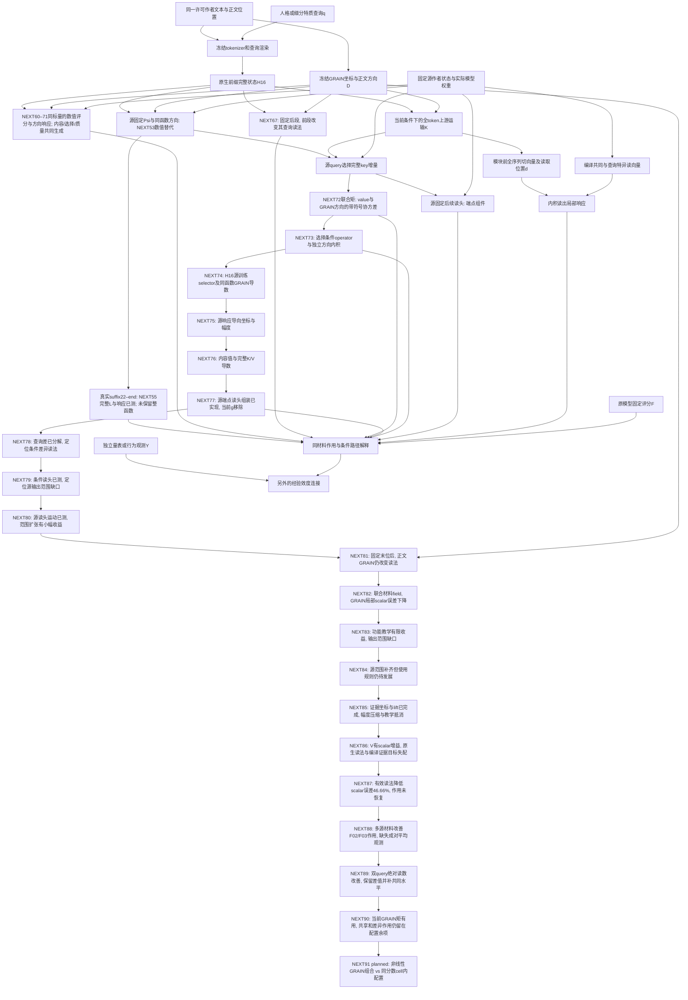

# 从同一文本到GRAIN方向与查询响应：完整机制接合图

2026-09-11，NEXT48归位、NEXT49/50/51/52/53/54/55/56/57/58/59/60/61/62/63/64/65/66/67/68/69/70/71/72/73/74/75/76/77/78/79/80/81/82/83/84/85/86/87/88补充。用户的终点仍是作者文本中的可测差异
如何导向人格相关推论；不是为某个模型层无限追求更高重现相关。

## 1. 现在实际连接的对象

GRAIN给D的是一组可比较方向，查询机制回答这些方向怎样影响固定模型的
推论。相同材料是接口；不是把两系统分数随意相加，也不是二者相关就自动
说明某个GRAIN因子是某一人格特质。

## 2. 哪一段已经能直接算

| 环节 | 本轮可用能力 | 保留的实际依赖 |
|---|---|---|
| 当前矩与query配置余项 | NEXT90新8可见GRAIN作用投影N/C从.054/.057到.451/.327；源4收益小 | 原生梯度余项仍有query共享/差异，F03有反向抵消；NEXT91区分更复杂G组合与同G内部token配置。full-L/null witness不替代完整组装评价 |
| 成对观测与共同读取 | NEXT89 N/确认局部误差低32.19%/52.58%，F02/F03成对作用低20.42%/14.05% | 新信息来自平均，原主差值因同核线性严格保留；不是自动多任务迁移。NEXT90已定位当前聚合遗漏的token配置；full-L与局部c分别定义 |
| 多源材料与有效作用覆盖 | NEXT88 source4->12，F02/F03作用坐标r从负转+.685/.554；K+V误差低5.26% | 两绝对query未共同获益，差异不决定平均；NEXT89已补十个query作用坐标。固定m也可能满足联合约束，不能误作不可能性；H16仍原生 |
| 适配当前证据的有效读法 | NEXT87同20系数换目标，contrast SSE/zero .165529->.088286；主要幅度/偏移改善 | 原生d更不像仍更可用；K+V无实质改善，confirmation变差。NEXT88增加不重合源，固定all4程序/单位；不等于完整无LLM或人格精度 |
| 教学增量与兼容读取 | NEXT86条件V/VB/VBC可执行；V的scalar误差.1652/.1665、r约.652，较NEXT84低7.35%/6.63% | K+V未改善；原生差异读头oracle误差.3999，证据与读法有误差抵消。NEXT87学习相对编译程序的有效坐标，不把单组件更准当整体必然更准 |
| 同材料的证据坐标与教学关系 | NEXT85固定/移动5坐标有scalar排序r=.700/.676，最小lift与全导数可执行；组装未改善 | 坐标不是人格因子，H16仍原生；预测幅度5.6%/6.5%，大贡献抵消且移动作用目标16-24x源尺度。NEXT86嵌套教学函数，不以系数反号为删噪声依据 |
| 可用方向与功能使用 | NEXT84扩展27->47，源目标.008343->.008276；新8scalar误差仅再低.20% | 同一控制的范围外scalar项低95.62%但总误差不变；新增场实际能量3.32e-7。NEXT85固定/移动证据坐标，保留旧场的未观测补空间；非整体L/人格精度 |
| 源功能目标与输出空间 | NEXT83同756参数，源功能拟合大幅改善，新8局部scalar误差再低.58%，K+V未改善 | 输出仅row(Y)，42.8%向量误差在外；投影后交叉项异号。NEXT84同目标扩为span(Y,R)已完成；非整体L/人格精度 |
| 同材料的可执行读头field | NEXT82三源拟合；GRAIN局部scalar误差.193610->.179712，context排序r=.684但raw误差更大 | 向量与功能误差排序不同；NEXT83同核源observable教学，不扫参数。384FD分别验证锚定偏导/对角全导数；非完整L或人类量表精度 |
| 同材料改变读取规则 | NEXT81固定完整末位后保留67.73%差异reader离差；4GRAIN正文方向均改变reader，54%-64%不在旧context空间内 | 非末位query/layout也保留，比例不是人格方差。NEXT82联合BODY/context源学习已完成；F(H;A)锚定偏导不等于F(H;H)对角全导数，不重复计算原生曲率 |
| 读法运动与同材料输入 | NEXT80源运动68.88%在旧范围外，rank3->7；新8差异reader原生证据K+V误差较条件核低5.30% | 实际向量误差仅低1.42%，常数投影误差仍略优，反向调制未恢复。典型外推59教学步；NEXT81固定完整last再变正文GRAIN，区分外推与缺少material输入，不调带宽 |
| 条件读法的输出范围 | NEXT79新8scalar对比r .577->.596，微小收益但作用误差未降；源差异范围rank3 | 78.60%向量误差在源范围外；权重改变不能生成缺失方向，非作用误差比例。NEXT80源context双向干预，开发有方向变化的reader场；不继续核带宽调参 |
| 共同证据与查询差异读法 | NEXT78源读头cos=.955仍有实质差异作用；原生scalar作者中心化投影.550/.741 | 新8GRAIN响应有反向调制-.129，固定源读头使其变正；只移植原生K/V也发生。NEXT79用当前last上下文选源差异读头，正文方向Dc=0，保持同函数；不重调上游向量 |
| 同材料数值函数的源端点接合 | NEXT77移除当前g/端点梯度，局部分数新8对比r=.545-.690；四函数均保留 | H16仍神经。响应幅度大，response/source K+V SSEzero7.288；源4分数排序负。运输/读头误差有放大交叉项，不能以各自改善推断组合改善。NEXT78分共同证据与差异读取，不调系数 |
| 内容值与观测误差几何 | NEXT76 V/dV误差下降约11%/4.5%，但固定selector总作用误差.783->.862；同函数双导数已计算 | H16数值应用移除当前V，保留g；误差由M^T M读出度量而非全空间范数决定。NEXT77重用已编译NEXT51端点reader；不继续V矩阵精度调参 |
| 源响应导向坐标 | NEXT75同rank32/67维设计，新8native-query作用对比误差1.266->.373，幅度.121->.077，r.945->.881 | 源旧导数字典约13%能量，强拟合导致巨大值误差；新映射有局部收益但source-Q幅度仍过大。NEXT76已构造V/dV；不将选择协方差误写为整个含值函数导数 |
| 源训练标量选择与响应几何 | NEXT74新8KL降25.62%/33.56%，logit MSE降40.60%/41.19%；同函数产生GRAIN dlogit | 响应排序改善但幅度高估；源joint导数残差loss约1，不能据r=.948替换旧reader。NEXT75源响应导向坐标已完成；H16/native V仍保留，不作整体人格准确率 |
| 查询引子的两种作用 | NEXT73交叉标量路径中，只换选择令新8对比反转r=-.780，只换方向仍+.905；选择对称投影86.32% | 源4约61.68%，方向和交互不删。C(Q_a)与Q_d的数值接口已实现，当前K/V/dK仍原生；NEXT74直接源训练selector势函数及兼容导数，不再刷归因 |
| 查询读取的共同配分几何 | NEXT72不拟合，联合矩重建旧key作用3.747e-16；交换引子边际value SD近似，却改变对比方向 | 源Q同时改变选择测度与d方向，尚未独立分配两者；NEXT73交叉标量路径解决。旧r=.939不是新预测提升，K/V/dK仍有神经依赖；共同函数需要signed coupling |
| 冻结读法的作用与误差分账 | NEXT71重建L/C/S/M，raw跨B仅M；新8raw改善3.602%/5.413%包含大幅反向交叉作用 | logmass的8/8正贡献是重叠计算单元，不是人格比例。C/S分别通常不可积、共同旋度抵消；NEXT72返回源查询log配分函数，不继续泛核试错。当前H16或K/V仍原生 |
| 证据质量与相对选择 | NEXT70源N归一化后GRAIN B响应误差.948326优于raw.969572；新8raw作用较local误差低3.60%/5.41% | 确认源作用不同，完整分数未晋级。平均核质量不等于全部choice；可逆摘要不等于相同线性函数。NEXT71拆内容/竞争/logmass/局部重拟合，不做归一化万能论 |
| 局部内容进入跨材料响应 | NEXT69预测B响应57.81%/53.26%能量不在旧位置范围；相同1305系数，两源拟合 | 坐标误差改善更少，确认GRAIN作用变差；新8整分数近似local。结束二次池化，下一相对选择保留logmass，区别表达范围与查询定向读取 |
| 跨材料作用的数值函数 | NEXT68源B响应误差比zero低2.67%/2.57%，四GRAIN作用低3.92%/3.84%；同一个标量保持评分和导数 | 新8无整体晋级；线性汇总二次响应严格限于常数+位置，仅容纳约3%源目标能量。下一NEXT69同参数数改非线性token汇总；不是拟合时间或alpha问题 |
| 同材料间的非局部读取 | NEXT67只改前半，未改后半梯度变化.261%/.314%，源8条件均成立；旧局部求和精确0 | 作用小但可计算；完整梯度与GRAIN投影两查询相似度不同。17原生调用/20.03秒，NEXT68用同标量二次池化开发，不再只检测非零 |
| 配对响应学习与非局部依赖 | NEXT66仅增加源归一化变化教学，源变化误差略降，源字典容量11.34%/8.66% | 新8整函数未晋级；局部token求和在固定last时强制跨token Hessian为0。NEXT67已测原生跨材料作用，回到联合证据选择而非磨alpha |
| 完整上下文几何及变化学习 | NEXT65源N配置变化r=.378->.530，2新求解/同1169参数；上下文空间外径向衰减可精确计算 | 完整新8评分未改善；配对变化能量仅.1905%/.4836%，下一NEXT66给同标量变化通道独立归一化监督，非删小信号或继续搜索核参数 |
| 条件标量的实际抽取 | NEXT64以同源干预/原始材料训练条件核与加性对照；新8方向RMSE低.757%/1.092%，配置query差r=.499 | 整体评分下降、源变化本身也仅弱恢复，不替换旧模型。源4标准化context恰成等距单纯形，源3维只覆盖新8位移9%/11%；下一NEXT65测试完整上下文距离，同参数/目标，不将context压成作者类别 |
| 同BODY在不同读取状态下的作用 | NEXT63源last替换约5%/6%后BODY梯度变化10%/16%，32个GRAIN响应全部变；原加性读取器对此恒零 | 9原生后缀/11.34秒；这是H16混合导数有限作用，非换真实文字或心理变化。需要context条件函数；NEXT64对照双方都用相同源干预信息，仅all4train/new8apply，防止伪留一 |
| 局部方向扩展与上下文读法 | NEXT62源字段容量.2605/.2171，新8完整作用误差降6.29%/7.53%，配置query差误差.924->.824；同标量产生分数和导数 | 参数593vs81，完整分数略降，全门槛未过；字段整体误差反而增。函数仍把last与BODY相加，混合导数严格零；NEXT63检验原生query-last如何改变BODY读法，再决定条件交互输入 |
| 原文到固定GRAIN测量 | 既有坐标、参考总体和token地址 | 固定编码器与评分契约，未在本轮重训 |
| 轻量原文推论分支 | 已有E5、四层context和条件读法，见完整依赖台账 | 是独立候选，不等于最新H16/JVP机制已经全部迁入 |
| H16共同正文方向 | 相同BODY/GRAIN方向接两查询，位置明确 | 原模型前缀、查询位置与保留状态 |
| MLP25局部响应 | 源固定伴随向量内积，跨查询可借用 | 当前上游d，不仅是原始GRAIN四个分数 |
| MLP24局部响应 | 共同v加查询差异v，new8总对比r约.977 | 当前上游d；源构造用实际模型权重/状态 |
| 上游attention选择与写入 | NEXT49 attention22完整Q/K/V三通道已有96原生向量核验 | 新8key对比占主导，Q仍非零；完整当前边界x/d与原生前缀仍依赖模型，NEXT50检验源query引子 |
| 源query选择引子 | NEXT50不读当前Q，同query源引子保留局部对比r=.939 | 当前K/V/dK仍原生，差别RMS仅29.1%；另一query引子反号，共享引子压缩差别；不能直接接全F |
| 选择到端点贡献 | NEXT51源固定Qbar和rbar给新8组件r=.973/.978，对比=.963 | 只是一项最后位置key对L导数的贡献，幅度59.2%；原生K/V/dK仍需要上游运输；不是整个F |
| 当前证据状态替代 | NEXT52源同函数映射已执行，状态更准但方向变差；identity仍有新8r=.878/.893 | 三候选幅度失配，未替换原生输入；仅学位置不足。NEXT53用GRAIN方向定义源响应学习目标，H16前缀仍依赖模型 |
| GRAIN定向源函数替代 | NEXT53联合图新8N/C组件r约.900/.924，去掉此处当前blocks17–21运行 | 归一化对照本身也有用；方向教学再降端点误差15–19%。源4端点弱，全部记录；只替代K组件输入，仍非整个F；H16前缀和固定attention矩阵存在 |
| 响应教学的状态/方向路线 | NEXT54固定四格把既有新8误差增益80.4–83.4%分到状态依赖读法，16.6–19.6%到方向 | 对称计算分配不是人格比例；交叉组合仅诊断，保留同函数配对。源4对比变差；家族结束，NEXT55完整L组装计划已冻结 |
| 完整函数组装与读法位置 | NEXT55新8联合分数排序r=.548/.420，但幅度压缩且完整方向作用丢失；identity查询对比仍r=.774 | 当前原生目标不进预测，H16/后缀仍神经。缓存I/J交叉定位状态梯度改变，非方向被破坏；NEXT56拆实际源截距与非截距，禁止把局部组件成功写成完整独立人格推论 |
| 源截距的完整作用 | NEXT56的源偏移-only几乎复现联合读法；非截距-only保留查询对比r=.811 | 四兼容函数、48新反传/39.67秒，整分数/每query响应门槛仍失败；旧局部与新对比效应保留，隐藏状态家族关闭。NEXT57直接拟合完整L及GRAIN响应以移除后缀，不是调偏移挽救 |
| 完整标量与方向抽取 | NEXT57明确函数Lhat及其导数，当前应用无后缀；value新8N分数r=.300/SSE比.942，joint F04响应.639/.610 | joint完整分数排序反向，未替换旧路线；源20/65秩约束、末token方向为0。关闭加性池化族，NEXT58一次缓存分解决定BODY-query关系如何进入下一函数；H16仍原生 |
| 局部响应到完整评分 | 局部一阶作用、部分有限路径与独立条件评分已有实验 | 一个局部导数不能替代整个非线性端点；F与人类Y分开 |
| 心理辅助解释 | 同原文地址、固定数值、候选解释与人工核对 | 不把模型内部通道直接命名为精神分析或交流分析构念 |
| 源补偿与输入支持 | NEXT58直接分出BODY/末位项，源kappa约1e-6，新8约.85/.87；N F04相对配置r=.629保留 | 新8评分行覆盖仅.346/.521；这解释冻结程序的失配，不唯一识别原模型。NEXT59在同token地址检查池化抹去的原生作用，先改输入契约而非继续更换回归头 |
| 输入中token配置的实际作用 | NEXT59的零均值分配/native响应投影新8=.946/.943，全部96旧phi核方向作用非零 | 数值见证而非人格比例；旧均值后非线性也无法读该方向。NEXT60源token非线性势函数计划中，可同时输出Lhat与梯度，当前尚未拟合；H16/源教师仍神经 |
| 同一可微token函数的评分/作用 | NEXT60新8评分r=.534/.547、配置响应r=.486/.087；完整tau误差比对照低6.66%/2.13% | 聚合前非线性接回局部配置，但完整tau仍差于zero、匹配评分对照相近，不将所有评分收益归于顺序。源梯度密度loss>1促使NEXT61做字典/目标兼容性分解；20拟合/0神经/Y |
| 源可积字典的表达上限 | NEXT61核前置的字段可表达能量约为对照7倍，但全源候选仍96.0%/97.2%在固定导数字典外 | 保持源评分可达同样极限，无不可解除代数冲突；达到极限会增正则成本590/438。不再磨alpha；NEXT62用center导数增加局部方向自由度，仍保持完整scalar/gradient兼容 |

## 3. 不把三个问题揉成一个问题

最新进展：NEXT84证实旧源输出限制真实，扩展rank27->47后目标降低；但新8
局部scalar仅再改善.20%，K+V仍未优于旧GRAIN。可用方向和实际使用是不同
机制：范围外投影项减少95.62%可以只是同一误差的重新分账。下一NEXT85直接
学习“对当前证据的作用坐标”，固定/移动frame对照，保持同一可微向量函数。
52测试、12CSV精确重放、256FD，7.450455CPU秒、0神经/Y。见
[报告](../reports/grain_vector_mechanisms/SOURCE_OBSERVABLE_SPAN_REPORT_V1.md)、
[理论](GRAIN_SOURCE_OBSERVABLE_SPAN_THEORY_V1.md)、
[NEXT85](GRAIN_EVIDENCE_COORDINATE_READER_PLAN_V1.md)。整体goal ACTIVE。

前轮进展：NEXT83功能教学已执行，源拟合改善未带来同幅度的新作者收益，
局部scalar误差仅再低.58%。27维输出范围外误差.215128，占向量总误差约42.8%；
投影后scalar抵消、K+V放大。新理论说明功能目标的充分输出空间是span(Y,R)，
不只是row(Y)。NEXT84将已有源证据方向纳入，而不是调损失。58主测试+1数学
例证，10CSV重放、256FD，7.820267CPU秒，0神经/Y。见
[报告](../reports/grain_vector_mechanisms/OBSERVABLE_READER_TEACHING_REPORT_V1.md)、
[理论](GRAIN_OBSERVABLE_READER_TEACHING_THEORY_V1.md)、
[NEXT84](GRAIN_SOURCE_OBSERVABLE_SPAN_PLAN_V1.md)。整体goal ACTIVE。

前轮进展：NEXT82将同材料依赖写为源值/导数学习的可微field。GRAIN输入的
局部组装scalar误差低7.18%，context输入的排序r=.684更高但raw误差更大。
向量接近与对证据的作用接近是两种度量；NEXT83保持同输入核，以源功能投影
教学。52测试、9CSV精确重放、384FD，9.652626CPU秒，0神经/Y/API。
见[报告](../reports/grain_vector_mechanisms/MATERIAL_READER_FIELD_REPORT_V1.md)、
[理论](GRAIN_MATERIAL_READER_FIELD_THEORY_V1.md)、
[NEXT83](GRAIN_OBSERVABLE_READER_TEACHING_PLAN_V1.md)。整体goal ACTIVE。

前轮进展：NEXT81在完整last固定时，源差异reader仍保留67.73%原离差；
四GRAIN正文方向都能改变读取规则，54%-64%变化在旧context扩展空间外。
下一[NEXT82](GRAIN_MATERIAL_READER_FIELD_PLAN_V1.md)用源值/导数构造d(B,C)，
三种嵌套输入不扫参数。锚定局部作用与对角标量导数明确分开，后者不能直接
当作原native一阶作用。78调用71.72秒、1.85数值CPU秒，44测试/6CSV重放。
见[报告](../reports/grain_vector_mechanisms/READER_MATERIAL_DEPENDENCE_REPORT_V1.md)、
[理论](GRAIN_READER_MATERIAL_DEPENDENCE_THEORY_V1.md)。goal ACTIVE。

此前进展：NEXT80源语境运动教学将输出rank3扩为7，方向变化68.88%在旧源
空间外；新8向量误差低1.42%，原生证据上的K+V差异读法误差较条件核低5.30%。
局部组装有小收益，但反向调制仍未恢复，保留机制而非晋级完整模型。
下一[NEXT81](GRAIN_READER_MATERIAL_DEPENDENCE_PLAN_V1.md)固定查询的完整last，
检查非末位材料与同材料GRAIN方向是否也改变读头；不继续仅依赖last的参数搜索。
76原生调用66.24秒、11.17成功数值CPU秒，38测试/9CSV重放。见
[报告](../reports/grain_vector_mechanisms/SOURCE_READER_MOTION_REPORT_V1.md)、
[理论](GRAIN_SOURCE_READER_MOTION_THEORY_V1.md)。整体goal ACTIVE。

此前进展：NEXT79实现条件读头后，新8局部分数变化略好、方向作用误差略差，
反向调制仍未恢复。源仿射范围外分量占条件差异reader向量误差78.60%，说明
不能只重选源reader，需要教其怎样移动。下一[NEXT80](GRAIN_SOURCE_READER_MOTION_PLAN_V1.md)
用源context干预构造方向secant，再与固定四函数接合。未用当前目标选权重，
不是把78.60%当作人格信息或作用缺失比例。见
[报告](../reports/grain_vector_mechanisms/CONTEXT_DIFFERENTIAL_READER_REPORT_V1.md)、
[理论](GRAIN_CONTEXT_DIFFERENTIAL_READER_THEORY_V1.md)。goal ACTIVE。

此前进展：NEXT78已将query差精确分成mean(r)^T Delta p与Delta r^T mean(p)。
差异读法在原生局部分数的作者差异中有作用，但在新8GRAIN方向响应中具有
反向调制。固定源读头将其变为正向，甚至在原生Q/K/V不变时也发生。下一步
因此开发条件差异读法，而不是继续追全向量重建。源归一化核权重依赖paired
H16 last；正文方向last恒零，允许上下文条件化并保持当前BODY导数一致。
见[报告](../reports/grain_vector_mechanisms/ENDPOINT_QUERY_CONTRAST_REPORT_V1.md)、
[理论](GRAIN_ENDPOINT_QUERY_CONTRAST_THEORY_V1.md)、
[NEXT79](GRAIN_CONTEXT_DIFFERENTIAL_READER_PLAN_V1.md)。0新神经/Y，goal ACTIVE。

此前进展：NEXT77从H16数值输入经源selector/value/endpoint reader直接计算局部
查询分数与GRAIN方向作用，当前材料g/端点梯度均不进入应用。响应/source函数的
新8分数对比r=.577、SSEzero=.194，但方向幅度.403高于目标.122。运输与读头误差
单项略降仍可因交叉项增大而恶化组合。该函数与误差机制已保留，非整模型晋级。
下一NEXT78将查询对比精确分为共同读法下的证据变化，以及差异读法下的共同证据，
决定下一处功能开发，不重复V精度网格。见
[组装报告](../reports/grain_vector_mechanisms/SOURCE_ENDPOINT_ASSEMBLY_REPORT_V1.md)、
[理论](GRAIN_SOURCE_ENDPOINT_ASSEMBLY_THEORY_V1.md)、
[NEXT78](GRAIN_ENDPOINT_QUERY_CONTRAST_PLAN_V1.md)。

此前进展：NEXT76已经从H16数值产生V/dV，原生V不再进入候选应用。新8全值
误差降约11%，但经固定query/读头后误差未同步下降：观测损失是E^T M^T M E，
而非E^T E。现在完整局部导数同时保留选择Cov和内容E[dv]，未任意删除交叉项。
下一NEXT77不调矩阵精度，重用NEXT51已存在的源端点reader进行组装，移除当前g，
回到实际人格查询端点的组件作用。41测试、24包6CSV重放、23.629569CPU秒，
0神经/Y。见[理论](GRAIN_SOURCE_VALUE_CHANNEL_THEORY_V1.md)、
[报告](../reports/grain_vector_mechanisms/SOURCE_VALUE_CHANNEL_REPORT_V1.md)、
[NEXT77](GRAIN_SOURCE_ENDPOINT_ASSEMBLY_PLAN_V1.md)。

前轮进展：NEXT75旧源导数字典只能表达约13%残差能量，达到投影下界会严重
破坏值拟合；坐标问题与拟合代价并存。新源响应导向rank32映射在新8把native-Q
作用对比误差1.266降到.373，幅度更准但r下降；source-Q目标仍幅度失配。
保留这个局部机制，不继续selector调参。下一NEXT76移除独立的当前V依赖，
从同一个内容函数求Dv，同时保留选择与内容两条导数项。H16/g仍单列。
36测试、24包4CSV精确重放；成功数值阶段8.173818秒CPU，失败汇总CPU未知。
见[理论](GRAIN_SOURCE_RESPONSE_COORDINATES_THEORY_V1.md)、
[报告](../reports/grain_vector_mechanisms/SOURCE_RESPONSE_COORDINATES_REPORT_V1.md)、
[NEXT76](GRAIN_SOURCE_VALUE_CHANNEL_PLAN_V1.md)。

前轮进展：NEXT74不再只做分账，而是构造源训练的可微selector。新8两query
选择KL改善25.62%/33.56%；但同函数GRAIN响应幅度仍高，源joint导数loss约1。
这把“选对材料”与“正确响应GRAIN方向”分开。下一NEXT75只开发源响应导向
坐标，保留局部收益，不任意缩放导数、不用新8调参。解释层增加AutoPsyC文献
接口，但不启动临床数据或诊断。20拟合、24包4CSV重放、31测试，11.527251sCPU。
见[理论](GRAIN_SOURCE_SELECTOR_POTENTIAL_THEORY_V1.md)、
[报告](../reports/grain_vector_mechanisms/SOURCE_SELECTOR_POTENTIAL_REPORT_V1.md)、
[NEXT75](GRAIN_SOURCE_RESPONSE_COORDINATES_PLAN_V1.md)。

前轮进展：NEXT73把查询引子的选择作用与定向作用分开。新8只改选择概率测度
便使查询对比反转，方向单独改变则保留同向；对称交换投影86.32%/13.68%。
源4比值不同，保留全条件。现在可以针对实际使用的query logits开发源势函数，
由同函数导数产生GRAIN响应，而不先逼近整个隐藏状态。NEXT74已具体规划，
当前V仍显式保留，不能把局部替代写成整体脱离LLM。
见[理论](GRAIN_QUERY_SELECTION_ORIENTATION_THEORY_V1.md)、
[报告](../reports/grain_vector_mechanisms/QUERY_SELECTION_ORIENTATION_REPORT_V1.md)、
[NEXT74](GRAIN_SOURCE_SELECTOR_POTENTIAL_PLAN_V1.md)。

前轮进展：NEXT72已把查询/GRAIN读取转成共同配分函数的联合矩。保留的关键
对象是带符号Cov(value,direction)，而不只是两个边际分布的强度。新8换引子
value SD只变约2%，但查询对比r从+.939变为-.890；C/S共同函数的需求因此有了
更明确的统计对象。下一NEXT73区分引子的选择测度与方向定向，随后开发该
联合operator，不回到泛核/alpha调参。当前完整原文编码与心理意义仍分层。
见[理论](GRAIN_QUERY_PARTITION_GEOMETRY_THEORY_V1.md)、
[报告](../reports/grain_vector_mechanisms/QUERY_PARTITION_GEOMETRY_REPORT_V1.md)、
[NEXT73](GRAIN_QUERY_SELECTION_ORIENTATION_PLAN_V1.md)。

前轮进展：NEXT71将上轮收益分清，发现不能归给单一选择器。raw跨后段作用仅
来自logmass，源外作用改善包含局部重新拟合与内容/选择的大幅抵消。两项梯度
一般要共同生成才对应一致评分，任意剪除反向项不是合法的同函数升级。
NEXT72将质量的一阶矩、key相对内容作用的混合二阶矩接到共同配分函数，
区分证据值差异、方向敏感度和二者对齐，使用已有源查询缓存，不追加训练。
见[理论](GRAIN_EVIDENCE_COMPONENT_THEORY_V1.md)、
[报告](../reports/grain_vector_mechanisms/EVIDENCE_COMPONENT_REPORT_V1.md)、
[NEXT72](GRAIN_QUERY_PARTITION_GEOMETRY_PLAN_V1.md)。

前轮进展：NEXT70给出依查询与测量对象不同的用途。源N相对选择的GRAIN跨段
响应更好，确认查询不复制该收益；源外raw+logmass的完整GRAIN方向误差低于
local约3.60%/5.41%，但整分数未同步提升。保留局部收益，下一拆开冻结函数的
内容、选择、质量与重拟合local作用；不再依次试更多核。
见[理论](GRAIN_NORMALIZED_EVIDENCE_THEORY_V1.md)、
[报告](../reports/grain_vector_mechanisms/NORMALIZED_EVIDENCE_REPORT_V1.md)、
[NEXT71](GRAIN_EVIDENCE_COMPONENT_PLAN_V1.md)。

前轮进展：NEXT69解除了位置响应限制，但未提高源读取效果。实际预测响应约
53%–58%位于原位置子空间之外；这说明内容依赖成功实现，不是正确响应已恢复。
二次池化家族结束，NEXT70返回此前已测到的相对证据选择机制，同时保留总量Z。
使用(m,logZ)与(m/Z,logZ)匹配比较，二者信息可逆重表达但读取函数不同。
见[理论](GRAIN_NONLINEAR_POOLING_THEORY_V1.md)、
[报告](../reports/grain_vector_mechanisms/NONLINEAR_POOLING_REPORT_V1.md)、
[下一计划](GRAIN_NORMALIZED_EVIDENCE_READER_PLAN_V1.md)。

前轮进展：NEXT68将跨材料响应学进兼容标量。源有小幅收益，但新8整函数未晋级。
已定位实际限制：线性矩汇总后的二次函数在不动B上只生成a+p*b，而非依B内容变化。
可表达源目标能量仅2.939%/3.034%，拟合已达到宽松改进上限的90.78%/84.64%。
下一[NEXT69](GRAIN_NONLINEAR_POOLING_PLAN_V1.md)用同样16维的非线性token特征
先汇总再交互；不增加更多正则搜索。见[理论](GRAIN_COUPLED_POOLING_THEORY_V1.md)
与[报告](../reports/grain_vector_mechanisms/COUPLED_POOLING_REPORT_V1.md)。

前轮进展：NEXT67已检出跨材料读取交互，改变A可使不动B的原生梯度与四个
GRAIN方向作用变化。固定last时，局部求和仍对此给精确0。两查询相同BODY的
B响应余弦均值.708，投影到四GRAIN方向后余弦差异更大；是共享/特异的
计算线索，不是人格方差比例。下一[NEXT68](GRAIN_COUPLED_POOLING_PLAN_V1.md)
把非线性池化接入同一个评分/导数函数，而非增加更多原生存在性测试。
见[理论](GRAIN_CROSS_TOKEN_READING_THEORY_V1.md)及
[报告](../reports/grain_vector_mechanisms/CROSS_TOKEN_READING_REPORT_V1.md)。

前轮进展：NEXT66已执行配对变化教学，源相对变化误差仍近零变化基线。
源谱分解把低能量、字典容量、正则代价分开；局部求和还严格遗漏跨token
作用。下一[NEXT67](GRAIN_CROSS_TOKEN_READING_PLAN_V1.md)固定后半BODY/last，
只改前半，读未改区域的原生梯度；源4两查询17调用，无新标签与拟合。
这是同材料机制的下一依赖，不把公式通用性等同于当前字典的充分性。
见[理论](GRAIN_PAIRED_RESPONSE_OBJECTIVE_THEORY_V1.md)及
[报告](../reports/grain_vector_mechanisms/PAIRED_RESPONSE_OBJECTIVE_REPORT_V1.md)。

前轮进展：NEXT65已保留完整last几何，局部源N配置变化r升到.530，但未改善
完整新作者推论。源目标的配对均值/变化恒等分解进一步发现，变化仅占
.1905%/.4836%能量，普通目标不会自动重视它的相对复现质量。
下一[NEXT66](GRAIN_PAIRED_RESPONSE_OBJECTIVE_PLAN_V1.md)保留完整函数与全部输入，
增加一项源归一化变化监督；2求解，不另造不可积的路径预测头。
见[新理论](GRAIN_FULL_CONTEXT_GEOMETRY_THEORY_V1.md)和
[报告](../reports/grain_vector_mechanisms/FULL_CONTEXT_GEOMETRY_REPORT_V1.md)。
整体goal ACTIVE。

前轮进展：NEXT63的原生BODY×last交互保留。NEXT64已将其写进同一标量，
但源变化幅度只恢复7.54%/8.20%，新8微小方向误差增益伴随完整评分下降。
新发现是源4全秩context白化将所有源间距离化为sqrt8，源空间外的新8变化
也没有进入调制。这不是“条件机制不存在”，而是具体输入几何待修正。
下一NEXT65用完整last距离，同目标/正文/参数数量、冻结旧对照，2新求解。
见[理论](GRAIN_CONTEXT_MODULATED_POTENTIAL_THEORY_V1.md)、
[报告](../reports/grain_vector_mechanisms/CONTEXT_MODULATED_POTENTIAL_REPORT_V1.md)、
[NEXT65](GRAIN_FULL_CONTEXT_GEOMETRY_PLAN_V1.md)。整体goal ACTIVE。

前轮进展：NEXT60完成，同一函数从当前H16输出Lhat与导数，不需当前原生
后缀。配置方向从严格零变为弱可用，完整评分关系保留，但完整作用未晋级。
NEXT61先计算源字典容量、评分零空间、三目标牵制，再选下一开发分支。
见[报告](../reports/grain_vector_mechanisms/TOKEN_POTENTIAL_EXTRACTION_REPORT_V1.md)、
[NEXT61](GRAIN_TOKEN_OBJECTIVE_COMPATIBILITY_PLAN_V1.md)。整体goal ACTIVE。

前轮进展：NEXT59完成，输入零空间的原生作用已明确，不是单纯源样本太少。
可见均值作用投影约.058/.030，token分配约.946/.943，源均值外项保留符号。
下一步[NEXT60](GRAIN_TOKEN_POTENTIAL_EXTRACTION_PLAN_V1.md)将非线性放在
token聚合之前，同时用源值和token梯度教同一标量；已有无约束系数场和
旧池化标量都不直接冒充该新函数。无新增临床或Y解释，见
[新理论](GRAIN_POOLED_FEATURE_NULL_RESPONSE_THEORY_V1.md)。

最新输入机制决策：NEXT58源内补偿已经定位，有限数据支持不足与phi本身
看不见的方向必须分开。NEXT59使用旧完整H16梯度，计算D的可见均值、
零均值token分配、PCA外均值三项。若后两者仍有原生作用，仅给相同phi换
非线性读法并不能恢复它。这是下一步计划，不把未计算的null结果提前写实。
见[理论](GRAIN_VALUE_TANGENT_COMPENSATION_THEORY_V1.md)和
[NEXT59](GRAIN_POOLED_FEATURE_NULL_RESPONSE_PLAN_V1.md)。

1. 数学作用：固定模型实际如何使用给定文本方向？目前逐段已有直接证据。
2. 轻量提取：哪些当前模型计算可以由固定源函数代替？MLP24/25取得局部
   进展，当前全序列传输K仍是最重要运行依赖。
3. 人格意义：这些测量/推论与作者何种量表、行为相关？已有历史外部联系，
   本轮不新增Y相关，也不拿模型响应r代替人格相关。

原来的P/Q重构与直接数学读出两条路线均保留。P/Q是早先定义的状态地址；
attention中的Q/K是网络内部投影，符号相似不代表一个对象。所有公式接合
必须使用相同层、位置、输入单位与目标，不从最后位置推断整个token系统。

## 4. 已完成的上游定位与下一步整链接合

attention22在旧NEXT45中对最终运输对比的有符号投影：new8自身+.290940，
source4自身-.035430。这只是定位线索，不能解释为特征重要性比例。
NEXT49在此处完整展开三种切向响应：query变化、key变化、value变化。
固定读头、固定方向、不挑头不拟合。查明传入的GRAIN差异究竟改变了
“关注什么”还是“搬运什么”，并把三项与原生完整向量相加核对。

MLP24细调已结束。NEXT49、NEXT50和NEXT51均完成：新8key对比投影=.904，
源query引子可保留这部分选择；同/另/共享引子对比r=.939/-.890/.477。
三者各query误差均低于零读法，却不是都保留query差别。局部家族现在关闭。

NEXT51放回后续读出后，源固定rbar^T uhat的N/确认组件r=.973/.978，对比
.963。误差精确分成r^T(uhat-u)与(rbar-r)^T uhat，新8二者部分抵消。
交换引子的局部反号不延续到最终读出，故query条件分布于选择/证据/读头。
当前r只作评估，源rbar才是程序；加入原生其它分量只称替换审计。

NEXT52已从H16以同一源Psi和D Psi生成K/V/dK，接固定Qbar/rbar组件。
状态误差下降42–47%但方向误差增加39–50%，全部未通过端点替代门槛。
源PCA32只覆盖31.94%方向能量，盲区方向只能原样通过；这不是人格信息份额。
GRAIN可进一步定义源函数必须保留的扰动分布Sigma_G，而不是简单与路径总分相加。
[NEXT53](GRAIN_RESPONSE_AWARE_STATE_PLAN_V1.md)现已完成：两联合图的新8端点组件
可保留，N/C约.900/.924；全方向误差较匹配对照小约1.1%，端点小15–19%。
运行前已补归一化匹配对照，不把全部修复归于方向教学。源4弱端点不隐藏。
当前可用对象为A_q(Psi(X16),D Psi[D])，不再需要该组件的原生blocks17–21。
详见[联合教学机制](GRAIN_RESPONSE_AWARE_STATE_THEORY_V1.md)。
[NEXT54](GRAIN_RESPONSE_REPAIR_MECHANISM_PLAN_V1.md)已完成固定2x2交叉：状态读法
贡献新8既有误差收益80.4–83.4%，方向贡献16.6–19.6%，交互RMS约1%。源4对比
恶化0.90–1.44%，没有改参救援。34测试，24包12CSV精确重放，0神经/拟合。
这一家族现在结束；[NEXT55完整组装](GRAIN_WHOLE_PATH_ASSEMBLY_PLAN_V1.md)已用
冻结pointwise联合/值对照/identity，经实际suffix22–end到整个L和四个GRAIN响应。
72候选反传/54.34秒，完整分数及响应门槛均未过。联合图保留部分作者排序但
压缩幅度；identity仍保留查询响应对比r=.774。缓存交叉I状态/J方向=.775，
J状态/I方向=.057，说明状态移动后后缀读法变化主导了损失，方向仅改1.82%。
99.95%的位移能量在token内恒定，但不等于全部来自源截距。局部NEXT53保留，
不追局部网格。[NEXT56](GRAIN_SOURCE_OFFSET_MECHANISM_PLAN_V1.md)已用实际源
截距和非截距构造兼容函数：偏移-only重现联合读法余弦.9998，其余校正保留
identity读法余弦.9993、查询对比r=.811。源4负结果和整分数失败保留。
[源偏移理论](GRAIN_SOURCE_OFFSET_MECHANISM_THEORY_V1.md)说明共同条件也改变
个体差异的敏感度；不据此把偏移叫心理噪声。隐藏状态替代家族结束，
[NEXT57](GRAIN_COMPLETE_FUNCTION_EXTRACTION_PLAN_V1.md)直接学原生完整L和
同函数GRAIN导数，用固定源PCA32特征与两个匹配损失，20小求解/0神经。
目标为应用时移除suffix，不将源系数学习误称为去掉H16编码器。

参见[完整输入契约](GRAIN_CONDITIONAL_INPUT_DEPENDENCIES_V1.md)、
[NEXT49执行计划](GRAIN_UPSTREAM_ATTENTION_CHANNELS_PLAN_V1.md)和
[同材料心理解释接口](GRAIN_SAME_MATERIAL_INTERPRETATION_THEORY_V1.md)。
