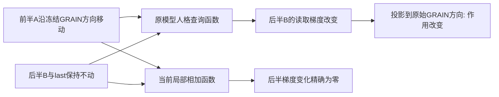

# NEXT67：同一段材料的作用会被另一段材料改变

2026-09-11，第56轮。主实现`9869e83`在原生观测前冻结。

## 1. 本轮发现

只改变前半正文的H16向量、保持后半正文及末位状态不动，原模型对后半正文
的读取梯度仍然改变。四位源作者、两个查询的8个条件全部观察到这种作用。
当前NEXT66局部求和公式在同样输入上，后半梯度变化精确为0。

这是一个已定位的**跨材料交互**，而不是继续调权发现的分数波动。它把
“GRAIN方向作用于人格查询”推进到“一个GRAIN方向能改变另一段材料的查询作用”。

## 2. 实验怎样做

- 既有源4作者、neuroticism与confirmation_seeking查询；确认寻求不是尽责性。
- BODY按既有位置一分为二。四个原始GRAIN方向各自限制到前半、单位化、
  等权平均再单位化；不挑胜出因子。沿此组合方向正负移动前半范数的1%。
- 后半、末位、所有非BODY行在float32写入后逐位相同。GRAIN方向不重新估计。
- 原模型后缀17..end每次输出同一固定评分L及正文梯度。一次未改重放、
  16次正负干预，共17次调用，无训练、新8作者、问卷或MEPS使用。
- 下表“变化”是正负端点的半差，不是正端点减原点，也不是人格分数变化。

## 3. 完整主结果

| 查询 | 改动前半A的梯度变化/原梯度 | 未改后半B的梯度变化/原梯度 | B的GRAIN作用变化RMS/原RMS | B响应条件数 | 局部求和B变化 |
|---|---:|---:|---:|---:|---:|
| neuroticism | 2.937% | **0.261%** | **0.0701%** | 4/4 | 0 |
| confirmation_seeking | 2.796% | **0.314%** | **0.1747%** | 4/4 | 0 |

B梯度相对变化范围为N的0.163%–0.406%，确认寻求的0.224%–0.487%。
未改重放评分、全梯度、B梯度与方向作用误差均为0；不是靠改动B实现的结果。
全部32个B方向收缩均超过冻结的重放分辨率门槛，没有将32项当成32位被试。

四个因子均保留，以下是各自B方向变化RMS/原作用RMS：

| 因子 | N | 确认寻求 |
|---|---:|---:|
| whole:F01 | .0760% | .1754% |
| whole:F02 | .0527% | .2041% |
| whole:F03 | .1423% | .1190% |
| whole:F04 | .0774% | .1275% |

原生评分半差的作者均值为-.000410/-.000739；正负作者均存在。
这些幅度较小，不把非零交互说成完整读取器误差的主要来源，亦不外推更大扰动。

## 4. 运行后的两查询共同/差异账本

只追加缓存运算，确认两查询BODY与四GRAIN方向完全相同；不追加神经调用。
令两个查询B响应为v_N、v_C，使用共同半和与查询半差：

    common=(v_N+v_C)/2; difference=(v_N-v_C)/2
    (||v_N||^2+||v_C||^2)/2 = ||common||^2+||difference||^2

每位作者先按自身元素数取均值，再作者等权，避免长文本权重更大。

| 响应空间 | 同作者两查询余弦均值 | 余弦范围 | 半差占共同+半差能量 |
|---|---:|---:|---:|
| 后半全梯度 | **.7080** | .6344–.7869 | 15.99% |
| 后半四GRAIN作用 | .4355 | -.7336–.9393 | 20.65% |

同一扰动有共享的向量响应，也有查询相关变化；投影到GRAIN方向会进一步
改变两查询的相似程度。这些比例是指定坐标和两个查询的算术分解，
不是共享人格方差、量表相关、独立潜变量或行为效度估计。

## 5. 理论与下一步

当前局部加和遗漏了跨token混合导数。NEXT67以有限干预观测到该函数依赖，
因此下一步需要非线性汇总或联合选择，而不只是更复杂的逐token函数。

[NEXT68计划](../../docs/GRAIN_COUPLED_POOLING_PLAN_V1.md)先用可解析、凸求解的
二次池化项建立最小交互读取器，源训练同时包含原评分、正文作用和此次B响应。
对照在相同材料/目标上拟合，只比较是否有交互项；不把本轮当新作者预测测试。
保留旧完整读取器，不改变GRAIN发布计分器、旧lockbox或临床材料用途。

## 6. 交付与核验

- 17次原生调用，计算20.025807秒，加载3.709590秒；零拟合、零API调用。
- 8份干预设计、16份端点梯度、1份未改重放保存在私有结果目录。
- 5张分析CSV精确重放，有限方向收缩恒等式误差1.85e-15。
- 51项相关测试通过，2条既有SWIG弃用警告；Ruff通过。
- [4张公开聚合表与哈希](cross_token_reading_v1/publication.json)，不含作者原文/ID。
- [完整数学说明与原始论文](../../docs/GRAIN_CROSS_TOKEN_READING_THEORY_V1.md)。
- 主入口`scripts/run_grain_cross_token_reading.py`；发布入口
  `scripts/report_grain_cross_token_reading.py`。
- 私有目录`results/grain_vector_mechanisms/logic_cross_token_reading_v1/`不入Git。
  NEXT67已完成、无后台模型；NEXT68尚未执行，整体goal ACTIVE。
