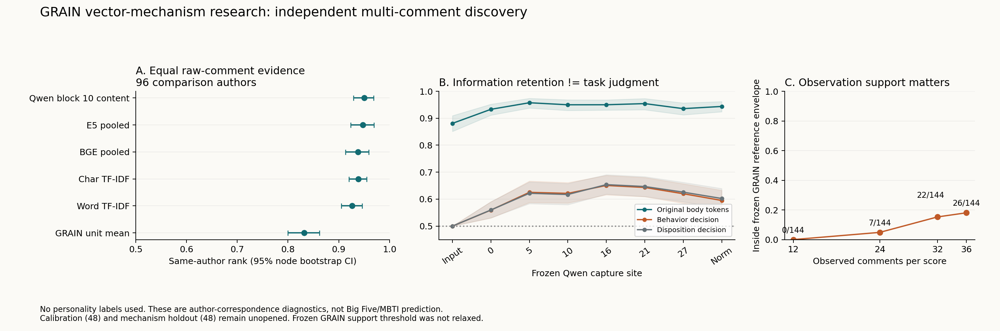

# GRAIN：独立多评论作者与信息组合

日期：2026-09-06。状态：`DISCOVERY_COMPLETE_WITH_FROZEN_SCORE_SUPPORT_REFUSAL`。
本轮完成自然多评论开发比较，不代表 VM02–07 或人格推论理论全部完成。
实现提交：`1d68c8b`。Mac 与 Windows 机制专项测试均 48 passed；本轮未重跑
全历史仓库测试。格式/静态检查通过；原有无关 worktree 改动保持不动。

## 当前裁决

信息保留、关系组合、任务判断、人格效度必须分开。增加自然文本量后，
词汇、编码器和 Qwen 内容表示都能保留很强的作者对应；但 Qwen 判断位置
仍弱得多，且没有建立超越 E5 的作者对应优势。此前合成关系绑定的结果
不能因此升级为自然人格推理。完整 GRAIN 冻结参照在此新观察设计上拒绝计分，
该问题不能靠放宽半径掩盖，也不推翻旧观察设计下的结果。

## 材料与访问边界

- 从官方作者 ID 中按新 hash 选 1,024 候选；全量流读 17,640,062 条评论。
  745 位满足本次覆盖规则，取首 240 位，与上一轮 8+24 人重叠为零。
- 每位 36 条不同讨论串、不同规范化正文的评论，按时间分三份，每份 12 条。
  共 8,640 评论；English、40–100 whitespace words，正文不截断。
  此长度限制是计算/材料选择，不是去噪，也不是 PANDORA 总体代表性抽样。
- 144 discovery 内的前 48 位仅用于 TF-IDF/scaler 参照拟合，其余 96 位做比较。
  48 calibration、48 mechanism holdout 仅完成材料准备，尚未进入模型或效应分析。
- 240 人文本总跨度中位数 1,094.5 天、每人涉及 subreddit 中位数 15。
  这是长期自然文本对应，不是短期重测，也不假设三年内人格不变。
- 全部材料有 MBTI 类型词 45 条、Big5 词 22 条、报告线索 7 条（可重叠）。
  96 比较作者中 80 位完全无这些线索，另作敏感性。词语线索不等于确证泄漏。
- 未使用心理标签选择作者、层或参数；未访问 MEPS 问卷。PANDORA 和旧 GRAIN
  在历史研究中已暴露，不称 pristine lockbox。精确去重只覆盖候选 reservoir，
  没有完成全库语义近重复审计。

## 主要定量结果

指标为三视图中“本人匹配是否高于陌生作者”的 directed rank，**不是 MBTI
准确率/AUC，也不是 Big5 Pearson**。95% CI 为 2,000 次作者节点 bootstrap，
条件于已冻结模型和 48 位参照作者；未包含重新抽取参照并 refit 的不确定性。

| 表示，按时间分组 | 作者 rank | 95% CI |
|---|---:|---:|
| Word TF-IDF | .9262 | [.9049, .9463] |
| Char TF-IDF | .9384 | [.9201, .9547] |
| BGE，独立评论均值 | .9376 | [.9132, .9589] |
| E5，独立评论均值 | .9473 | [.9237, .9695] |
| E5，局部联合编码后聚合 | .9512 | [.9302, .9697] |
| Qwen block10，正文 token 均值 | .9499 | [.9289, .9683] |
| Qwen block16，行为判断位置 | .6507 | [.6161, .6879] |
| Qwen final norm，行为判断位置 | .5951 | [.5622, .6326] |
| 冻结 GRAIN 单位投影均值，24 维 | .8315 | [.7997, .8618] |
| GRAIN 上游 mean/std，48 维、开发参照标准化 | .7894 | [.7564, .8216] |
| 完整冻结 GRAIN 几何/CSR 分数 | 不适用 | 所有比较视图超出参照半径 |

配对差：Qwen block10 − E5 = **+.00256 [−.01103, .01580]**；
− BGE = +.01232 [.00041, .02450]，仅名义未校正区间的微弱优势，
不是多重比较后的确定优势；− char = +.01148 [−.00742, .03012]。
全层扫描中 block5 内容均值 .9575 为描述结果，不因此替换预选 block10。

E5 联合 − 独立 = +.00384 [−.00520, .01236]；BGE = −.00256
[−.01398, .00821]。**局部联合编码没有建立作者匹配增益**。
这不否定其在合成关系任务中的优点：两个实验的目标变量不同。

固定判断 suffix 的 input embedding rank 恰为 .5、置换 p=1。
其他主要内容通道的 unrestricted permutation p=.002（499 次的最小分辨率），
只能拒绝随机作者对应，不能排除语域、内容选择、个人惯用语或人口学解释。

## 时间、条件与读出

同一 36 条评论改成 round-robin 三组，不新增材料、不重新拟合参照变换：
BGE .9915（增量 .05391 [.03307, .07801]），E5 .9921（.04477
[.02373, .06833]）。高分对曝光时间/主题混合方式敏感，不能把交错近满分
称为跨时间不变人格。Qwen 本轮没有额外重跑交错文本。

将陌生作者匹配至本人两视图的 subreddit-set overlap ±.10，且目标文本量
比率在 1/1.25–1.25，覆盖 86 位 target、7,552 条 directed edges：
BGE .8624、E5 .8835、Qwen block10 .8953。此为社区集合相似度条件化，
不是完全固定 topic/situation。本人两视图 subreddit 完全无交集的对照
只有 18 位 target：E5 .7347 [.5731,.9014]、Qwen .8284 [.7356,.9236]。
交错设计同条件仅 3 位 target，不作强结论。

排除人格词线索作者后，E5 .9495、Qwen block10 .9516，主要作者对应未消失。
同作者三视图均值的描述性 linear CKA：Qwen10–E5 .8815、Qwen10–BGE
.8586、Qwen10–判断位置16 .5457。CKA 在此比较的是相同作者行上的几何，
有有限样本偏差，不是心理构念相等或推理实现相同的证明。方法依据：
[Kornblith et al., ICML 2019](https://proceedings.mlr.press/v97/kornblith19a.html)。

LLM 432 份原文的行为题只有 5 次 Yes，倾向题 14 次 Yes。没有自然文本
人工真值，所以不报告答题准确率，也不能判定全部是阈值错误或缺证据。
这是下一步应审计**证据归属/合成与输出读出**，而非继续冲作者 rank 的原因。

## 冻结参照的机制问题

所有 432 chronological 与 432 interleaved 视图均达 12 单位，但超出冻结
半径 8.7111；前者半径中位数 12.7811。保持原文池和参数不动，仅增大
每次取用的单位数，均匀时间覆盖子样本的可计分作者为：12 条 0/144、
24 条 7/144、32 条 22/144、36 条 26/144。增加量只能部分缓解，不能
把原因完全归于样本数；长度带、清洗、总体组成、时间覆盖仍可能参与。

均值分量有可明确量化的一部分。令每人的有限原文池有 N=36 条向量，
均值为 bar(h)，无偏协方差为 S；M 是冻结度量的均值子矩阵，c 为参照。
从这 36 条中均匀无放回取 m 条，则严格有：

\[
E[(\bar h_m-c)^T M(\bar h_m-c)\mid h_{1:N}]
=(\bar h-c)^T M(\bar h-c)+(1/m-1/N)\operatorname{tr}(MS).
\]

这是标准有限总体协方差与二次型期望的组合，不是新定理，也不要求真人
文本独立同分布。二次型依据见 [CMU Shalizi 讲义](https://stat.cmu.edu/~cshalizi/sml/21/lectures/04/lecture-04.html)。
穷举小总体单元测试与真实向量 144 人 × 6 文量 × 500 次抽样均已运行。
m=12 时预测均值平方半径 96.2531，Monte Carlo 96.0760，其中预期
抽样膨胀 37.5783；m=36 时膨胀精确为零。这只解释**均值分量的条件抽样
变化**，不解释完整 mean/std 联合半径、标准差偏差或长期心理变化。
因此没有把该项直接从人分数中扣除，没有解除冻结拒绝规则。

## 运行与修正溯源

以下目录均在私有 `results/grain_vector_mechanisms/` 下：

| Canonical 输出 | 内容 |
|---|---|
| `vm02_multicomment_cohort_r1` | 240 作者材料、split-specific 文件、schema/筛选审计、原文 hash |
| `vm02_multicomment_base_r2` | 16 个词汇/风格/GRAIN条件；完整支持状态 |
| `vm02_multicomment_bge_r1` | Windows CUDA FP32，6,916 编码文本，约 191 秒 |
| `vm02_multicomment_e5_r1` | Mac MPS FP32，同 6,916 编码文本，约 1,186 秒 |
| `vm02_multicomment_qwen_r2` | Windows BF16，864 条件、865 forward，382 秒 |
| `vm02_multicomment_analysis_r3` | 62 条件 comparison、sensitivity、paired differences、同作者 CKA |
| `vm02_multicomment_support_r2` | 支持半径/文量、有限总体矩验证 |

BGE/E5 每条原文独立编码；联合臂使用两模型共同可容纳的完整评论组
（最多 3 条），再按评论数加权；最大实际 token 分别 481/483，固定 padding512。
Qwen 可在同一上下文读取完整 12 条，最大实际 prompt1993、padding3072；
987,509 input tokens、2,657,280 processed tokens，peak GPU 4.31 GB。
相同正文预算不等于相同感受野，Qwen 另有固定 system/question，需保留限制。
Qwen 逐 task 的 pre-question 与首例 replay 最大误差都为 0。

修正：base r1 的交错词表/scaler 曾重拟合，r2 改为统一使用 chronological
reference 变换；r1 chronology 和支持结论不变。Windows BGE 首次在 GBK
解码处失败，无模型调用，显式 UTF-8 后完成。Qwen r1 被真实嵌套引文的
重复子串挡住，未启动 forward；r2 使用明确字符区间与真实 tokenizer offset，
不丢作者、不擅自改写原文。运行时源快照各自保留，旧目录不覆盖。

## 下一步，不再无限优化作者匹配

1. VM03 选 hash 固定的最多 12 个 development cases，做原文/事实摘要/
   冻结检索/随机历史与主体归属、否定、矛盾更新；审核摘要覆盖和事实保真。
2. 保留既定 Qwen block10 内容通道与 block16 判断通道，不追逐此轮最高层。
   在 calibration 固定最多两条机制，再执行自然证据替换及机制 holdout。
3. 冻结表示后才做 VM05 外部量表连接；先审计新队列的标签可用性和各类
   有效 N，不能假定这些官方作者都有 Big5。MEPS 仍只作后续无标签固定条件。
4. GRAIN 冻结分数在当前设计上不适用已明确；后续要么重播其原生观察算子，
   要么在 reference-only 材料上另立重校准版本，不能混称“旧分数直接适用”。

原始评论、token/激活、作者关联 ledger 均 gitignored；这里只发布聚合结果。
