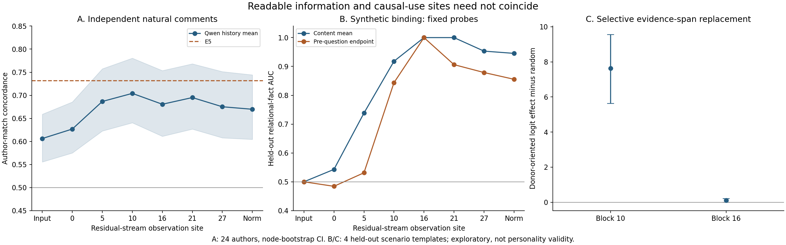

# VM03/04：关系绑定、读出与分布式计算

日期：2026-09-06。状态：`SYNTHETIC_MECHANISM_PILOT_COMPLETE`。

## 本轮裁决

本轮找到了一个可执行的机制问题：**相同的词汇可以表达不同的主体关系；独立编码后相加会漏掉这种交互，联合编码或显式乘积交互可以恢复它。** 另一个结果是“容易从某位置读出的信息”不等于“模型还通过这个位置使用的信息”。

这些结论来自受控语义事实，不是新的人格维度，也不证明真实人格预测已经提高。自然作者比较见 [VM02 同预算报告](VM02_SAME_MATERIAL_BASELINES.md)。正式 GRAIN scorer、既有量表连接、发布版本均未替换。

## 1. 实验怎样排除简单词频解释

12 个场景，每场景用两个代码名标记“我”和“同事”。操纵两个变量：

- a：哪个代码名属于叙述者。
- b：哪个代码名自由选择并实际完成行动。

两人中另一人明确没有做该行动，因此叙述者是否做了该行动的真值为 `y = 1[a=b]`。四种 a×b 组合使用**完全相同的词汇与 token 多重集**，但关系真值不同。12 场景 × 4 组合 × 2 记录顺序 × 3 问题，共 288 个 prompt。

三个问题分别询问叙述者做了什么、是否明确没有做，以及固定代码名是否做了。最后一个问题的真值只依赖 b，不应被 a 改变，是主体切换的 collateral 对照。这里的“主体身份”是语义角色绑定，不是 GRAIN 中相对参照群体的个体偏离，也不是人格标签。

固定 8 场景拟合辅助读出器、4 场景留出；词法模板、代码名和生成规则跨分割复用。后续定位又查看了这 4 场景，因此干预属于探索性定位，**不能称全新确认集**。Prompt/system 预先要求解析代码名，不是完全无任务先验的阅读。

Qwen 1.5B 固定 revision、GPU BF16、512 masked padding。288 prompt/289 forward，22.61 秒；重播及问题出现之前的状态不变性误差均为 0。没有训练 LLM，没有真实心理量表标签。

## 2. 可读性：交互项在哪里出现

对每个表示使用相同固定 Logistic probe（C=.01）；scaler 仅在 8 discovery 场景拟合。不依据留出结果改层、调 C 或重新命名人格。

| 表示 / 固定读出 | 留出关系判断 AUC | 留出准确率 |
|---|---:|---:|
| word unigram / bigram counts | .5000 | .5000 |
| Qwen 初始 token mean | .5000 | .5000 |
| BGE：两条记录分别编码后相加 | .5000 | .5000 |
| E5：两条记录分别编码后相加 | .5000 | .5000 |
| BGE：完整记录联合编码 | .6602 | .5313 |
| E5：完整记录联合编码 | .9883 | .7813 |
| Qwen block10，content mean | .9180 | .8438 |
| Qwen block16，content mean | 1.0000 | .9688 |
| Qwen block16，pre-question endpoint | 1.0000 | 1.0000 |
| Qwen final norm，pre-question endpoint | .8555 | .7500 |

此表每条件 4 留出场景、32 个组合/顺序样本；全部层和问题均在 CSV 中。辅助 probe 的分数不是 LLM 自己的回答。完美小样本分类不证明复杂的心理推论，更不证明跨任务、跨语言成立。

向量交互用二阶有限差分记录：

\[
\Gamma_l=h_l(0,0)+h_l(1,1)-h_l(0,1)-h_l(1,0).
\]

任意记录加性表示 `h(a,b)=u(a)+v(b)+c` 都有 Γ=0；本次 counts、独立记录 embedding 相加及初始 token mean 确为 0。上下文化中层产生非零 Γ。它是函数交互，不是信息论 synergy、独立人格因子或心理因果证明。

## 3. 表示、回答与阈值必须分开

| 叙述者正向问题 | 默认准确率 | discovery 校准阈值后 balanced accuracy | 留出 pooled AUC |
|---|---:|---:|---:|
| 先说明身份，再说明行动 | .8125 | .8750 | 1.0000 |
| 先说明行动，再说明身份 | .5000 | .6875 | .6875 |

校准阈值仅用 discovery 数据，改变的是输出标尺，不是模型的推理过程。逆序条件并非完全没有信息，但存在明显顺序和读出偏差。语义否定问题更脆弱：逆序默认/校准准确率均 .5000；这不是此前任意反转 Yes/No 代码的实验，而是正常语言中的否定问题。

`output_summary.csv` 另有“先在四格内算 AUC、再平均场景”的指标，逆序正向为 .9375；它**不是**本表跨留出场景合并后的 .6875。不同场景的输出偏置能让局部排序较好而全局排序较差，两者不能互换。

## 4. 功能作用：单点与分布式替换

### 4.1 单点不够

把 pre-question 句末 marker 的 block10/block16 向量替换为身份交换后的自然 donor，或替换 discovery 拟合的 rank2 分量。16 目标组合，两个任务、两层、随机/自身/恢复对照；修正后的 r3 共 544 forward、31.05 秒。

主要变化非常小，通常不足 .1 logit；个别 candidate-minus-random 区间虽偏正，也接近 BF16 分数粒度，且伴随 collateral 漂移。**不能据此宣布找到专属身份轴。** 这与 block16 能被 probe 完美读取并不矛盾。

### 4.2 多 token 替换定位到更早的使用阶段

交换 a、固定 b 和问题，替换身份记录、行动记录或全部证据的同位置 hidden states。每个 token 的随机对照匹配其干预 L2 范数；另有自身、恢复及全 prompt 替换控制。全 prompt 替换是仪器上界验证，不作为新机制证据。

下表是“朝 donor 真值方向的 logit 改变量，减去随机对照”，只报告身份先行条件；CI 由 4 场景 bootstrap，未进行多重比较确认性裁决。

| 位置 / 替换范围 | 配对改变量 | 95% CI |
|---|---:|---:|
| block10，身份记录 | +4.1563 | [3.2500, 5.0625] |
| block10，行动记录 | +1.7969 | [1.5938, 2.1172] |
| block10，全部证据 | +7.6328 | [5.6328, 9.5625] |
| block16，身份记录 | -.0703 | [-.1094, -.0313] |
| block16，行动记录 | +.1094 | [.0625, .1875] |
| block16，全部证据 | +.1016 | [.0000, .2031] |

在 block10，全部证据的原始朝向变化为 8.1406 logit，接近完整自然 donor 的 8.3438；同一位置的单 marker 替换接近零。模型显然能通过分布式证据状态改变回答，不能以单点失败宣布信息未被使用。

逆序条件中，行动记录发生在身份之前，其状态在 a 交换时完全不变；替换该 span 的范数和输出效应都为 0。这符合因果 decoder 的时间顺序。身份先行时，即使行动记录字面不变，它的向量仍因上文身份而改变，并能影响回答。

block16 的证据状态虽然容易读出，替换后作用已很小。**可行解释**是相关信息已在更早阶段写入问题/答案位置，较晚修改证据不再改写这条已发生的计算。当前只采两层，尚未定位具体 attention head、路径或完整 circuit。

collateral 未消失：block10 身份先行、全部证据替换，对固定代码名问题的绝对变化为 .5469 logit；逆序身份记录替换的 collateral 为 2.125。故不能把这个通路称作纯净、任务无关的主体概念。

### 4.3 修复过的数值问题

第一轮 span 替换的完整 donor 控制误差为 .375 logit，自身/恢复却均为 0。原因是 BF16 中 `x+(y-x)` 不保证等于 y；完整替换必须直接赋值。修复并增加 BF16 测试后，r2 的自身、恢复、全 prompt donor 重放误差全部为 0。r2 完成 1,120 forward、60.89 秒。

`vm03_binding_spans_r1` 为失败证据；单点 r1 中止，r2 使用旧插值实现，当前采用 r3。未修改这些旧文件中的数值来隐藏历史。先前 VM01 已另用新实现完整复跑 3,264 forward：原有限功能作用保留，ownership/voluntary 的选定配对改变量分别从 .6406/1.5677 变为 .5938/1.5313；原报告增加版本化更正，不抹掉旧成果。

## 5. 把缺失交互写成可测试的标准公式

本轮没有证据说只有 LLM 可以解决关系绑定。为检验数学可替代性，另运行显式关系核：

\[
k_A(i,j)=\langle u_i,u_j\rangle,\quad
k_B(i,j)=\langle v_i,v_j\rangle,
\]
\[
k_\otimes(i,j)=k_A(i,j)k_B(i,j)
=\langle u_i\otimes v_i,u_j\otimes v_j\rangle.
\]

比较 `k_A+k_B`、`k_A k_B`、`k_A+k_B+k_A k_B`，固定 Ridge α=.01；无需显式展开百万维张量。各分量按 discovery 均值和平均平方范数处理；不是把公共均值解释为噪声。组合核保留边缘与关系通道，但不承诺等权组合最优。

| 冻结记录编码 | 加性核 AUC | 乘积核 AUC | 加性+乘积 AUC |
|---|---:|---:|---:|
| word 1–2 gram counts | .5000 | 1.0000 | 1.0000 |
| BGE | .5000 | .9688 | .9688 |
| E5 | .5000 | 1.0000 | .9375 |

该补充只用 identity-first，8/4 场景、32/16 样本，避免重复的顺序不变输入加权。不能把它和前面 32 留出样本的表当成完全相同协议；但加性与乘积在本表中严格同材料、同训练标签和同正则。

结果支持：**缺失的可以是关系交互，而不是输入向量没有信息。** Counts 乘积核也能成功，排除了“必须很大的 LLM 才有可能”的解释。高分仍局限于已知生成规则，不代表已从真实历史提取出人格规律；乘积核也未被证明就是 Qwen 内部实现。

## 6. 与先行研究及 GRAIN 的连接

角色/值的张量积绑定是已有方法，不是本项目首创。[Smolensky, 1990](https://doi.org/10.1016/0004-3702(90)90007-M)。现代 LLM 研究也通过激活干预研究实体与属性绑定，但其模型、刺激和机制不能直接搬来命名我们的通路。[Feng & Steinhardt, 2024](https://arxiv.org/abs/2310.17191)。把可解释变量与内部状态对齐后再做交换干预，与 causal abstraction 的方法思想一致；本轮还没证明完整的高层因果抽象。[Geiger et al., 2021](https://arxiv.org/abs/2106.02997)。乘积核的合法性及其张量积特征解释是标准核方法结论。[Berkeley 课程资料](https://people.eecs.berkeley.edu/~jordan/courses/281B-spring04/lectures/lec5.pdf)。

GRAIN 的新增候选应是**关系条件化观察通道**，而不是新的人格因子名：保留原有边缘分布、choice 和动态，另记录哪些“主体×事件×情境”关系改变了表示与输出。它需要确定的参照、稳定的采集器和外部连接后才可心理解释。

## 7. 产物与下一队列

私有 `results/grain_vector_mechanisms/`：

- `vm03_binding_full_r1/`：原材料、288 条预测、token 多重集、逐层三类读点 cache、数值检查。
- `vm03_binding_analysis_r1/`：联合/独立编码、全部 probe、有限差分与输出统计。
- `vm03_binding_patch_r3/`、`vm03_binding_spans_r2/`：当前可用的单点/分布式干预与随机/恢复对照。
- `vm03_binding_patch_analysis_r3/`：阈值校准、单点和 span 聚合。
- `vm03_relational_kernel_r1/`：固定加性/乘积核、逐例预测、模型/文本哈希。

下一轮不是继续在四个合成场景上调到满分：

1. 扩充独立自然作者、多评论视图和来源覆盖，补完整 GRAIN 对照；旧 24 作者保留为开发材料。
2. 自然历史做 joint/context-conditioned 与 independent-pooled 比较；角色/时间/重复、直接自我声明和事实摘要单独登记。
3. 新场景改写、反证/修正/冗余、不同答案描述复测，随后细分 block10–16 的使用路径。当前所有人格方向仍未按外部标签选择。
4. 固定两个候选通道后再做 VM05 PANDORA 外部连接；MEPS 仍限无标签固定条件，VM06/07 尚未完成。

精确命令统一记录在 [研究日志](../../docs/GRAIN_VECTOR_RESEARCH_LOG.md)。图像只含聚合数值，不含原始作者文本或 ID。
